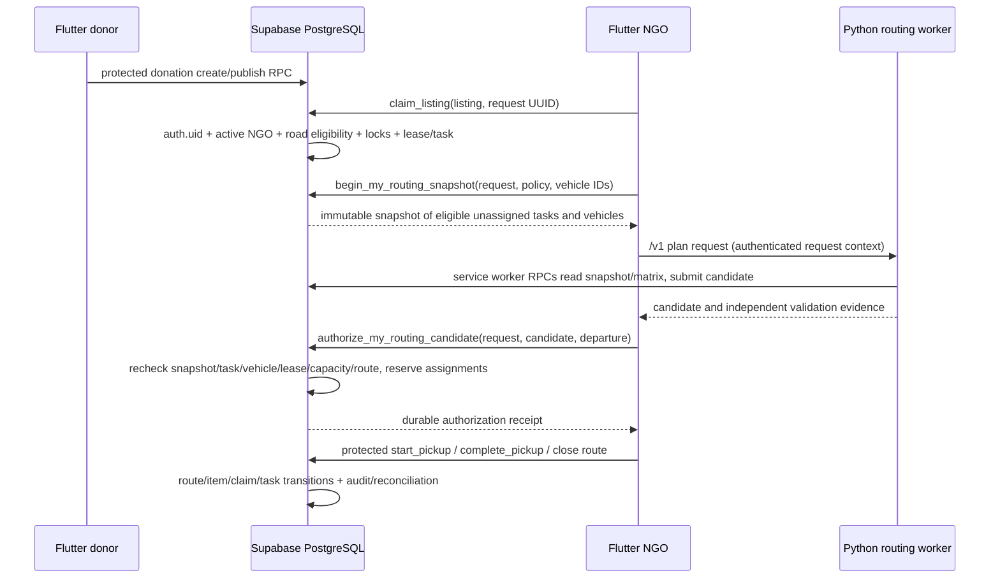

# GeoLock Hub — Full End-to-End System Architecture and Workflow Audit

**Inspection date:** 2026-11-03 (Asia/Kuala_Lumpur)  
**Scope:** current repository checkout plus read-only catalog/aggregate inspection of Supabase DEV project `rcgyuwiidqvrgbxswhqj`. No application or database changes were made, and no state-changing RPC was called.

## Evidence labels and limits

- **DEV verified** means observed directly through Supabase MCP SELECT/catalog queries during this audit.
- **Source verified** means observed in the current local checkout, which contains extensive pre-existing modified and untracked files. It is not by itself proof that a file was deployed.
- **Test evidence** means a checked-in test or saved test artifact; it does not imply a live DEV workflow was executed.
- **Not verified** marks a deployment, end-user workflow, or behavior that could not safely be proved by read-only catalog queries.

The DEV session reported PostgreSQL **17.11**, database `postgres`, `current_user=session_user=postgres`, and `transaction_read_only=off`. Queries in this inspection were SELECT-only, as required, but the connection was not technically forced into a read-only transaction. The project URL resolved to `https://rcgyuwiidqvrgbxswhqj.supabase.co`. The MCP migration-list API returned an empty list. That result is not evidence that no SQL was installed: DEV contains the Stage A routing schemas, functions, triggers/indexes and data described below. I found no `supabase_migrations.schema_migrations` release ledger in the earlier checked-in read-only audit evidence; the MCP migration list alone does not establish the operator/deployment history.

## Executive assessment

| Capability | Assessment | Basis |
|---|---|---|
| Road-network claim eligibility | **PASS, with provenance caveat** | DEV has the deployed road-node/edge/coverage data and protected `claim_listing`; the live function calls `geolock_ngo_listing_road_check`. Active operational network is `OSM-OPS-20261018` (926,414 nodes, 2,145,828 edges). The exact current helper definition and availability policy still need a release ledger for complete source provenance. |
| Atomic claim protection | **PASS for observed deployed contract** | DEV `claim_listing(uuid,uuid)` is SECURITY DEFINER and matches its normalized Stage A pin. It derives NGO from `auth.uid()`, takes an active NGO row lock, request advisory lock and listing row lock, and records idempotent request outcomes. No concurrency experiment was run against DEV in this audit. |
| Multi-vehicle routing | **PASS as a protected multi-vehicle candidate/authorization architecture; not a live-user workflow test** | DEV snapshot accepts a selection of up to 20 owned vehicles, optimizer can emit multiple vehicle routes, and authorization locks selected vehicle rows in canonical order. Per-vehicle booking uniqueness is present. Candidate contents remain subject to database validation and protected authorization. |
| Reconciliation | **PARTIAL** | DEV has reconciliation cases/evidence and participant RPCs, route resolution functions, and guarded recovery. The recovery definition’s fingerprint does not match the reviewed deployed pin and there is no authoritative deployment record explaining why. No reconciliation case was exercised. |
| Claimed pickup task lexicographic optimizer | **PASS in local proposed CP-SAT code; deployed worker execution not established** | The CP-SAT implementation uses stage 1 to maximize served pickup-task count and stage 2 to minimize the sum of directed road distance while fixing the stage-1 count. Independent validation recomputes served task count, capacity, windows, and directed arc distance. Current DEV candidate authorization requires method `proposed` and trusted validation, but the exact worker build currently serving requests was not queried. |
| DEV runnable from current worker configuration | **NO-GO until the operator supplies and verifies worker runtime configuration/activation** | Worker source requires a configured service endpoint and protected database roles; write activation and approval reference are deliberately gated. This audit did not read or reveal secrets, activate the worker, or deploy it. |

## 1. Current deployed project and core database identity

### DEV verified

- Supabase API URL: `https://rcgyuwiidqvrgbxswhqj.supabase.co`.
- Database/version: `postgres`, PostgreSQL 17.11.
- Catalog connection identity: `postgres` / `postgres`.
- The `transaction_read_only` setting was `off`; I nevertheless issued only catalog, metadata, and aggregate SELECT queries and did not call any business RPC.
- Supabase MCP `list_migrations` returned `[]`. This is an incomplete provenance source: DEV has active `routing_private` objects plus public route functions and the `routing_task_authority` trigger condition used by the authorization function. Therefore those objects exist regardless of the MCP migration-list result.
- Current aggregate state (no identities or raw business records read): 5 NGO profiles, 7 active vehicles / 7 active vehicles available for planning, 5 ACTIVE claims and 5 ACTIVE leases, 0 CONFIRMED pickup tasks, 6 PLANNED pickup tasks. Counts are a point-in-time observation, not a fixture suitability assessment or claim on any specific account.
- Current `coordination_config` is version `v2.0`: claim lease 360 minutes, geofence radius 20,000 m and direct-donation minimum weight 10 kg.
- Exactly one active operational road coverage record was returned: snapshot `OSM-OPS-20261018`, 926,414 nodes, 2,145,828 edges, `active_flag=true`, approved 2026-10-20.
- A `pg_cron` job named `geolock-expired-claim-recovery` is active every minute. Its command invokes `public.recover_expired_claims(1)` with 5-second lock timeout and 50-second statement timeout. The job was inspected, not executed.

### Lifecycle function fingerprints

The normalized `prosrc` MD5s observed in DEV are compared to the local recorded Stage A postdeployment pins:

| DEV function | DEV normalized `prosrc` MD5 | Stage A postdeployment pin | Result |
|---|---|---|---|
| `public.claim_listing(uuid,uuid)` | `2c1f60c876797c61b44b3cb43591bab8` | `2c1f60c876797c61b44b3cb43591bab8` | Match |
| `public.start_pickup(uuid)` | `cb306433867538804b67aa1a242867b4` | `cb306433867538804b67aa1a242867b4` | Match |
| `public.complete_pickup(uuid,boolean)` | `26f0cd8cebe783c65b45e05649693860` | `26f0cd8cebe783c65b45e05649693860` | Match |
| `public.recover_expired_claims(integer)` | `05fe46d8b76085f71c87fcc5f6520775` | `89e01f42d5ec23bfcbcdc47c1f4fd4e5` | **Mismatch; provenance unresolved** |

All four are owned by `postgres`, SECURITY DEFINER. The first three have the expected search path/configuration recorded by Stage A. DEV’s recovery routine has `search_path=pg_catalog, public, extensions, pg_temp`; Stage A’s expected config lists this same path. Thus the recovery mismatch is a **body** discrepancy, not a line-ending explanation: normalization removes CRLF and still yields a different hash.

Directly observed recovery body details include route-scoped recovery locking through `routing_private.lock_route_for_recovery`, followed by claim/lease/listing/task row locking and checks for open/manual-review reconciliation, authorized route item state and dispatch/collection evidence before releasing or reopening a listing. This is materially more routing-aware than the checked-in historical 20261031 recovery routine and is consistent in shape with the local Stage A `20261109_claim_scoped_reconciliation.sql` proposal. **That resemblance is not proof that the proposal was deployed or approved.** Do not pin this observed hash, overwrite DEV, or attribute it to a migration without an operator/release artifact. Reconcile the exact complete body against deployment records before treating reconciliation as fully source-proven.

Local Stage A fingerprint references: [postdeployment_catalog.sql](../../docs/stage8/stage-a/postdeployment_catalog.sql), [Stage C.0 DEV parity report](../../docs/stage8/stage-c0/REPORT.md), [Stage A 003 migration](../../docs/stage8/stage-a/forward-migrations/20261103_routing_pickup_and_reconciliation.sql), and [local claim-scoped recovery proposal](../../docs/stage8/stage-a/forward-migrations/20261109_claim_scoped_reconciliation.sql). These are local artifacts; the last file is not established as deployed.

## 2. End-to-end architecture and authority boundaries



The Python optimizer proposes a plan. It does not grant dispatch authority. DEV’s `authorize_my_routing_candidate` checks for the enabled `routing_task_authority` trigger, requires a trusted validation record and feasible `proposed` plan, then rechecks current NGO, snapshot, matrix, task, vehicle, lease and route constraints while writing route assignments and route state in one database transaction. Flutter’s authorization request and receipt recovery are in [ngo_routing_repository.dart](../../frontend/geolock_hub_app/lib/routing/ngo_routing_repository.dart); the worker’s staged orchestration is in [orchestrator.py](../../backend/routing/worker_service/orchestrator.py) and [staged.py](../../backend/routing/worker_service/staged.py).

The database has RLS enabled on sensitive public tables, including donations, claims, leases, tasks, routes, route stops, vehicles and active task assignments. Most have no direct end-user RLS policies; the intended access surface is SECURITY DEFINER RPCs. `donation_categories` has public/read policies. This is an RPC-mediated design, so missing table policies are not evidence of missing access controls by themselves. Direct grant review should remain part of every migration/deployment postflight.

## 3. Donation publish, road eligibility and claim workflow

### Donation/category data path

**DEV verified:** public `donation_categories` has `category_id uuid`, `category_name text`, `active_flag`, and storage/accessibility capability flags. `donation_items.category_id` is a non-null UUID. Listing rows distinguish `DIRECT_DONATION` from `HUB_BATCH`; a claimed hub listing is represented as one listing/task whose weight is the batch weight. NGO profile fields currently include role, organization name, operating address, lat/lon, road node, activation flag, location verification timestamp and location generation. There is no NGO category-mapping table or category-selection column in the inspected `ngo_profiles` columns, so NGO category capability selection is **not present in the deployed schema inspected here**.

The current DEV NGO profile column inventory did not include `registration_number`. The repository has a new local-only removal migration ([20261103_remove_ngo_registration_number.sql](../../supabase/migrations/20261103_remove_ngo_registration_number.sql)); it was not run and is not needed to explain the current inspected schema.

### Road network and eligibility

**DEV verified:** an operational road graph is available with the network snapshot above. Claim-side `claim_listing` calls `geolock_ngo_listing_road_check(v_actor,p_listing)` and refuses when the result is not `ELIGIBLE`; it also requires verified NGO location and a non-null NGO road node. This places the claim eligibility check at the database authority boundary, not solely in a Flutter filter. Claiming a hub batch evaluates the listing pickup location/hub under the same database rule.

**Source verified:** Flutter location selection/resolution appears in `frontend/geolock_hub_app/lib/location/`; API-facing claim UI is in `donation_pages.dart` and claim state in `claim_request.dart`. The road eligibility SQL and cache/refresh logic are in `20261020_operational_road_node_resolution.sql`, `20261023_async_ngo_eligibility_refresh.sql`, and `20261024_async_listing_eligibility_refresh.sql`. These local files do not independently prove every current DEV helper body.

### Atomic claim and leases

The deployed `claim_listing(uuid,uuid)` is SECURITY DEFINER and grants EXECUTE to `authenticated` (not `anon`). Its observed body:

1. derives the actor only from `auth.uid()` and requires an active NGO profile (`FOR SHARE`);
2. requires listing/request IDs, takes an advisory transaction lock keyed to the actor and request, and makes the request idempotent (same request/payload returns saved result; payload reuse is rejected);
3. locks the listing row `FOR UPDATE`, checks AVAILABLE/expiry, location verification and road-network eligibility, then verifies the direct donation or hub batch is ready;
4. proceeds through the protected claim/lease/task/donation state transition and audit path in the body’s internal subtransaction; concurrent conflicting claims serialize on request/listing-level locks and active-claim uniqueness constraints.

The detailed DEV body was read from `pg_proc`; no claim RPC was executed. A live concurrency guarantee is inferred from the locking/unique-index implementation and its local tests, not newly load-tested against DEV. The active lease period is controlled by `coordination_config`; prior inspected records and the local checked-in coordination policy use 360 minutes, but this audit did not re-read that table’s exact value.

`start_pickup(uuid)` finds an unreleased route item for the claim, locks its route, checks remaining lease/schedule feasibility, atomically consumes the dispatch item, marks the route `IN_PROGRESS`, then advances the legacy pickup state. It rejects dispatch where the claim is not assigned to a database-authorized route (except the legacy-inflight branch). `complete_pickup(uuid,boolean)` locks the route/item, requires dispatch already started, performs the protected underlying completion and marks the routing item collected. Completion alone does not release the vehicle booking; depot-return closure is separate.

Local lifecycle and claim sources: [20261031 claim/lifecycle migration](../../supabase/migrations/20261031_claim_audit_and_failure_capture.sql) (`claim_listing` around line 198, `start_pickup` 333, `complete_pickup` 360, `recover_expired_claims` 518); Stage A deployment pins: [postdeployment_catalog.sql](../../docs/stage8/stage-a/postdeployment_catalog.sql). The deployed body hash match establishes the three local pins above, not full deployment history.

## 4. Donation discovery and claim display

**DEV verified:** `get_my_claim_cards_v2()` is SECURITY DEFINER, authenticated-only, requires an active NGO derived from `auth.uid()`, and projects claim, lease, pickup task and listing data via `get_my_claim_cards()`. The v2 return shape includes server-current time and lease-expired/claimable indicators. Flutter claim cards call this through the claim repository/controller code in `donation_pages.dart`, `claim_cards_controller.dart` and `claim_card.dart`.

The claim read RPC is a view of the NGO’s own claims, not authority to start pickup. A route-planning snapshot is separate and stricter: the DEV `begin_my_routing_snapshot(p_request,p_policy,p_vehicle_ids)` requires an NGO identity and verified depot, validates at most 20 distinct vehicles owned by that NGO, serializes snapshot creation under an NGO advisory lock, and records an idempotent immutable snapshot. It reads only that NGO’s `CONFIRMED` pickup tasks; the database observer/admissibility checks later exclude stale, unleased, expired, reconciled, already assigned or otherwise unauthorized tasks. Route authorization repeats these checks.

**Category restriction status:** no NGO category mapping table/column was observed in DEV’s public schema and no category eligibility predicate was observed in the inspected claim or snapshot interface/body. The current category list is dynamic, but selected NGO capability is absent; therefore the previously requested “all categories represented by the donation must be selected by the NGO” rule is **not implemented in the inspected deployed schema**. It must be added consistently to every discovery/listing detail path and authoritative claim path, as a later separately approved change; it is outside the current audit’s implementation scope.

## 5. Multi-vehicle routing and optimization

### Current local optimizer behavior

**Source verified:** the current CP-SAT implementation is `backend/routing/phase_b/optimizers.py`. Both `distance_only()` and `proposed()` call `_optimise()`. Its model has a binary assignment per pickup task/vehicle, each vehicle’s circuit route, capacity, time windows, lease margin, max route duration, and only available directed matrix arcs. Every optional task can be assigned at most once; mandatory tasks are constrained to assignment exactly once.

The objective is two-pass and strict:

1. `model.maximize(served)` where `served=sum(assigned.values())` counts served **pickup tasks**, each task once regardless of its source listing membership.
2. After a feasible/proven stage-one value is obtained, the model adds `served == coverage` and minimizes the sum of directed raw road-millimetre arc costs across all vehicles.

That matches the corrected objective: one direct donation claim task counts 1, one hub-batch task counts 1, and the hub batch’s whole task weight is used in vehicle capacity. No donation-membership multiplier is applied. Local independent verification in `backend/routing/phase_b/validation.py` recomputes admitted/served pickup-task IDs, total directed road distance from the matrix, capacity, time windows, leases, duration and task uniqueness without importing solver/problem implementation helpers.

The local input contract distinguishes `DIRECT_DONATION` and `HUB_BATCH` at `backend/routing/contract.py:158–200`, and explicitly requires task `weight_kg` to equal listing weight at `:242`; the solver adds each task’s weight to vehicle load in `backend/routing/phase_b/problem.py:78`. Thus one batch remains one task and consumes its full listing/batch weight.

Solver proof metadata is explicit: the plan is `OPTIMAL` only if stage one and stage two both return `OPTIMAL`; a feasible incumbent without both proofs is `FEASIBLE_UNPROVEN`. Stage solver statuses, coverage bound and secondary objective/bound are emitted and checked by the independent validator. The database authorization RPC requires a feasible validated plan; I did not inspect in this audit whether it rejects `FEASIBLE_UNPROVEN` specifically, so do not assume that permitting it is a deployed policy. The plan’s intended provisional policy must be confirmed against the entire current DEV authorization body and an approved release rule before live use.

Other algorithms (`fcfs`, `nearest_neighbour`) remain in the method registry for comparison. `backend/routing/phase_c2/orchestration.py` checks the four-method registry and evaluates methods; the proposed route remains the dispatch candidate. Static and solver tests exist under `backend/routing/phase_b/tests/` including `test_algorithms.py`, `test_validation.py`, `test_routing_model.py`, and worker `test_solver_invocation.py`. These are local tests, not proof that the currently running DEV worker has the same commit/build.

**Exact local source pointers:** CP-SAT model construction starts at `backend/routing/phase_b/optimizers.py:27`; stage-one maximize is line 105; fixing the optimum and minimizing directed distance are lines 141–142; final proof status is line 177. Independent validation begins at `backend/routing/phase_b/validation.py:25`; objective/proof reconciliation is around lines 189–237. Worker solve and validation entry points are `backend/routing/integration/worker.py:118` and `:139`. Flutter snapshot/authorization/route close calls are `frontend/geolock_hub_app/lib/routing/ngo_routing_repository.dart:337`, `:1017`, and `:1173`; the worker client plan endpoint is `frontend/geolock_hub_app/lib/routing/routing_worker_client.dart:141`. Deployed DEV routine signatures and bodies were queried from `pg_proc`; local source landmarks are `supabase/migrations/20261031_claim_audit_and_failure_capture.sql:198`, `:333`, `:360`, and `:518`; the Stage A vehicle/task booking indexes are in `docs/stage8/stage-a/forward-migrations/20261101_routing_authority.sql:98` and `:107`.

### Worker/client/database flow

Flutter’s `NgoRoutingRepository` starts a snapshot and later calls `authorize_my_routing_candidate`. The UI carries selected vehicle IDs through planning; DEV snapshot accepts up to 20 owned vehicles. The worker uses the saved snapshot and frozen road matrix; reads/writes to its internal routing schema go through worker-only roles. The public authorize function revalidates and persists each route, route stop, active task assignment and task `PLANNED` state, and writes audit evidence.

DEV’s authorization body additionally:

- requires `routing_task_authority` to be enabled;
- requires an existing validation row tied to the candidate digest, `feasible=true`, `dispatch_authority_issued=false`, `method='proposed'`, and 1–20 route objects;
- locks source tasks and vehicle rows in canonical vehicle-ID order;
- checks the candidate vehicle belonged to the frozen snapshot, is still active/available, has no hold, still has the same version and depot, and is owned by the authenticated NGO;
- checks every task is admissible against the immutable snapshot and still matches current task digest/status; disallows any active assignment and checks route schedule, capacity, lease, depot and exact unserved-task complement;
- records authorization request receipt for idempotency, writes `pickup_routes` and route bindings/items/stops/active assignment rows atomically.

No client-side direct table mutation is needed or authorized for route publication. RLS is enabled on public route/task/vehicle rows; worker roles and function ACLs separate snapshot/candidate work from NGO authorization. Observed ACLs: `authenticated` can execute snapshot/authorization/route read/start/complete/close; `anon` cannot. `recover_expired_claims` is executable by `service_role`, not `anon` or `authenticated`.

### One route vs multiple vehicles

The deployed snapshot signature takes an array of vehicle IDs and the authorizer accepts a candidate containing multiple routes; it locks all involved vehicles in sorted order. The current local UI can therefore submit a multi-vehicle plan where the selected fleet is included. The private partial unique index `routing_private.routing_one_vehicle_booking` on `(vehicle_id) WHERE closed_at IS NULL` prevents booking the same vehicle twice while leaving another vehicle of the same NGO independently bookable. The private partial unique task-booking index similarly keeps one active assignment per task. This supports concurrent active routes on distinct vehicles, subject to fresh snapshots and task exclusion. It does not mean every Flutter interaction necessarily selects all vehicles: that depends on the exact selected-vehicle UI flow.

## 6. Route lifecycle, booking, archival and reconciliation

The route lifecycle is database-owned after authorization:

- `start_pickup(claim)` locks its route, checks remaining stops/lease schedule, consumes dispatch authority, and changes route status to `IN_PROGRESS`.
- `complete_pickup(claim,true/false)` records a completed task through protected lifecycle logic and marks the item collected; a no-handover/uncertain path is subject to reconciliation rules.
- `close_my_collected_route(route,true)` requires explicit depot return confirmation and calls the private closure helper. Closure releases remaining route/task and vehicle booking state only under its server-side completeness/return checks. It is idempotent for an already-closed completed route.
- Route authorization receipt and route read functions are authenticated and owner-scoped. No closure was invoked.

Flutter’s local planning-operation archival is separate from route closure. `ngo_routing_repository.dart:217–231` checks the durable operation at startup and retries receipt reconciliation/archive; `:367–378` archives after `_acceptAuthorization` has verified the database receipt while retaining recovery IDs. If that safe archive fails, the operation remains persisted. `ngo_routes_page.dart:87–100` keeps the manual `Keep route history / allow new planning` recovery action. A local archive frees the planning-operation UI slot and must not be interpreted as changing PostgreSQL route status, closing the route, or releasing a vehicle. Pending/ambiguous attempts are not archived.

The database recovery function is a service/scheduler operation, not an NGO read path. Its visible cron calls it every minute with a bounded batch of one. Current DEV function body has routing-aware locking and fences reconciliation/dispatch evidence before claim release. Its unexplained fingerprint drift is the main source-integrity blocker for recovery approval.

Reconciliation interfaces present in DEV include `submit_claim_reconciliation`, `get_my_claim_reconciliation_receipt`, `get_my_donation_claim_reconciliation`, `get_my_reconciliation_cases`, and route resolution RPCs (`get_my_route_resolution`, `submit_route_resolution_evidence`, `finalize_route_resolution`, etc.). These are SECURITY DEFINER. Participants are inferred from claims/route/case ownership by database helpers, not client-supplied role identity. Read-only catalog inspection confirms interface presence and recovery checks for `OPEN`/`MANUAL_REVIEW`; it does not establish that all edge cases are correct in deployed code. Require dedicated isolated integration tests and deployment provenance review before declaring reconciliation PASS.

## 7. NGO category capability and registration state

This audit also confirms the earlier category eligibility request is still an outstanding feature: DEV’s `ngo_profiles` columns contain no selected-category field and no mapping relation was found in inspected public tables. Existing categories remain in `donation_categories`; NGO registration does not currently persist category IDs in the deployed schema. Existing NGOs therefore have no configured category capabilities. Current claim/read/listing paths cannot be proven category-restricted. This is a **confirmed gap**, not an administrator-approval workflow: the requirement states immediate self-selected capability and should remain that way in a future implementation.

The local NGO registration-number removal migration is not represented in MCP migration results, while the live column inventory also lacks `registration_number`. Since the MCP list is empty and deployment ledger is unresolved, report this as “DEV column absent; exact removal deployment provenance not established,” not “the local migration was applied.”

## 8. Security and compatibility observations

### Positive protections observed

- Authenticated NGO identity is derived with `auth.uid()` inside claim, snapshot and route RPCs.
- `claim_listing` has no `anon` EXECUTE; claim, pickup and route lifecycle endpoints are authenticated-only. Recovery is service-role-only and checks trusted scheduler identity in its body.
- SECURITY DEFINER routines pin `search_path` (usually `pg_catalog, pg_temp`; selected compatibility routines include explicitly qualified schemas). Review any function with wider path together with qualification/ACL before changing it.
- Public lifecycle tables have RLS enabled; direct user table policies are mostly absent. This relies on narrow definer RPCs as the access layer.
- Partial unique indexes protect one active claim per listing, one active booking per vehicle, and one active booking per task.
- Authorization is atomic and database-authoritative; route candidates are not authority, and pickup dispatch requires a persisted authorized route binding.
- Lease recovery does not simply expire/reopen a route-assigned task: current body inspects active route items, dispatch/collection and reconciliation state under route-first locks.

### Risks / limits

1. **Recovery provenance mismatch:** DEV `recover_expired_claims` MD5 differs from the pinned release artifact; behavior looks deliberately routing-aware but deployment approval cannot be inferred. Obtain the exact applied package/deployment record and compare its normalized `prosrc`; do not “fix” by changing a hash pin or replacing the body.
2. **No authoritative migration history in MCP response:** empty migration list conflicts with deployed objects. Obtain operator deployment logs/release manifest and record a full current fingerprint/ACL postflight.
3. **Session not read-only-enforced:** only SELECTs were issued, but PostgreSQL reports `transaction_read_only=off`; future inspection sessions should use read-only transactions/credentials if available.
4. **Operational worker deployment not attested:** source supports an independent validator and CP-SAT solver, but live build, current URL/configuration and activation state were not verified. Do not enable request-driven service-role writes until reviewed build, secret handling, TLS, worker-role ACLs and activation receipt are established.
5. **Category capability missing:** category reads exist, but no NGO mapping or server-side category authorization was found. Do not claim the eligibility feature is already deployed.
6. **In-flight data:** DEV currently reports five active leases and six planned tasks. Any future migration affecting task/route/recovery logic must preserve these records and should use pre/post counts and scoped transaction locking. I did not inspect actor identities or alter these records.
7. **Optimizer proof policy:** local optimizer may emit a feasible unproven result. Before production dispatch, explicitly decide whether the protected authorization RPC accepts it, and ensure UI/reporting says `FEASIBLE_UNPROVEN`, never “optimal.” Current authorization body requires feasible/trusted evidence, but this audit did not establish an approved product rule for proof status.

## 9. Existing local tests and evidence

The current checkout includes (source verified):

- Claim behavior and concurrency: `supabase/tests/claim_two_actor_isolated_test.py`, `claim_to_two_vehicle_route_isolated_test.py`, `claim_concurrency_test.py`, `claim_fault_injection_dev_test.py`, and the Stage 8 integration/isolation tests.
- Route lifecycle: `stage8_integration_isolated_test.py`, `route_resolution_isolated_test.py`, `route_resolution_api_isolated_test.py`, route-resolution v2 tests and `postclaim_local_e2e.py`.
- Routing algorithm/validation: `backend/routing/phase_b/tests/`, `phase_c2/tests/`, `worker_service/tests/`, and `supabase/tests/stage8_worker_rpc_isolated_test.py`.
- Flutter routing and recovery/archive behavior: `frontend/geolock_hub_app/test/ngo_routing_test.dart`, `automatic_route_operation_test.dart`, `committed_operation_archive_test.dart`, `route_execution_test.dart`, `route_resolution_test.dart`, and widget tests.

The artifacts are mixed between checked-in source, untracked local tests and prior isolated run outputs. I did not run the full suites during this inspection. Therefore these are **available tests, not fresh PASS results**. Prior run evidence should be cited only with its own run manifest and source hash; it is not a substitute for deployed runtime identity.

Repository-documented verification commands for a later local-only run:

```powershell
.\.venv-stage8\Scripts\python.exe -m unittest discover -s backend/routing -t . -p 'test*.py' -q
Push-Location frontend/geolock_hub_app
flutter test
Pop-Location
```

The isolated PostgreSQL runners require their own disposable-runtime arguments and environment; review each runner's `--help`/README before execution. No tests were executed as part of this read-only audit.

## 10. Required follow-up before a controlled DEV workflow test

1. Reconcile `recover_expired_claims(integer)` against an approved deployment artifact and produce a signed/recorded complete fingerprint/owner/SECURITY DEFINER/search-path/ACL postflight. Preserve current DEV; do not overwrite it based on an unapproved local proposal.
2. Establish the real migration/deployment history for the Stage A routing package and the current recovery routine; MCP `migrations=[]` is insufficient.
3. Verify worker deployment/build identity and environment without disclosing secrets. Confirm graph-reader, planner and validator service roles; endpoint/TLS; auth forwarding; request/timeout limits; solver/dependency versions; and that write activation is either deliberately disabled for dry-run or tied to an approved activation reference for live writes.
4. Run local algorithm, validator, worker, Flutter and full claim-to-route isolated tests against a disposable PostgreSQL database. Include multiple vehicles, task exclusion between routes, hub batches (one pickup task, full batch weight), lease recovery, timeout status and uncertain authorization recovery.
5. Check active route/lease state with scoped read-only queries immediately before any later live test; the current aggregate already contains active records.
6. Separately design and deploy NGO category capability mapping and enforce it at both discovery and database-authoritative claim boundaries. Reuse deployed categories; at least one selection and all-item-category coverage must be enforced if that feature is required.
7. Obtain separate approval before any live DEV business RPC, data fixture, worker activation, migration or deployment.

## 11. Final recommendation

**NO-GO for a controlled live DEV claim-and-route execution at this time.** The core architecture in DEV is substantial: protected claim, road eligibility, snapshot isolation, multi-vehicle candidate authorization, route lifecycle, leases and reconciliation objects are present. However, the recovery definition’s unexplained pin mismatch and absence of a reliable deployment ledger prevent a complete source/provenance sign-off; the serving worker build/configuration was not verified; and active leases/planned tasks exist in DEV. This is not a recommendation to change the database. First resolve provenance and worker readiness, use a local disposable integration environment for the complete workflow, then request a separately approved, narrowly scoped DEV test plan.

**No code, SQL migration, database object, Flutter screen, worker activation, or DEV record was changed by this audit.** The sole repository addition is this report.
