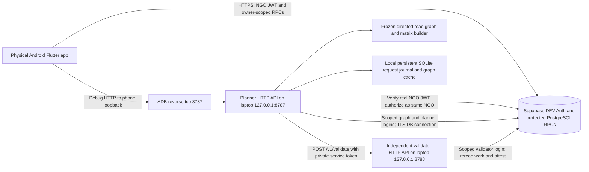
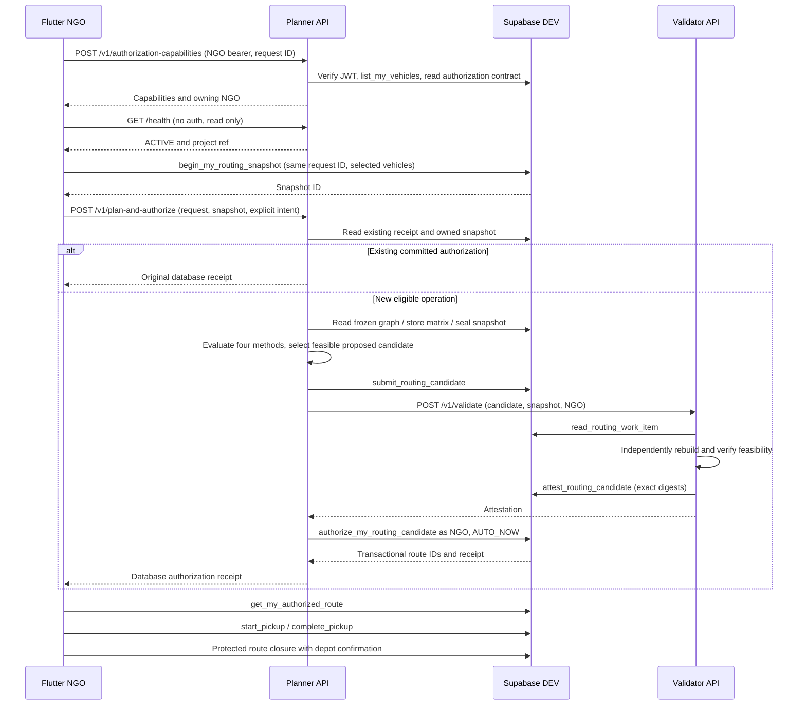

# Planner, validator and phone connection diagnosis

Investigation date: 5 November 2026, Asia/Kuala_Lumpur. Project: `C:\Users\User\Downloads\FYP-GeoLock_Hub`. DEV only: `rcgyuwiidqvrgbxswhqj`. Affected request: `72b257d0-e335-43b8-9c60-95294cdbfbf4`.

## 1. Executive summary

**Confirmed current fault: the physical phone's ADB connection is offline.** The existing USB/loopback design needs a working reverse tunnel from the phone's port 8787 to the laptop's port 8787. The local APK contains `http://127.0.0.1:8787`, which means the *phone itself* unless that tunnel is present. This is a strong explanation of the reported transport/preflight failure. It is not proof of the installed APK's configuration or the USB state at the original failure time: the offline phone prevented those checks.

**Both existing HTTP servers are reachable from this laptop.** Actual GET requests to ports 8787 and 8788 returned `{"project_ref":"rcgyuwiidqvrgbxswhqj","status":"ACTIVE"}`. The planner is already its own HTTP API; there is no missing separate gateway for the USB development path. Do not launch duplicate workers or restart them to repair a phone tunnel.

The reported preflight error comes from a failed HTTP transport operation before Flutter requests a snapshot. In the current source, combined routing first POSTs to `/v1/authorization-capabilities`; the read-only connection button separately GETs `/health` on the same base URL. No received HTTP status means no HTTP response was available to that client, not an HTTP 401/403 or proof that no bytes ever reached a server.

**Limits:** the installed APK/hash, current reverse mapping and phone-side HTTP policy could not be inspected while ADB was offline. The affected request's DEV rows and fresh deployed function/grant checks could not be completed: automatic approval review for the read-only state query failed with a usage-limit error. That query did not execute; no alternative privileged connection was used to bypass review. Its backend outcome remains unverified, so retain the original operation/history.

Only this report was created. No app/backend code, configurations, tunnels, workers, database records or migrations were changed. No route generation/retry, worker activation/restart/shutdown, backup, deletion, production access or push occurred. GET health checks can create normal service access logs but invoke no planning/validation or business RPC.

## 2. Confirmed architecture



The planner and validator are foreground Python HTTP processes, not automatically provisioned Supabase services and not polling daemons that consume a database queue. Database records are durable work inputs/results, but validation is explicitly requested by the planner. Each HTTP request can perform several synchronous database RPCs. Flutter awaits the response asynchronously; background HTTP request threads do not imply detached durable jobs. The journal makes explicit retries resumable.



The sequence depicts the successful combined path, not a claim that this affected request reached those stages. Its reported failure is at the first planner contact.

## 3. Post-claim workflow: inputs, outputs and authority

All database behavior below is traced to local source and previously recorded evidence. Fresh deployed bodies/ACLs were not verified in this investigation; see section 8. Flutter Futures await operations; there is no automatic route retry just from opening a page.

1. **Publish a donation.** `donation_pages.dart`, `_CreateDonationPageState.submit`, uploads validated photos and calls `create_donation_with_images` using the donor's Supabase session and durable creation request ID. Donation/item/photo/location/availability inputs become protected donation/listing records. The persisted lifecycle and photo migrations enforce valid transitions and required data. Direct pickup and hub collection have different publication paths; `_publishBatch` calls `publish_whole_donation_batch` for the owning hub admin's batch. The user-facing save is asynchronous/awaited; listing-eligibility refresh also has a separate asynchronous job mechanism (`20261024_async_listing_eligibility_refresh.sql`). A failed publication/eligibility refresh does not itself create a pickup route. Do not assume a listing is discoverable until the protected reads confirm it.
2. **Claim.** The claim send path in `donation_pages.dart` calls `claim_listing(p_listing,p_request)` with the NGO JWT; the claim request ID is persisted for safe retry. The protected RPC locks/rechecks listing/source/eligibility, creates `donation_claims`, `claim_leases` and a CONFIRMED `pickup_tasks` record, and changes the source/listing state atomically. Input is an eligible listing ID; output is an authoritative claim outcome/IDs, not route authority. Failure/conflict is displayed; an uncertain claim retry uses the same request ID. This is an awaited synchronous transaction.
3. **Routing eligibility.** `NgoRoutesPage.fetch` / repository overview and claim-card reads use `get_my_routing_overview`, `get_my_claim_cards_v2` and `list_my_vehicles`. `routing_private.admissible` requires owning NGO, CONFIRMED unassigned task, ACTIVE claim/lease, valid listing/source state, matching node/weight, sufficient availability and lease/listing horizon plus dispatch margin. A claim can be ACTIVE yet insufficiently long-lived for routing. Inputs are current protected records/policy; output is eligible work/fleet and blockers. These are owner-scoped reads at load/refresh; expiry checks can trigger UI refresh. Ineligible work is excluded, not silently repaired.
4. **Select fleet/work.** `NgoRoutesPage` stores selected eligible vehicle IDs in `_selected`. The normal combined action does **not** accept an arbitrary client-supplied task manifest: the server snapshot gathers the NGO's CONFIRMED tasks and the policy/engine admit them. The separate exact-pilot endpoint accepts a narrowly validated explicit scope; it is not the normal Generate button. Invalid vehicles/tasks remain blocked. Selection is local UI state until a protected request is sent.
5. **Generate & Authorize.** `_generate` calls `NgoRoutingRepository.generateAndAuthorize`; `_startRouteOperation` persists NGO-scoped request/policy/vehicle IDs in SharedPreferences *before* sending. `_continueRouteOperation` awaits capability checks, health and then `begin_my_routing_snapshot`. The snapshot freezes selected fleet and observations under the NGO's authorization. Existing pending operations block replacement; failure in preflight is saved as blocked, while uncertain later writes retain recovery IDs.
6. **Flutter contacts planner.** `RoutingWorkerClient` sends `POST /v1/plan-and-authorize` with `{request_id,snapshot_id,authorize_on_success:true}` and the current NGO bearer token. The configured base URL is a Dart compile-time value. Transport is direct HTTP over USB in the current debug configuration; Supabase business RPCs remain HTTPS. The default POST timeout is 150 seconds. Timeouts/lost responses preserve uncertain outcomes; the UI must not invent a new request to escape them.
7. **Planner accepts request.** `server.Application.dispatch` validates activation/path/fields, verifies the bearer through DEV Auth and an NGO-only RPC, then uses a single-slot semaphore. `RoutingWorker.plan_and_authorize` checks the owned snapshot and existing database authorization receipt before planning. Input is only authorized IDs, not a phone-supplied plan. Output is an existing receipt, infeasibility, an error, or progress toward a new plan. Busy errors require same-request retry. This is synchronous request handling with local journal/OS locks, not queue polling.
8. **Road matrix and optimization.** `orchestrator.RoutingWorker.plan` reads the pending snapshot via planner-role RPCs, checks freshness, obtains the frozen graph through `GraphCache`, builds directed road distances/travel times, stores the matrix through the graph role, seals and rereads the bundle, then calls `integration.worker.solve_bundle`. `phase_c2.orchestration.evaluate` runs FCFS, nearest-neighbour, distance-only and proposed methods on the same inputs. Only a feasible proposed result is submitted as a candidate. Missing/unreachable roads, stale inputs and infeasibility fail closed; no straight-line/reverse-road invention or automatic dispatch authority is allowed.
9. **Independent validation.** Planner calls `RemoteValidator.validate` → `POST /v1/validate` on private port 8788. The shared private service token authenticates this hop; Flutter never receives it. `Validator.validate` independently rereads candidate/snapshot/matrix through `read_routing_work_item`, checks owner/binding/age, and calls `validate_work_item` / `validate_plan` without executing the optimizer. Success is stored by `attest_routing_candidate` in `routing_private.validations` against exact candidate/snapshot/matrix digests and validator build. Failure rejects the candidate. The planner waits for this response (validator transport timeout 120 seconds); there is no automatic background validation polling.
10. **Database authorization.** After ATTESTED proposed feasibility, planner forwards `authorize_my_routing_candidate` through `NgoSession.rpc` using the **same NGO JWT**, never the planner login. `p_depart_at=null` requests server-chosen AUTO_NOW departure. The protected transaction rechecks current sources/lease/fleet/depot, attestation, digests, task/vehicle locks, timing/capacity/route structure and existing reservations. It creates `pickup_routes`, `pickup_route_stops`, `active_task_route_assignments`, private `bindings`/`items`, audits and `routing_private.requests` receipt; tasks become PLANNED. Output is committed route IDs/receipt. A plan or attestation alone cannot authorize. Failure rolls back; lost acknowledgment must be reconciled.
11. **Display authorized route.** Repository `detail` / `get_my_authorized_route` retrieves owner-scoped detail and action flags from Supabase. Flutter checks returned ownership/receipt/binding and refreshes routes. There is no planner mutation on merely viewing a route. Missing receipt is unconfirmed, not proof of rollback. Current reconciliation reader privacy gates protect historical locations; do not infer those gates from front-end masking alone.
12. **Pickup execution.** Repository `pickup` calls `start_pickup` or `complete_pickup` with owning NGO authorization and explicit handover confirmation. Protected remaining-route, task, lease, custody and route guards check execution and write consumed/collected history. Start changes to DISPATCHED/pickup-in-progress; completion records collection and completes claim/lease as permitted. These are awaited DB transactions, not planner calls. Expiry, missing authority or custody conflicts block execution and use the reconciliation workflow; they do not authorize unilateral release.
13. **Close and release vehicle.** Repository `close` selects `close_my_collected_route` or `close_my_resolved_route` and uses durable receipt recovery where required. The reconciliation package classifies all-collected as COMPLETED, started all-released as ABANDONED/NO_COLLECTION, mixed as ABANDONED/MIXED_OUTCOME; unresolved custody blocks closure. Started terminal closure requires truthful registered-depot vehicle confirmation, not a claim that goods were returned. Never-started safe cancellation uses its protected cancellation path. Database fleet guards release the hold only on valid closure. Failure retains vehicle accountability and the request; neither worker needs to be online for these Supabase pickup/closure RPCs.

## 4. What the planner does

`Start-Worker.ps1` imports the local protected planner configuration, sets process-local scoped connection/graph/validator settings and explicit activation flags, and synchronously invokes `.venv-stage8/Scripts/python.exe -B -m backend.routing.worker_service.native_worker --mode planner`. Native setup collects hidden password bytes before accepting NGO requests, then delegates to `server.main`.

`server.main` constructs `ThreadingHTTPServer` with default host `127.0.0.1` and port 8787, prints ACTIVE after binding, and calls `serve_forever`. There is no `Start-Process`, scheduler registration or detached Windows service installation in this launcher. Normal startup remains in that PowerShell session. If the prompt returns, do not assume the server remains running; inspect its listener/process/health. The launcher clears its temporary environment on exit. No password/JWT/DSN is needed in this report.

**ACTIVE means the explicitly enabled application was constructed and its HTTP listener started.** `/health` returns this activation/project state. It does not probe phone reachability, login/password validity, current grants, graph warmth, validator token connectivity or feasibility of a particular route. Both current health checks passed, but those deeper conditions were not exercised here.

The planner has whitelisted database-role capabilities:

| Role | Permitted worker RPCs in `transport.RPCS` | Purpose |
|---|---|---|
| `geolock_graph_worker` | `read_frozen_routing_graph`, `store_routing_matrix` | Frozen network export and matrix persistence |
| `geolock_planner` | `read_pending_routing_snapshot`, `seal_routing_snapshot`, `read_routing_snapshot_bundle`, `submit_routing_candidate` | Prepare immutable planning input and candidate |
| `geolock_validator` (separate process) | `read_routing_work_item`, `attest_routing_candidate` | Independent verification and attestation |

Worker roles do not have a general direct-table/dispatch API. NGO-session authorization RPCs remain a separate boundary. Private tables are not a mobile write interface; local authority/publication SQL revokes client mutations and uses protected security-definer RPCs and task/fleet triggers.

`GraphId eab1f7ee-a8e0-4bed-a0e1-2c4bff024936` identifies an already-frozen database graph manifest, not an API endpoint, Google Maps key or new graph to build on each request. Historical approved probe evidence records 926,414 nodes and 2,145,828 edges for that graph. Those counts were not freshly reread here. `graph_cache.py` pages/checks complete immutable exports and retains a sealed disk/in-memory cache. `integration.graph_worker.matrix_from_export` and `phase_c2/matrices.py` compute directed shortest-road-distance paths, carrying travel time along the chosen path and preserving unavailable-arc semantics.

The proposed optimizer is OR-Tools CP-SAT (`phase_b/optimizers.py:_optimise` / `proposed`). It maximizes the number of pickup tasks served, then fixes that coverage and minimizes directed road kilometres. Capacity, windows, service time, depot start/return, lease horizon and vehicle duration constrain the model. It uses deterministic seeds/search settings and declared time limits; feasible time-limited output is not necessarily a proof of global optimality. The distance-only optimizer and two heuristics are comparisons, not independent authority.

`-EnableCombinedWorkflow` enables `/v1/plan-and-authorize`: explicit intent to plan, validate and invoke the existing NGO authorization RPC in one client action. `-EnableExactWorkflow` enables a separate exact pilot API (`staged.ExactRouteWorkflow`), including its explicit three-task/one-vehicle, 240-minute horizon and 15-minute margin scope. It does not select a different algorithm for the ordinary Flutter Generate button or make all requests exact-pilot requests.

## 5. What the validator does

Validator mode starts another foreground HTTP server on loopback 8788 using its own least-privilege login and the private shared token. It receives candidate identifiers from the planner, not a plan supplied by Flutter. `validate_work_item` rebuilds input from the protected candidate/snapshot/matrix bundle and checks exact digests/configuration. `phase_b/validation.py` deliberately does not import solver/problem code: it independently recomputes admission, served/unserved consistency, duplicate/ownership rules, vehicle/depot/capacity limits, schedule/time windows, service/return duration, matrix arcs and reported metrics.

This is independent **plan feasibility verification against the protected road matrix**, not a second independent collection of the road network or a separate shortest-path computation from raw road tables. It verifies road connectivity/metrics represented in that bound matrix. Claim/source admission is checked against snapshot inputs and freshness; planner live reads and the final authorization transaction revalidate current authority. Do not claim that validator attestation alone proves every live database condition at commit time.

`ATTESTED` means a trusted validator has persisted a report bound to that exact candidate digest. It does not mean an NGO owns an authorized route, a task may start, or goods changed custody. Planning proposes; validation checks; database authorization grants route authority. If validator is offline/token-invalid, planning cannot obtain the required attestation, combined authorization stops and a candidate may remain unvalidated. The phone does not contact validator port 8788 and a validator failure is not the current first-contact/preflight error.

## 6. Connection failure: exact trace and evidence

| Observation | Confirmed result / implication |
|---|---|
| Laptop listener check | `netstat` showed planner `127.0.0.1:8787` PID 7684 and validator `127.0.0.1:8788` PID 16336 during inspection; PIDs are transient |
| Actual laptop health requests | Both HTTP GET `/health` returned ACTIVE for the intended DEV project |
| ADB device inventory | Physical serial `6f44c56b1020` reported `offline transport_id:46` |
| Reverse-map inspection | `adb reverse --list` failed `device offline`; existence/validity of mappings is unverified, not proven empty |
| Latest local build | `frontend/geolock_hub_app/build/app/outputs/flutter-apk/app-debug.apk`, 111,978,700 bytes, timestamp 2026-11-05 00:06:32 MYT |
| Local APK SHA256 | `dcbfcc3206d09c47bf91db0a91d5f57bba496cbd3ea652359eafd7dc9baac65b` |
| Local APK compiled kernel | Contains `http://127.0.0.1:8787`, `PLANNER_CONNECTION_FAILED` and the newer health-diagnostic code; kernel inspected directly from ZIP without modifying it |
| Installed APK | Cannot inspect `pm path`, hash or pull/read installed kernel while phone offline; local build is not proof of installation |
| DEV endpoint | Connected project URL confirmed `https://rcgyuwiidqvrgbxswhqj.supabase.co` |

`NgoRoutingRepository.live` reads `String.fromEnvironment('GEOLOCK_ROUTING_API_URL')`. It constructs a direct `RoutingWorkerClient` and wires `authorizationCapabilities`, `plannerReady`, `combinedPlanner` and receipt reads to it. Although a legacy Supabase-function transport exists for old advisory planning, this combined path is the direct HTTP API, not a Supabase Edge Function automatically launched by worker activation.

`RoutingWorkerClient._post` catches `http.ClientException` and emits `PLANNER_CONNECTION_FAILED` without an HTTP status. For `/v1/authorization-capabilities` it marks a read phase and a known non-writing outcome. `_continueRouteOperation` has already saved `phase=preflight`, but does not change to `snapshot` until after capabilities and health succeed. The support page displays saved operation phase/code/status, so a client-side preflight failure is consistent with “Snapshot: not confirmed / HTTP: not recorded.” It does not identify a PostgreSQL constraint/migration failure.

The connection button is correctly wired: `RoutingDiagnosticsPage` / `NgoRoutesPage._checkPlannerConnection` → repository `checkPlannerConnection` → client `checkReady` → GET `/health` on the **same** base URL, no bearer and no snapshot/planning RPC, with a five-second timeout and redirects disabled. Newer health failures use `PLANNER_HEALTH_CONNECTION_FAILED`, `PLANNER_HEALTH_TIMEOUT` or health rejection/format codes; the original saved `PLANNER_CONNECTION_FAILED` can remain visible alongside a later generic diagnostic message. The support page does not expose the underlying exception for its generic catch, and the saved operation does not persist `transportReason`, so that screen alone cannot distinguish refusal/reset/DNS/policy errors.

Debug URL policy permits HTTP only for localhost/127.0.0.1/10.0.2.2/::1; release requires HTTPS. Android main/debug manifests include INTERNET and the debug network-security XML permits cleartext only for localhost, 127.0.0.1 and 10.0.2.2. The local loopback build therefore has an intentional cleartext allowance. `10.0.2.2` is the emulator host alias, not the physical phone's route to this laptop. A raw laptop LAN HTTP URL is also rejected by current Flutter policy; changing to it is not the minimal fix.

**Most strongly supported diagnosis:** the laptop APIs are up, but the physical-device/USB transport needed for a loopback APK is currently unavailable. Restore authorized ADB connectivity and its planner reverse mapping first. Do not open firewall ports, bind to all interfaces, disable TLS or restart working workers as an initial fix. The local loopback arrangement does not depend on Wi-Fi/LAN inbound routing. An installed emulator/stale/HTTPS-mismatched APK, phone-side cleartext policy or additional auth problem remains possible until the phone is reachable and its actual artifact/diagnostic are verified. Laptop GET health proves neither phone path nor end-to-end NGO authentication.

## 7. Manual activation and hosting

The current setup has no installed auto-start supervisor/service: the operator intentionally opts into DEV-capable workers using `-Activate` and an approval reference. Omitting activation leaves the application disabled. The flags do not permanently enable a hosted Supabase worker. Processes are intended to stay alive across requests for a test session; snapshot age (default 300 seconds) is not their lifetime. They do not normally exit after one request, but terminal closure, Ctrl+C, errors, Windows logoff/reboot/sleep or laptop shutdown can stop or make them unreachable. They are foreground child processes; do not rely on closing PowerShell to leave them detached.

The phone currently targets a laptop development endpoint through USB, subject to installed-APK verification. Both laptop power and working USB debugging matter. Supabase remains independently hosted: sign-in, donation/claim reads and writes, existing route views, protected pickup execution, reconciliation and closure can still work over Supabase when workers are offline, subject to their own authorization/network state. New matrix/candidate computation and independent attestation/combined generation cannot proceed. A failed planner does not delete existing authorized routes.

A future hosted arrangement would run planner/validator under supervised long-lived deployment, keep scoped secrets/journals/cache persistent, expose only a trusted HTTPS planner hostname, keep validator private, and compile that HTTPS endpoint into the mobile build. It would need secure unattended secret provisioning and explicit deployment/activation controls. Supabase would still authorize claims/routes; the phone would no longer depend on this laptop/ADB tunnel. No hosting/auto-start implementation or readiness claim is made here.

## 8. DEV/request inspection limits

An explicit READ ONLY catalog transaction completed and reported `transaction_read_only=on`. It confirmed the routing tables/signature-supporting columns and the new `routing_private.coord_current_evidence` view exist. This is consistent with the user's deployment statement but is not a fingerprint check of the entire migration.

The subsequent REPEATABLE READ READ ONLY query for this request's snapshot, candidate, validation, binding, authorization-receipt and audit counts was blocked **before execution**: automatic approval review could not complete due to a usage-limit error. No backend row counts were returned. Fresh deployed function source, owner/grant/policy verification was therefore also left pending. No passwords/tokens were requested/printed, no alternative privileged DSN was used to bypass that failure, and no mutation RPC was executed. Local results/log searches did not find this request; absence there is not proof of absence in DEV. Private running-journal state was not established by the available local file inspection.

Consequently this report does **not** assert that the request has no snapshot/route, that it committed, or that deployed definitions exactly equal local files. The reported durable preflight phase and source order support an inference that snapshot creation was not reached, but installed-version/state verification and a successful backend read are still necessary to certify that request's state.

Once review access is restored, the following read-only inspection can establish the direct lineage without invoking business RPCs (not executed here):

```sql
BEGIN ISOLATION LEVEL REPEATABLE READ READ ONLY;
WITH target AS (
 SELECT '72b257d0-e335-43b8-9c60-95294cdbfbf4'::uuid AS id
), s AS (
 SELECT snapshot_id FROM routing_private.snapshots,target WHERE request_id=target.id
), c AS (
 SELECT candidate_id FROM routing_private.candidates,target
 WHERE request_id=target.id OR snapshot_id IN(SELECT snapshot_id FROM s)
)
SELECT current_setting('transaction_read_only') AS read_only,
 (SELECT count(*) FROM s) AS snapshots,
 (SELECT count(*) FROM c) AS candidates,
 (SELECT count(*) FROM routing_private.validations WHERE candidate_id IN(SELECT candidate_id FROM c)) AS validations,
 (SELECT count(*) FROM routing_private.bindings WHERE candidate_id IN(SELECT candidate_id FROM c)) AS route_bindings,
 (SELECT count(*) FROM routing_private.requests,target
  WHERE request_id=target.id OR result->>'snapshot_id' IN(SELECT snapshot_id::text FROM s)) AS receipts;
ROLLBACK;
```

Also compare deployed `authorize_my_routing_candidate`, `begin_my_routing_snapshot`, authorized-route readers, pickup/closure helpers, enabled task/fleet guards and role EXECUTE/private-table grants with the reviewed baseline using `pg_get_functiondef`, catalogs and explicit READ ONLY transactions. Do not substitute local SQL or historical preflight fingerprints for those current observations. Combined authorization uses a UUIDv5 derived from the **snapshot** (`step_id(sid,'authorize-auto-now')`), so looking only for a receipt with the UI request UUID can miss a real commit; join through snapshot lineage or read the protected receipt using its derived authorization ID.

## 9. Correct startup, repair and safe retest instructions

These commands are source-verified procedures, not actions performed by this investigation. Current workers are already listening: skip startup/restart now. Future activation references must still represent applicable approval, not merely copied historical strings.

### A. Fresh approved session: validator first, planner second

In two separate PowerShell terminals at project root, use the existing protected configs and native hidden password prompts. Do not paste passwords into arguments/chat:

```powershell
Set-Location 'C:\Users\User\Downloads\FYP-GeoLock_Hub'
# Terminal 1 — only when a new session is separately approved and 8788 is free:
.\backend\routing\worker_service\windows\Start-Worker.ps1 -Mode validator -Activate -ApprovalRef 'DEV-VALIDATOR-RESTORE-20261029'
```

```powershell
Set-Location 'C:\Users\User\Downloads\FYP-GeoLock_Hub'
# Terminal 2 — only when approved and 8787 is free:
.\backend\routing\worker_service\windows\Start-Worker.ps1 -Mode planner -GraphId 'eab1f7ee-a8e0-4bed-a0e1-2c4bff024936' -Activate -ApprovalRef 'DEV-GROUP1-EXACT-20261030' -EnableCombinedWorkflow -EnableExactWorkflow
```

Both terminals remain occupied. No separate gateway command is needed. Neither process should be duplicated. Starting validator first avoids reaching validation with no validator service, although planner startup alone does not test it.

### B. Laptop readiness: distinguish layers

```powershell
Invoke-RestMethod -Uri 'http://127.0.0.1:8787/health' -TimeoutSec 5
Invoke-RestMethod -Uri 'http://127.0.0.1:8788/health' -TimeoutSec 5
netstat -ano -p tcp | Select-String ':878[78]\s'
```

Expected health is ACTIVE plus the intended DEV project, as observed here. This establishes local HTTP availability only. An operator can separately run the launcher's explicit `-CheckConnection` diagnostic **without -Activate**, if database-read diagnostics are approved and access is available:

```powershell
.\backend\routing\worker_service\windows\Start-Worker.ps1 -Mode planner -CheckConnection
.\backend\routing\worker_service\windows\Start-Worker.ps1 -Mode validator -CheckConnection
```

Those paths use READ ONLY connections, inspect scoped login permissions and exit without starting another listener. They need native hidden prompts; they were not run here. They still do not validate a candidate or prove the phone tunnel, graph readiness, shared validator token or a real route's feasibility. Do not send dummy `/v1/plan`, `/v1/validate` or authorization requests as health checks.

### C. Repair phone transport first, after approval to change the tunnel

Unlock the phone, confirm USB debugging and authorize this laptop's RSA prompt. Reconnect a working USB data cable/port if it remains offline; do not clear app storage, revoke all debugging keys or kill global ADB as an initial remedy. Then:

```powershell
$adb = 'C:\Users\User\AppData\Local\Android\Sdk\platform-tools\adb.exe'
$device = '6f44c56b1020'
& $adb devices -l
$phoneState = (& $adb -s $device get-state).Trim()
if ($LASTEXITCODE -ne 0 -or $phoneState -ne 'device') { throw 'Phone must be online and authorized before continuing' }
& $adb -s $device reverse tcp:8787 tcp:8787
if ($LASTEXITCODE -ne 0) { throw 'Planner reverse tunnel failed' }
& $adb -s $device reverse --list
```

This mapping is the proposed corrective change; it was **not** executed. Only port 8787 is needed on the phone. Some existing helper scripts also reverse 8788, but validator traffic is laptop-to-laptop and that extra phone mapping is unnecessary. Reversals can be lost after USB/device/ADB changes; starting a worker does not install them.

Verify the phone browser can GET `http://127.0.0.1:8787/health`, then use the app's **Check planner connection (read only)**. The browser check isolates tunnel reachability; the app check also exercises its own compiled URL/platform policy. Do not press Generate yet. If browser succeeds but app fails, verify actual installed endpoint/build/network-security policy before changing workers or database grants.

### D. Inspect installed artifact before rebuilding

After ADB is online, these checks are read-only:

```powershell
$packageLine = @(& $adb -s $device shell pm path com.example.geolock_hub_app)
if ($LASTEXITCODE -ne 0 -or $packageLine.Count -ne 1) { throw 'Inspect package/splits before continuing' }
$installedApk = ($packageLine[0] -replace '^package:','').Trim()
& $adb -s $device shell sha256sum $installedApk
Get-FileHash -Algorithm SHA256 -LiteralPath '.\frontend\geolock_hub_app\build\app\outputs\flutter-apk\app-debug.apk'
```

Matching SHA256 establishes the installed bytes match the locally inspected loopback build. If they differ, inspect/pull that installed APK for endpoint/kernel/manifest review; a mismatch alone does not prove it is wrong. Do not automatically install the old October demo APK. If a fresh build is actually needed, preserve feature flags and approved DEV configuration: `GEOLOCK_SUPABASE_ENV=dev`, `GEOLOCK_ROUTING_API_URL=http://127.0.0.1:8787`, debug mode for this USB setup. The existing `scripts/Run-RoutingDev.ps1` implements those defines plus reverse mappings but **builds/launches**; it is not a read-only diagnostic and was not run. Build/install changes require their own approval; in-place installation must retain app data and request history. No rebuild is needed merely because workers were restarted.

### E. Inspect progress and retry safely

1. Stay signed into the same NGO; retain request `72b257d0-e335-43b8-9c60-95294cdbfbf4`, saved snapshot/authorization IDs and app data. Complete the pending backend lineage check before claiming a clean rollback.
2. Verify laptop health, online device/tunnel and the app's read-only health check first. A health success is not an authorization receipt or permission to generate automatically.
3. Inspect the saved operation in Route support. With a confirmed snapshot ID, **Check authorization outcome (read only)** invokes `reconcileRouteOperation` → `/v1/authorization-result`; it never falls back to generation. If an authorization receipt is found, refresh/open that existing route and do not generate again.
4. When a retry is separately approved, use `resumeRouteOperation()` through the UI's explicit original-operation recovery action if exposed by that build. It reuses saved request/policy/vehicles and snapshot; with a snapshot it reads the outcome first. Do not fabricate another UUID or call private planning endpoints manually. The inspected normal page does not directly call `resumeRouteOperation`; therefore do not promise a Resume button exists on the installed version. Some builds expose only guarded archival of a demonstrably finished preflight record. If the original operation cannot be resumed in the UI, stop for a reviewed recovery action rather than clear preferences.
5. The guarded preflight archival path (`isFinishedPreflight`, `finishRouteOperation`, page `_dismissFinishedSetup`) retains local history and requires blocked preflight/explicit intent/no confirmed snapshot/no in-flight operation. The actual current button is **Dismiss interrupted setup**. After connectivity, installed-version and request-state checks establish this was a finished preflight, that button is the current source-supported recovery path: it archives the original request under an immutable local history key before removing only the finished active-operation slot. Then refresh eligibility, select the intended vehicle(s), and make a single explicitly approved Generate & Authorize attempt. This is a new operation only after the previous one is proven pre-generation; it is not a retry of an uncertain commit. If a snapshot/authorization is present or the button is unavailable, do not force dismissal. Do not delete request/snapshot history to get an enabled button.
6. Worker `Journal` stores exact intermediate payloads in SQLite, with owner/request/snapshot binding and OS locks. Matrix/candidate IDs and the automatic authorization request are deterministic from snapshot UUID. Existing committed receipts are checked before generation, and DB request conflicts/locks/assignment guards prevent treating a replay as a new route. Preserve the journal; a new arbitrary UUID defeats some recovery protections.
7. Monitor existing planner console `routing_request` events for this request/snapshot: `http_received`, JWT verification, `read_pending_snapshot`, freshness, road matrix, optimization, candidate submission, independent validation, and HTTP result. Fixed stage labels/UUIDs are logged without headers/tokens. Use current protected route/receipt reads for final truth, not an ACTIVE line or a journal-only success. No real request/progress was triggered here.

If a snapshot is now stale, do not repeatedly send mutation requests or modify its cutoff. Reconcile receipts first and use only the reviewed terminal/archival/new-operation flow after current task/fleet reads. No automatic reservation cleanup or claim release is implied.

### F. Shutdown after a separately approved testing session

Stop generating requests and let active operations finish. Confirm/record receipts and reconcile uncertain outcomes before shutdown; preserve the journal/cache/app history. Once idle, Ctrl+C in planner's foreground terminal, then validator's terminal, and verify ports are no longer listening. Do not use broad process-kill commands or delete state. `daemon_threads=True` means abrupt process shutdown can abandon HTTP handlers; DB commit outcome must then be read before any retry. No shutdown was performed by this investigation.

## 10. FYP supervisor explanation

“After an NGO claims food, GeoLock records the claim, its time-limited lease and a pickup task. The NGO chooses eligible vehicles. The planner combines the NGO depot, pickup tasks and a frozen directed road network to calculate travel distances and times. It compares four methods; the proposed OR-Tools model first tries to serve more pickup tasks, then reduces travel distance within capacity, service-window and vehicle-duration constraints.

“A separate validator rebuilds the protected inputs and checks the proposed schedule and metrics without running the optimizer. It attests an exact candidate, but cannot grant pickup authority. Supabase performs the final live ownership, lease, task, vehicle and route checks and commits route reservations atomically. The app then reads that authorized route and uses protected pickup/closure actions.

“This is more than drawing Google Maps directions: the system decides which claimed pickups can be served by which vehicles, verifies feasibility and controls execution authority. Google Maps presentation is not the source of those database permissions. In the current development setup the planner and validator run on my laptop, and my phone reaches the planner over an ADB tunnel. A running worker does not prove that tunnel works.”

Implemented/source-verified: separate HTTP services and scoped RPC roles, directed graph/matrices, four-method comparison, proposed CP-SAT constraints, independent candidate verification, database-authorized route execution, immutable request/evidence recovery mechanisms. Existing local test records include `backend/routing/worker_service/test-results.json` (33 Python, four disposable PG and 22 Flutter checks at that historical snapshot) and the November reconciliation/blocker validation reports. They are bounded synthetic/local evidence, not current production certification or a test of this affected request.

Not established here: current deployed function/grant parity, successful physical-phone route generation for this request, fresh end-to-end validator/graph/database readiness, global optimality of every timed solver run, turn-by-turn road geometry, or a hosted/auto-start deployment. The exact-three-task pilot and formal E4 comparison results must be presented with their own documented scope; enabling a flag or seeing ACTIVE is not new experimental evidence.

## 11. Evidence index

Primary source paths below are relative to project root; functions are included so the report remains useful if line numbers change.

| Evidence | Relevant implementation |
|---|---|
| Flutter transport | `frontend/geolock_hub_app/lib/routing/routing_worker_client.dart`: configurationErrorCode, allowedUrl, checkReady, authorizationCapabilities, _post |
| Operation ordering/recovery | `frontend/geolock_hub_app/lib/routing/ngo_routing_repository.dart`: live, _startRouteOperation, _continueRouteOperation, routeOperation, reconcileRouteOperation, resumeRouteOperation, checkPlannerConnection, pickup, close |
| Screens and diagnostics | `frontend/geolock_hub_app/lib/routing/ngo_routes_page.dart`: fetch, _generate, _checkPlannerConnection; `routing_diagnostics_page.dart`: connection/outcome buttons and saved phase/code display |
| Donation/claim | `frontend/geolock_hub_app/lib/donation_pages.dart`: _CreateDonationPageState.submit, _publishBatch and claim_listing send path; `supabase/migrations/20261031_claim_audit_and_failure_capture.sql`; persisted lifecycle/photo/eligibility-refresh migrations |
| Android policy | `frontend/geolock_hub_app/android/app/src/main/AndroidManifest.xml`, `src/debug/AndroidManifest.xml`, `src/debug/res/xml/routing_debug_network_security.xml` |
| Physical-device configuration | `scripts/Run-RoutingDev.ps1`, `scripts/Build-VerifiedRoutingDev.ps1`; the old `Install-ExactRoutingDemoApk.ps1` pins a historical artifact and is not the repair for this current build |
| Worker launcher/process | `backend/routing/worker_service/windows/Start-Worker.ps1`; `native_worker.py:main`; `server.py:main`, Application.dispatch, make_handler, request_event |
| Planning/idempotency | `backend/routing/worker_service/orchestrator.py`: step_id, RoutingWorker.plan, fresh, automatic_authorization_capabilities, authorization_result, plan_and_authorize; `journal.py:Journal` |
| Graph/algorithms | `worker_service/graph_cache.py`; `integration/graph_worker.py:matrix_from_export`; `phase_c2/matrices.py:build_matrix`; `phase_c2/orchestration.py:evaluate`; `phase_b/optimizers.py:_optimise`; `phase_b/baselines.py` |
| Independent validation | `worker_service/validator.py:Validator.validate`, RemoteValidator.validate; `integration/worker.py:validate_work_item`; `phase_b/validation.py:validate_plan` |
| Auth/role boundary | `worker_service/transport.py:RPCS`, RoleRpc, NgoSession, SupabaseAuth.verify; native connection role checks |
| Protected DB authority | `docs/stage8/stage-a/forward-migrations/20261101_routing_authority.sql`, `20261102_routing_publication.sql`, `20261103_routing_pickup_and_reconciliation.sql`, `20261104_routing_automatic_departure.sql`, subsequent reconciliation migrations |
| Current local reconciliation contract | `supabase/migrations/20261104130000_unstarted_released_route_cancellation.sql`; previous local implementation, blocker/preflight reports and their explicit test scopes |
| Graph historical readiness | `results/worker-readiness/20261027T083653Z-5f56bb/result.json`; cache script pins its graph/seal/counts, but that script was not executed here |

**Stop point:** repair/verify the offline phone and planner tunnel, verify installed artifact and affected-request lineage, then approve any retry separately. No corrective changes or business operations were made.
