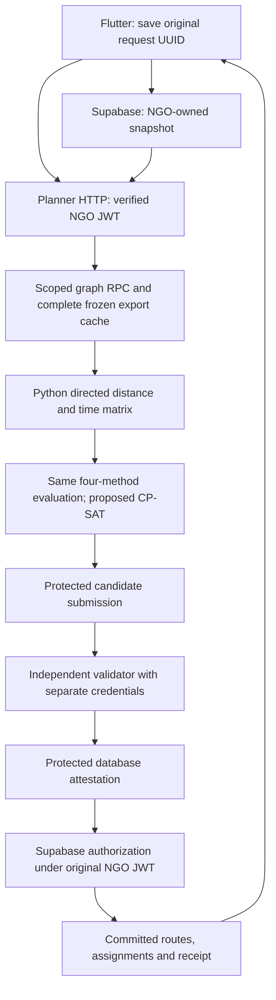

# Graph memory and free cloud routing investigation

**Historical reference — cloud hosting postponed/not selected (owner decision, 7 November 2026).** The selected default is [Windows laptop routing](../LOCAL_ROUTING_WINDOWS.md). Measurements and alternatives below are retained reference material; no cloud deployment or journal redesign is planned by the current workflow.

6 November 2026, Asia/Kuala_Lumpur. **Final verdict: FREE POSSIBLE WITH CHANGES.** No free deployment has been demonstrated. Render Free compatibility remains unproved and the unchanged planner does not fit it. The strongest zero-recurring-compute-cost candidates are an approved university VM or an eligible Oracle Always Free VM, with hosted-runtime/recovery work and measured acceptance tests first.

This investigation created documentation and new offline evidence only. No application source, Flutter, planner, SQL function, migration, permission, DEV record, Storage record, worker configuration or historical benchmark was changed. No worker was activated; no live route was generated; no cloud account/service was created or deployed; nothing was pushed. Reference-document startup/deployment commands were not followed.

## 1. Current DEV inventory: access limitation and evidence status

**A fresh DEV inventory could not be performed.** The earlier approved inspection method was Supabase MCP with explicit read-only transactions. No Supabase query tool is exposed in this session, no configured unattended approved read-only credentials were found, and no database connection was attempted. A read of nonsecret fields in the saved worker profile was denied by the filesystem sandbox; no escalation, decryption, password extraction, privileged fallback or password guessing was attempted. Do not confuse available historical catalog receipts with current database observations.

See [access receipt](C:/Users/User/Downloads/FYP-GeoLock_Hub/docs/investigations/routing-graph-memory-free-hosting-review/DEV_ACCESS_STATUS.json) and the [unexecuted bounded inventory queries](C:/Users/User/Downloads/FYP-GeoLock_Hub/docs/investigations/routing-graph-memory-free-hosting-review/READ_ONLY_INVENTORY_NOT_EXECUTED.sql). The latter is an investigation artifact, not a migration. It contains catalog/privilege SELECTs and timeout-bounded counts, with READ ONLY/ROLLBACK transaction controls; it invokes no graph traversal or application RPC. Reconnect through the approved DEV inspection method before using it. A permission error or timeout leaves a fact unknown, not estimated as exact.

| Requested fact | What is supported now | Current DEV verification |
| --- | --- | --- |
| Road storage | Local DDL defines `public.road_network_coverage`, `road_network_nodes`, `road_network_edges`. Nodes/edges are relational rows, not a single binary graph object. | Not available |
| Exact node/edge counts | The October 27 full probe and October 28 receipt recorded **926,414 / 2,145,828**. | **Unknown today** |
| Graph versions | Historical approved coverage `OSM-OPS-20261018`, frozen graph `eab1f7ee-a8e0-4bed-a0e1-2c4bff024936`, digest `5e06dab0fb4d2b97ac53fd9a1178dc46aa6b98811aefbaef96528c604a04012a`. | No fresh version list |
| Planner's graph | Source reads `GEOLOCK_GRAPH_ID`; Windows launcher takes `-GraphId` override or saved profile GraphId. Prior reviewed startup command selected the graph above. | Effective current process setting not attested |
| Node metadata | DDL: bigint OSM ID; snapshot ID; double-precision latitude/longitude; generated geography Point; component ID; active flag. | Types/rows not freshly queried |
| Directed edges | DDL: identity edge ID; source/target OSM IDs; positive REAL `road_km` and `travel_minutes`. Frozen output uses `PG_REAL_OUTPUT_0`, with at most six decimal places in historical export evidence. | Weights/precision not freshly checked |
| Indexes | DDL has node-ID PK, node-geography GiST, coverage PK/GiST, one-active-operational partial unique index, edge `(source_node,target_node)` PK. An older archived schema lacked an edge-ID cursor index. | Do not infer that absence is still true |
| Regional reads | Node-geography index permits indexed radius/bbox candidate selection. Edges can join source nodes through the source-leading PK. Edge geometry/region-partition support is not established. | No EXPLAIN ANALYZE or traversal run |
| Graph-access RPC | Source `read_frozen_routing_graph(graph,cursors)` returns up to 10,000 nodes and edges per page through a restricted graph role. It has no regional selector. | Existence/body/grants unverified today |
| Distance RPC | Source `geolock_road_costs` uses directed `pgr_dijkstraCost` on radius-selected edges, returning distances only. | Existence/permission/performance unverified today |
| Matrices | Source `routing_private.matrices` stores per-request JSONB matrices linked to graph identity. Historical October 28 receipt contained one matrix. NGO/listing eligibility cache is a separate distance cache. | Current matrix count/coverage unknown |
| Partitions/extensions | Local migrations request PostGIS/pgRouting. No reusable graph-region partition hierarchy was identified in the inspected source. | Installed extension versions, usable grants and actual partition catalog unknown |

Sources: [operational road DDL and distance RPC](C:/Users/User/Downloads/FYP-GeoLock_Hub/supabase/migrations/20261020_operational_road_node_resolution.sql), [authority/graph/matrix SQL](C:/Users/User/Downloads/FYP-GeoLock_Hub/docs/stage8/stage-a/forward-migrations/20261101_routing_authority.sql), [historical graph/policy receipt](C:/Users/User/Downloads/FYP-GeoLock_Hub/results/automatic-routing-dev-preflight/20261028-readonly/state.json), [historical source/precision checks](C:/Users/User/Downloads/FYP-GeoLock_Hub/docs/stage8/integration/dev-graph-and-source-checks.json). These distinguish source contracts and dated observations from live schema facts.

## 2. Verification of the existing architecture review

The [previous review](C:/Users/User/Downloads/FYP-GeoLock_Hub/docs/investigations/ROUTING_RENDER_ARCHITECTURE_REVIEW.md) remains accurate about the current source call chain:

[GraphCache](C:/Users/User/Downloads/FYP-GeoLock_Hub/backend/routing/worker_service/graph_cache.py) downloads the complete export only when no accepted disk cache exists. On process restart it fetches a manifest page, verifies the disk seal, then parses the whole cached JSONL into Python objects. Within the same process `_loaded` retains the full `(manifest,nodes,edges)` tuple and avoids further graph-download calls. **It does not download the entire graph for every request.** However, every new matrix request still calls [matrix_from_export](C:/Users/User/Downloads/FYP-GeoLock_Hub/backend/routing/integration/graph_worker.py), reconstructs/canonicalizes a frozen graph, and invokes [build_matrix](C:/Users/User/Downloads/FYP-GeoLock_Hub/backend/routing/phase_c2/matrices.py), which decodes and reconstructs it again. Cache reuse therefore does not remove conversion CPU or temporary-memory peaks.

[Planner orchestration](C:/Users/User/Downloads/FYP-GeoLock_Hub/backend/routing/worker_service/orchestrator.py) still solves all four methods; [METHODS](C:/Users/User/Downloads/FYP-GeoLock_Hub/backend/routing/phase_b/__init__.py) still exports the [CP-SAT proposed callable](C:/Users/User/Downloads/FYP-GeoLock_Hub/backend/routing/phase_b/optimizers.py). The objective remains maximum pickup-task count, then minimum directed road distance. A historical RoutingModel/cost description is not the invoked algorithm. E4 frozen scenarios do not replace this operational graph/snapshot chain.

The [HTTP client](C:/Users/User/Downloads/FYP-GeoLock_Hub/frontend/geolock_hub_app/lib/routing/routing_worker_client.dart) still has 150-second POST and five-second health deadlines. [Server](C:/Users/User/Downloads/FYP-GeoLock_Hub/backend/routing/worker_service/server.py) still defaults snapshot freshness to 300 seconds and serializes generation with one semaphore slot. The [Windows launcher](C:/Users/User/Downloads/FYP-GeoLock_Hub/backend/routing/worker_service/windows/Start-Worker.ps1) still uses the native Windows bootstrap and local validator URL. Hosted Linux bootstrap/public HTTPS are changes that remain necessary even if graph memory is reduced.

The historical **3.51 GiB / 294.485 s warm-up / 58.437–61.672 s matrix** figures come from [the actual probe receipt](C:/Users/User/Downloads/FYP-GeoLock_Hub/results/worker-readiness/20261027T083653Z-5f56bb/result.json). They remain useful risk evidence, not new measurements or guaranteed bounds for current full-network requests. No fresh full-graph profile was run, and equivalence of every historical source revision was not established. Current inspected source hashes are recorded in the new evidence receipts.

## 3. Where graph and solver memory go

There is **no NetworkX graph in this path**, and the road graph/matrix builder does not use compact NumPy adjacency arrays. NumPy/pandas are declared solver-environment dependencies; merely having them installed does not make these Python dictionaries compact.

| Component | Current allocation mechanism | Full-size order-of-magnitude estimate, not isolated measurement |
| --- | --- | --- |
| Cached export | Lists of node/edge dictionaries; Python ints/floats/strings; list/dict references; repeated source/target objects from JSON parsing. | Approximately 0.7–1.4 GiB depending on sharing/types/allocator. |
| Export conversion | Selected-node set, sorted ID lists, stringified IDs, another edge-dictionary list. `freeze_graph` copies edge dictionaries and makes exact decimal strings. | Several hundred MiB to about a GiB of transient overlapping objects. |
| Canonical graph/digests | Large canonical JSON string, encoded byte copies during SHA256, temporary serialization buffers. Existing code already avoids one redundant serialization; the larger reconstruction remains. | Roughly 0.25–0.5 GiB per full graph text/byte representation; actual current artifact size unmeasured. |
| Matrix validation | `graph.to_dict()` builds a decoded object graph; `digest(data)` serializes it; `freeze_graph` reconstructs it for equality; the original cached export remains alive. | Another approximately 0.8–1.6 GiB decoded representation plus serialization/rebuild temporaries. |
| Adjacency | Dictionary entry/list for every node, edge references in per-source lists. These reference decoded edge dictionaries rather than copying each dictionary yet again. | Tens to low hundreds of MiB. |
| Dijkstra search | Per-node Decimal distance/time, dictionaries/sets, heap tuples and full edge-ID path tuples. Extending `path+(edge_id,)` copies path references. Unreachable/far targets can exhaust a large component. | Workload-dependent; full-path tuples and duplicate heap labels can dominate. No defensible fixed peak from the tiny-pair probe. |
| Output matrices | Three N×N arrays/lists: distance, time, availability, plus node order and metadata. | At 100 nodes, two bare 64-bit numeric arrays are only 160,000 bytes; JSON/Python overhead is larger. This is not the multi-GiB graph bottleneck. |
| CP-SAT | Native solver/model allocations plus Python wrappers/imports; per-vehicle circuit arcs grow roughly with task-count squared. | Not bounded by the historical graph probe; needs representative admitted-task/fleet tests. |
| Persistence/server | Graph JSONL and SQLite WAL/journal on disk; parsing/page buffers, TLS/HTTP, responses, threads and retained plans consume additional memory. | Must be budgeted separately; disk capacity is not RAM capacity. |

These estimates are explanatory ranges, **not additive allocations or measured attribution**. Actual lifetimes overlap differently and CPython may retain arenas after objects become unreachable. The 3.51 GiB historical measurement was the isolated graph/matrix process's sampled peak private commit, including interpreter/transport overhead and simultaneous graph representations. It did **not** include an actual CP-SAT solve or full planner+validator HTTP system. It is neither a measurement of bare adjacency nor a full service memory limit.

The historical last matrix profile attributed about 26.12 s to conversion/freezing and 31.36 s to matrix building. Inside the latter, reconstruction was about 21.25 s, digesting 4.79 s, decode 2.71 s and adjacency 2.03 s; directed search was about 0.025 s for those nearby diagnostic nodes. These nested timings must not be added twice. They support eliminating repeated representation work before replacing shortest-path mathematics.

## 4. Safe local measurements performed in this investigation

Host resources were checked first: approximately **10,055 MiB available RAM**, 20,257 MiB total, and **25.43 GiB free workspace disk**. Only small synthetic fixtures were allocated. No existing full graph/cache was loaded, no DEV worker was started and no network was used by the profiling calculations.

| New experiment | Measured result |
| --- | --- |
| Existing GraphCache, 2,000 synthetic nodes / 3,998 directed edges | Load 0.151 s; JSONL 553,558 bytes. |
| Current matrix builder, three nearby nodes, with tracemalloc | First 0.550 s; repeated warm request 0.583 s; exactly equal outputs; zero additional graph RPC calls on repeat. |
| New cache instance reading the same local disk artifact | 0.150 s, one manifest-page call; equal rows. |
| Representation-only compact arrays | 143,952 payload bytes; 153,356 allocated array-object bytes; exact row roundtrip and original matrix equality. This is not a compact shortest-path implementation. |
| Small directed detour fixture | Full-graph result equals exhaustive reference. A valid shorter route leaves the selected region; cropped graph is explicitly MISSING rather than falsely accepted as complete. |
| Graph-profile process | OS peak private commit about 50.61 MiB across the whole experiment; original first/repeated matrix traced peak about 6.8 MiB. Later compact roundtrip intentionally retained both representations and raised traced peak to about 10.14 MiB. |
| Separate existing solver pipeline, two tasks / two vehicles | Four methods independently valid; both CP-SAT methods OPTIMAL in both passes; 0.133 s total. After-import private commit about 278.61 MiB; after-solve working set about 82.22 MiB. |

Windows private commit and working set are different measures; neither is a direct Linux container/cgroup measurement. The solver process's import-time high-water mark was about 283.34 MiB, and the solve-interval sampled private maximum about 278.84 MiB. The small solve adds little here; it does not establish a realistic large-model bound or mean that the graph and solver totals should simply be summed.

Evidence: [graph profile, phase observations and hashes](C:/Users/User/Downloads/FYP-GeoLock_Hub/docs/investigations/routing-graph-memory-free-hosting-review/OFFLINE_GRAPH_PROFILE.json), [separate solver profile](C:/Users/User/Downloads/FYP-GeoLock_Hub/docs/investigations/routing-graph-memory-free-hosting-review/OFFLINE_SOLVER_PROFILE.json), [six passing offline tests](C:/Users/User/Downloads/FYP-GeoLock_Hub/docs/investigations/routing-graph-memory-free-hosting-review/OFFLINE_TEST_RESULTS.txt). The six existing tests cover target settlement versus exhaustive paths, directed/tie/unreachable cases, irrelevant tails, complete keyset paging, failed-page reporting and real worker CP-SAT invocation/role boundaries. All data is synthetic. Tracemalloc inflates timings and native solver allocations are observed through OS counters, not attributed by tracemalloc.

The compact experiment validates **storage roundtrip only**: it converts to arrays and back, then calls the unchanged original matrix builder. It does not measure compact-only full-network RSS, an optimized search, solver coexistence, cold-start downloads or free-host latency. No optimized application source was implemented.

## 5. Supabase capabilities and database-side routing

Supabase documents PostGIS/pgRouting availability as a platform capability; that does not prove installation or execution rights in this DEV project. [Supabase pgRouting documentation](https://supabase.com/docs/guides/database/extensions/pgrouting).

Local source already has `geolock_road_costs`: it selects edges by source-node geography around a center and calls directed `extensions.pgr_dijkstraCost`, returning only aggregate **distance**. It was designed for bounded NGO/listing road eligibility. Its documented bounded-radius reasoning concerns paths within the eligibility radius that start/end at the center; it is not a general pickup-to-pickup matrix certificate. `ngo_listing_road_eligibility` lacks all pickup-pickup pairs and time-on-selected-path values, so it cannot replace the route matrix.

A database-assisted implementation would need to reproduce the frozen graph version and **distance first, travel time second, lexical edge-ID-path third** semantics, with travel time summed on the chosen distance path. Two independent distance/time shortest-path calls are wrong. A plain `pgr_dijkstraCost` result supplies no selected edge path/time or guarantee of the same tie-breaking. A generic floating-point route result also needs exact parity with the existing six-decimal export, precision checks and numeric execution scales.

Indexes can accelerate edge selection, but pgRouting may still materialize and traverse a substantial graph inside PostgreSQL. Moving memory from Python into a shared database is not eliminating it. Source graph functions use dedicated roles; a new arbitrary SQL/region/matrix API must not be exposed to authenticated clients without tight owner/snapshot/node limits and protected storage. Every call needs bounded work, concurrency limits and fixed graph identity. No extension installation, index change, route query or traversal was performed.

Supabase's public Free plan currently lists shared CPU, 500 MB RAM, 500 MB database storage, 5 GB egress and pausing after inactivity; the existing project's actual plan/usage was not inspected. Large new matrices/traversals could compete directly with atomic claims, leases and authorization. Do not assume the current graph/index footprint or additional computation fits a fresh Free project. [Supabase pricing](https://supabase.com/pricing).

## 6. Alternatives to full graph loading

| Option | Memory/startup and request expectations | Correctness, workload and authority implications | Complexity |
| --- | --- | --- | --- |
| A. Geographic subgraph | Potentially large reduction when a genuinely small sufficient region exists; cheap spatial selection is possible in principle. Speed/size unmeasured. | An ordinary bbox/radius can exclude a shorter directed detour or required return path. Need a proven boundary/lower-bound certificate, complete relevant component, exact hierarchical boundary graph, or full-search fallback. Failure in a crop is not proof of unreachability. New regional RPC/export and DB selection workload require review. | High for exact general routing; low naive crop is unacceptable. |
| B. Supabase-assisted paths | Removes full graph from planner RAM; might reduce planner startup substantially. DB execution/latency unknown. | Adds expensive shared DB work. Current helper is distance-only/radius-based, not equivalent. Need protected bounded version-bound path/time computation and concurrency tests before considering it a replacement. | Medium/high, requires approved backend work. |
| C. Precomputed matrices | Small requests and startup for covered nodes; avoids repeated search. | Key by graph digest, ordered source/destination IDs, path/precision/speed profile and algorithm version. Unknown nodes require exact dynamic computation or explicit unavailability. Immutable graph pairs can be reused, but claim/lease/task authority and snapshots cannot. All-pairs storage is impractical; finite hub/depot/pickup subsets can help. | Medium for bounded pair cache; high for arbitrary dynamic coverage. |
| D. Compact full graph/CSR/mmap | Bare arrays estimated at about 71.44 MiB, before indexes/search/solver; much lower than millions of Python dictionaries. Fast binary load and mmap are plausible, unmeasured. | Preserve direction, IDs, exact costs and manifest/provenance; validate complete artifact once, not a cropped claim. A read-only mapped file still consumes charged resident memory when touched. Avoid dictionary/JSON expansion during requests. | Medium/high; needs format, conversion and search parity POC. |
| E. Avoid repeated conversion | Likely the lowest-risk CPU improvement; could remove substantial reconstruction/serialization work per matrix. No new full-network speedup measured. | Retain one immutable validated representation privately. Verify manifest/seal/version before reuse, forbid mutation, invalidate caches on identity/version change. Keeping old dictionaries plus new arrays forever defeats memory reduction. Python decoded structures alone may still exceed 512 MB. | Low/medium for caching; still needs corruption/concurrency tests. |
| F. Separate matrix and CP-SAT services | Lightweight planner startup; independent resource sizing; graph cost moves to another service rather than disappearing. | Matrix producer must retain graph-worker trust/credential scope and submit through protected storage. Validate matrix/snapshot binding and provenance; do not accept client-supplied distances. Adds network latency, two readiness dependencies and persistent recovery needs. | Medium; free only if **all** required services fit genuine free allocations. |

Do not replace this implementation with SciPy's default shortest-path result, float32 weights, a nearest-neighbour route, undirected search or Euclidean distance merely to reduce RAM. Such substitutions do not automatically preserve the current path/time/tie or CP-SAT contract. Numeric edge IDs also do not have the same order as current string IDs (`"10"` precedes `"2"` lexically).

## 7. Compact representation and precomputation arithmetic

Using historical N=926,414 and E=2,145,828, a possible full directed CSR layout is:

| Field | Bare bytes |
| --- | ---: |
| OSM node IDs uint64 | 7,411,312 |
| Row offsets uint64, N+1 | 7,411,320 |
| Dense target indexes uint32 | 8,583,312 |
| Original edge IDs uint64 | 17,166,624 |
| Distance in exact micro-km uint64 | 17,166,624 |
| Time in exact micro-minutes uint64 | 17,166,624 |
| **Total** | **74,905,816 (71.44 MiB)** |

This excludes original-ID lookup, metadata/digests, node activity where needed, coordinates, shortest-path frontier/labels, tie-path representation, Python/native solver/runtime, server, journal and conversion peaks. Integer scaling requires verified six-decimal values and overflow checks. It must preserve the existing serialized costs, not reinterpret raw REAL storage or silently round. Coordinate arrays are not needed for the existing shortest-path cost computation itself.

The present path tuples can still make search memory large even if adjacency fits in 72 MiB. A compact search must reproduce the same settled-path/tie semantics using a proven representation; predecessor arrays alone cannot be assumed equivalent. Streaming conversion on a sufficiently provisioned offline machine could avoid full Python expansion on a tiny host, but derived artifacts require a reviewed link to the frozen DB graph, reproducible checksum, format/version and full parity tests.

All-pairs distance+time for every historical road node requires **13,731,886,390,336 bare bytes, about 12.49 TiB** at two 64-bit values per pair, before statuses/indexes/JSON. That is not a free-tier plan. A 100-node matrix is only about 156 KiB bare; fixed known hubs/depots and demand-cached pairs are realistic subsets. They do not cover every new donation automatically. [Allocation arithmetic receipt](C:/Users/User/Downloads/FYP-GeoLock_Hub/docs/investigations/routing-graph-memory-free-hosting-review/REPRESENTATION_ESTIMATES.json).

## 8. Free hosting provider comparison, checked 6 November 2026

“Free” below distinguishes recurring allowances, time-limited credits and institution-funded resources. No account eligibility or available capacity was verified. Specs are public documentation, not reservations. CPU allocation, persistent recovery, outbound DB connectivity and cold-start behavior matter alongside RAM.

| Provider | RAM / CPU and storage | Sleep, timeouts, network and Python/validator fit |
| --- | --- | --- |
| **Render Free** | 512 MB / 0.1 CPU per free web instance; filesystem ephemeral, no persistent disk. | Idle sleep after 15 min; restart about a minute. HTTP platform ceiling up to 100 min does not override Flutter 150 s. Python/Docker works; outbound DB access allowed subject to limits. Separate validator needs its own resources; two continuously active services exceed 750 shared workspace instance-hours/month. No free private-service substitution assumed. [Specs](https://render.com/docs/compute-plans), [limits](https://render.com/docs/free), [HTTP ceiling](https://render.com/docs/render-vs-heroku-comparison). |
| **Oracle Always Free A1** | Current documentation: **2 OCPUs / 12 GB ARM total**, 1,500 OCPU-hours and 9,000 GB-hours/month; 200 GB combined boot/block storage. | Can run persistent Linux processes and separate validator containers/VMs; no serverless per-request cap when self-hosted (proxy/client limits remain). General outbound connectivity, 10 TB/month allowance. Capacity/home-region restrictions and seven-day idle-reclamation criteria apply. ARM pinned-stack installation/parity must be tested. [Always Free resources](https://docs.oracle.com/en-us/iaas/Content/FreeTier/freetier_topic-Always_Free_Resources.htm). |
| **Google Compute Engine free tier** | One eligible US-region e2-micro instance-time allowance, preset 1 GiB RAM, shared CPU about 0.25 sustained across two visible vCPUs; 30 GB standard persistent disk, 1 GB outbound/month. | No normal idle sleep or platform HTTP deadline on a self-hosted VM. Linux Python works. Too small for unchanged graph; an optimized planner plus separate validator/OS must fit combined budget. Public IPv4 and extra networking can cost money. [Free allocation](https://docs.cloud.google.com/free/docs/free-cloud-features), [VM specs](https://cloud.google.com/products/compute/pricing/general-purpose), [CPU sharing](https://docs.cloud.google.com/compute/docs/general-purpose-machines), [IPv4 pricing](https://cloud.google.com/vpc/pricing). |
| **Google Cloud Run** | Configurable up to 32 GiB; e.g. 2 vCPU/8 GiB possible. This is metered configurable compute, not an always-running free 8 GiB VM. Writable filesystem ephemeral/in-memory; external durability needed. | Scale-to-zero/cold starts. Default timeout 300 s, configurable up to 3,600 s, still Flutter-limited. Linux container CP-SAT works in principle; validator consumes separate quota. Cold full-graph warm-up is problematic; service startup limit is four minutes. Outbound HTTPS/Postgres permitted subject to network configuration/charges. [Memory](https://docs.cloud.google.com/run/docs/configuring/services/memory-limits), [timeouts](https://docs.cloud.google.com/run/docs/configuring/request-timeout), [quotas](https://docs.cloud.google.com/run/quotas). |
| **AWS new-customer Free plan** | Credit-funded EC2 choices; documented eligible options include m7i-flex.large (2 vCPU, 8 GiB). EBS is persistent but consumes allowances/credits. No permanently free 8 GiB instance allocation. | Self-hosted Python/validator possible, no ordinary idle sleep or platform HTTP cap. General outbound networking; public IPv4/EBS/egress are billing items to include. Account/service access and region capacity must be checked. [EC2 eligibility](https://docs.aws.amazon.com/AWSEC2/latest/UserGuide/ec2-free-tier-usage.html), [instance specs](https://aws.amazon.com/ec2/instance-types/m7i/). |
| **Azure for Students / Google education credits** | Flexible paid VM/service sizes covered by finite credits; an 8 GB sizing trial is a proposal, not a permanent free-RAM entitlement. Persistent VM disk available within credits. | Python/independent validator can run on suitable Linux resources. Self-hosted VM has no serverless timeout/sleep; institutional lab policies may terminate sessions. Outbound/IP/storage costs consume credits. [Azure student offer](https://azure.microsoft.com/en-us/free/students), [Google education credits](https://docs.cloud.google.com/billing/docs/how-to/edu-grants). |
| **University-managed VM/server** | Unknown until the university allocates it; request at least a trial 2 vCPU/8 GB planner budget plus measured validator headroom and persistent disk. | Could provide stable public HTTPS and controlled outbound Supabase ports with no student bill. RAM/CPU, uptime, DNS/TLS, backups, off-campus access, account expiry and allowed persistent workloads must be confirmed by IT. No university-specific entitlement is assumed. |
| **Koyeb Free** | One free web instance/organization: 512 MB / 0.1 vCPU / 2 GB ephemeral SSD; no volumes, no free worker service. | Sleeps after one idle hour; documented HTTP connection timeout 100 s. Python/Docker supported; outbound quota applies. Separate validator cannot be assumed free within the one-instance allowance. [Instance limits](https://www.koyeb.com/docs/reference/instances), [edge timeout](https://www.koyeb.com/docs/reference/edge-network). |
| **Hugging Face Spaces** | CPU Basic lists 2 vCPU/16 GB/50 GB nonpersistent disk, but **new Docker/Gradio compute Spaces require a paid subscription**; static Spaces remain free. | Python Docker technically possible, but not a genuine new-account free routing host. CPU Basic can sleep after inactivity. Documented outbound ports 80/443/8080 conflict with current PostgreSQL worker connections on 5432/6543. Persistent journal and independent validator still need solutions. Do not treat ZeroGPU Gradio as a durable unrestricted routing API. [Current Spaces rules](https://huggingface.co/docs/hub/spaces-overview), [runtime management](https://huggingface.co/docs/huggingface_hub/guides/manage-spaces). |
| **Supabase Edge Functions** | 256 MB, two seconds active CPU/request; Free wall lifetime/idle response limit 150 s. No durable local journal. | Deno/JS runtime, not the current Python/native CP-SAT stack. Outbound calls can proxy work; they do not create free optimizer CPU. A lightweight gateway could fit, but full graph/CP-SAT and trusted validator cannot be moved here unchanged. [Limits](https://supabase.com/docs/guides/functions/limits), [runtime overview](https://supabase.com/docs/guides/functions). |

The Oracle allocation above deliberately uses the **current 2/12 documentation**, not the widely repeated older 4 OCPU/24 GB figure. Check the actual account limits before any plan; this report does not assume a paid-account exception or recommend upgrading to obtain one.

### Payment, permanence and charge boundaries

| Provider | Free duration / card / potential charges | Verdict for this workload |
| --- | --- | --- |
| Render | Recurring free allocation; free deployment can start without payment, though verification may be requested. Shared 750 instance-hours, build/bandwidth quotas; suspension without a payment method or overage billing when enabled. No free persistent disk. [Free terms](https://render.com/docs/free), [free deploy](https://render.com/docs/your-first-deploy). | Current NO. Compact memory alone cannot fix weak CPU, journal loss, validator budget or cold start. |
| Oracle | Always Free has no trial expiry, but eligibility/capacity/reclamation/terms still apply. Card verification required; temporary authorization holds possible. Only stay within eligible home-region quotas; trial-only resources and paid upgrades are not free. [Signup/terms](https://www.oracle.com/cloud/free/faq/), [trial transition](https://docs.oracle.com/en-us/iaas/Content/FreeTier/freetier.htm). | Best documented recurring cloud allowance to investigate, conditional on account access, ARM parity and recovery. |
| GCE / Cloud Run | Billing account required; ordinary trial signup needs a valid payment method. $300/90-day trial is distinct from ongoing monthly free allowances. Paid-account overages are billable. GCE public IPv4 standard rate is $0.005/hour, roughly $3.60 per 720 hours unless an applicable account-specific allowance offsets it; do not assume the free VM makes the whole endpoint free. [Billing/free terms](https://docs.cloud.google.com/free/docs/free-cloud-features), [IP costs](https://cloud.google.com/vpc/pricing). | GCE: optimized-only, endpoint/combined-memory limits unresolved. Cloud Run: potentially $0 for light usage, not guaranteed free or durable as-is. |
| Cloud Run quotas | Request-based pricing currently includes 180,000 vCPU-s, 360,000 GiB-s and 2 million requests monthly, aggregated across the billing account and discounted at Tier-1 rates. Builds/registry/storage/egress and any always-on instances have separate cost implications. [Pricing](https://cloud.google.com/run/pricing). | Both planner and validator count. A theoretical 8 GiB × 90 s request is 720 GiB-s; 500 such requests exhaust 360,000 GiB-s before validator/startup/other usage. This arithmetic is not a measured capacity estimate. |
| AWS | Current new-customer FAQ: $100 signup credit plus up to $100 earned, Free plan ends at six months or credit exhaustion. Most new signups do not require a payment method, but verification may require one; older signup cohorts differ. Paid-account overages charge; the credit-limited plan is not permanent free hosting. [Current FAQ](https://aws.amazon.com/free/free-tier-faqs/). | Credible temporary FYP demonstration budget, not ongoing free 8 GiB hosting. |
| Student programs | Azure: eligible students, $100 over 12 months, no card required, renewal subject to student eligibility. Keep spending protection; resources can stop when credits run out. Google teaching credits require faculty/institution participation and expire one year after redemption; amount varies. AWS Educate's no-card labs are learning environments, not a promised always-on public VM. [Azure](https://azure.microsoft.com/en-us/free/students), [spending protection](https://learn.microsoft.com/en-us/azure/cost-management-billing/manage/spending-limit), [Google grants](https://docs.cloud.google.com/billing/docs/how-to/edu-grants), [AWS Educate](https://aws.amazon.com/education/awseducate/). | Useful credit-funded alternative if available, with explicit end date. |
| University | Institution-funded, no implied personal card or fee; allocation and expiry unknown. | Potential best FYP fit if approved public hosting exists; not established here. |
| Koyeb | Current pricing FAQ requires card verification and documents a hold plus possible selected-plan charges; a free instance does not mean every signup plan is free. No free durable volume. [Billing FAQ](https://www.koyeb.com/docs/faqs/pricing). | No advantage sufficient to solve the current architecture. |
| Hugging Face / Supabase | HF subscription gate means CPU Basic's zero hourly rate is not zero total cost for a new Docker Space. Supabase has recurring free quotas, with separate DB/storage/egress/pause limits; this project may already use a different plan. [HF](https://huggingface.co/docs/hub/spaces-overview), [Supabase pricing](https://supabase.com/pricing). | Neither supplies a drop-in, genuinely free current routing runtime. |

No free tier guarantees an unbounded public app or permanent uptime. Budgets/alerts do not universally impose a hard spend cap; quota and paid-plan decisions must be verified in the owner's account. Do not use artificial keep-alive traffic, multiple-account workarounds or undocumented allocations as the plan.

## 9. Architecture comparison and ranking for the FYP

All acceptable architectures must preserve the same logical chain: Flutter -> authenticated snapshot -> equivalent planning -> independent validation -> protected Supabase authorization -> owner-bound route read. A service being publicly reachable does not authorize any NGO that fails existing eligibility checks.

| Architecture | Can preserve correctness/authority? | Suitability and free-host feasibility |
| --- | --- | --- |
| **A: Current full-graph planner in cloud** | Yes, with Linux/HTTPS bootstrap, durable journal/cache and separately credentialed validator; no solver rewrite required. | **First cloud trial: Oracle A1 if eligible.** Measured graph peak suggests its documented RAM could accommodate a one-at-a-time planner, but actual ARM/system/validator peaks and latency remain untested. Not Render Free. |
| **B: Compact full graph + existing CP-SAT** | Yes in principle if exact graph/matrix parity is proved and source provenance remains trusted. | **Best optimization direction.** Reduces cost/memory while preserving dynamic pickup coverage. Prefer on a persistent VM first. Render 512 MB remains an experiment, not a promised destination. |
| **C: Supabase road distances + lightweight CP-SAT** | Possible only with an approved bounded version-bound matrix API reproducing time/path semantics and independent validation. | Avoid as the first FYP change: shifts substantial work into the claim/authorization DB and requires backend/schema/permission review. Shared Free DB capacity unproved. |
| **D: Precomputed matrices + lightweight CP-SAT** | Yes for covered nodes; dynamic misses need an exact protected fallback. New pickups cannot silently disappear or use Euclidean distances. | Useful supplementary cache or controlled known-location demo, not a general replacement for arbitrary valid donations. Render also still needs durable operation state and validator resources. |
| **E: On-device optimization + trusted server validator** | Possible only with untrusted-plan gateway, trusted matrix provenance and native CP-SAT mobile integration; client cannot receive worker credentials. | Lowest near-term fit: major Flutter/FFI/platform work, device variability, battery/RAM, and a trusted backend is still required. Moving the solver does not remove graph or validation costs. |
| **F: University-managed VM with original planner/validator containers** | Yes, same application authority chain, separate identities and persistent state; requires public HTTPS/IT approval. | **Preferred if actually available:** minimum redesign, known x86 stack can be retained. Resource entitlement and off-campus operation are unknown. |

Practical order: (1) ask for an institution-managed suitable VM; (2) verify Oracle Always Free eligibility/capacity and ARM stack; (3) use clearly time-limited student/cloud credits if neither is available; (4) pursue compact representation and conversion reuse as a separately approved POC. C/D are secondary optimizations, E is not a shortcut. This order prioritizes a reliable supervisor demo over spending the FYP timeline on forcing an unproven 512 MB service.

## 10. Teammate Render service and reusable patterns

The [supplied ZIP](<C:/Users/User/Downloads/FYP-GeoLock_Hub-ss (1).zip>) is unchanged from the previous audit (SHA256 `e3a101eeed99a7c49158521cf21108daa3696ab011fa4979891cb4459cbcdd93`). [New reference receipt](C:/Users/User/Downloads/FYP-GeoLock_Hub/docs/investigations/routing-graph-memory-free-hosting-review/REFERENCE_ZIP_CHECK.json) records the inspected member hashes without copying credentials/model assets.

Its `render.yaml` requests a free Docker web service, and `ai hub ranking/api/main.py` exposes `/health` and `/v1/hub-ranking`. It reads authorized candidate options from Supabase, evaluates a comparatively small feature table and returns advisory rankings; reservation authority remains in PostgreSQL. It does not load the 926k-node full route graph, run the four-method CP-SAT pipeline or manage a protected route-publication journal. A rule fallback is acceptable there because it remains advice, not committed dispatch authority. No actual memory measurement proves the ranking service's free-tier fit here, and the README-referenced Flutter `hub_admin/hub_service.dart` remains absent from the ZIP.

Reuse the FastAPI/Docker/PORT/health endpoint pattern and user-JWT enforcement, not the ranking algorithm, model, credentials, broad CORS, raw error messages or assumption that ephemeral JSONL logs are sufficient for routing. Lightweight routing could use the same deployment pattern after genuine resource/recovery proofs, but cannot inherit its advisory fallback semantics.

## 11. Security, authority and safe recovery requirements

Preserve the existing CP-SAT objective, capacity, mandatory-task treatment, service windows, directed distances, lease/dispatch margin, NGO identity/depot, custody exclusions and immutable snapshot binding. The [Authority Contract](C:/Users/User/Downloads/FYP-GeoLock_Hub/results/fyp-requirements-review-20261030/GeoLock_Hub_Coordination_Authority_Contract_v3_2_DEV_Aligned_Draft.txt) requires advisory optimization and protected database authority; the previous report already identifies its older cost-objective wording versus the implemented distance objective. Do not change the algorithm to resolve a hosting issue.

The matrix producer retains graph-role trust; planner has only read/seal/submit permissions; independent validator has separate read/attest credentials and reconstructs source facts; final authorization uses the verified NGO JWT. Compact graphs must retain complete frozen graph identity and exact costs. A client-provided region, graph digest or matrix is not sufficient authority. No service-role key or worker DSN belongs in Flutter. Same-host separate containers/processes can preserve the existing process/credential separation, but do not claim physical-host compromise isolation.

Keep the SQLite journal's original request/payload bindings, deterministic step UUIDs and receipt-first recovery. VM/block storage supports the current approach; sleeping ephemeral web containers do not. A durable external journal would need atomic ownership/locking/conditional-write semantics, not simply a JSON file uploaded after each request. Do not assume an object-store mount supports SQLite WAL/file locking or that an existing routing authorization receipt reconstructs every unfinished solver artifact.

On timeout/restart, reconcile the **same** request/snapshot and committed database receipt before resuming. Do not generate a replacement UUID or automatically switch to laptop/another instance. An absent receipt is not proof of rollback. Cached distance data can remain graph-version reusable; claim/lease authorization cannot be cached as indefinitely valid. A cold-host/readiness failure must not consume a short-lived snapshot and then bypass freshness limits. Preserve the existing in-button loading/duplicate guard and unconfirmed-outcome UI; do not silently return a queue acknowledgment to a client expecting a committed authorization receipt.

## 12. Exact preferred implementation steps — proposals only

No files listed as proposals in this section were implemented. Reuse the previous report's synchronous hosted adapter plan; add compact work only after its separate POC approval.

1. Restore the approved read-only DEV connection, confirm project identity and transaction_read_only, then run the bounded inventory plan. Record exact counts, installed extension versions/effective role privileges, graph manifests, index/partition catalog and matrix metadata. Do not run pgRouting queries at this stage.
2. Confirm a real university VM offer, or Oracle account/card/home-region/A1 capacity/limits. For an initial Oracle sizing plan, two A1 VMs could split the documented 2 OCPU/12 GB total into planner 1 OCPU/8 GB and validator 1 OCPU/4 GB; this is a proposed allocation, not a proven requirement or reservation. Include boot volumes within the shared 200 GB and verify public HTTPS/egress costs. If pinned ARM dependencies cannot be installed/proved equivalent, use an approved x86 VM/credit allocation rather than silently changing solver versions.
3. Add review-only `backend/routing/hosted_api/{main.py,config.py,runtime.py,requirements-linux.lock,Dockerfile}` and strict image allowlist. Reuse Application/worker/validator logic; replace Windows-only credential/libpq startup with verified Linux secret mounts and existing restricted identities. No authority SQL change should be necessary for this VM-first synchronous move.
4. Add `deploy/routing-vm/compose.review.yaml` and reviewed service-unit/HTTPS configuration proposals. Mount persistent graph/journal state, one planner process/one generation slot, separate validator secrets; prewarm before readiness. Preserve validator verified TLS or local loopback semantics and service-token checks. Do not weaken non-loopback TLS guards.
5. Run current solver/worker and disposable PostgreSQL/Flutter suites on the proposed Linux stack, then a resource-capped full-size offline test using an approved sealed graph artifact. No fresh full graph extraction or live route generation follows from this report.
6. If approved, add an investigation-only compact artifact builder, e.g. `backend/routing/graph_artifacts/{format.py,build.py,verify.py}`, and tests before any operational integration. Stream source pages into versioned CSR arrays, preserve ID mapping/cost precision and compute reproducible provenance. Keep this outside the active path until parity tests pass.
7. Add a proposed `backend/routing/phase_c2/compact_matrix.py` behind an explicit test-only feature selection, keeping the original builder as the comparison oracle. Prove exact path/time/arc-status semantics, zero/parallel/tie cases and graph-integrity failures. Only then review a narrow GraphCache integration that retains one validated representation and avoids repeated canonical expansion. No solver-objective or eligibility change.
8. Add `scripts/Build-VerifiedRoutingHostedDev.ps1` only after approving a public endpoint, preserving existing feature flags and app data. Compile `GEOLOCK_SUPABASE_ENV=dev` and root `GEOLOCK_ROUTING_API_URL=https://<approved-host>`. No automatic loopback fallback. Keep route button/recovery behavior unchanged.
9. Document backups/restores, secret rotation, frozen graph/solver/validator versions, journal receipt reconciliation and operator readiness checks. Obtain separate deployment/live-fixture approval before starting hosted workers or replacing the APK. A queue or external journal/matrix RPC needs another design/authority review, not an incidental hosting patch.

## 13. Required proof-of-concept gates and remaining blockers

| Gate | Necessary evidence |
| --- | --- |
| DEV catalog | Approved read-only connection restored; actual exact counts/manifests/privileges/indexes/partitions. Missing now. |
| Full graph representation | Baseline versus compact complete graph digest/row parity; peak RSS/cgroup memory during loading, validation, search and conversions; corruption and wrong-version rejection. Small-array roundtrip is insufficient. |
| Path semantics | Same distance/time/status on directed asymmetric pairs, equal-distance different-time paths, lexical edge-ID ties, long detours, far/unreachable targets and realistic random pairs. Prove region boundaries or reject cropping. |
| Workload/solver | Representative admitted task/vehicle sizes including many tasks sharing nodes; same four methods/objective/policy/seed; independently valid plans and disclosed timeout/optimality differences. Preserve all frozen historical evidence and write new run IDs. |
| Render-specific 512 MB claim | Actual proposed Linux image under a 512 MB cgroup and realistic 0.1-CPU quota, including interpreter, HTTP/TLS, graph, worst allowed search, all solver passes and response/journal work. A target such as <=400 MiB total peak provides margin but must be measured. Also test separate validator and durable journal cost; passing RAM alone is not acceptance. |
| Latency/readiness | Cold restart, disk cache reload, true readiness, then warm end-to-end p50/p95/p99 comfortably within the unchanged 150 s client limit and 300 s freshness. Matrix-only timing is insufficient. No silent lease/freshness relaxation. |
| Concurrency | Same request replay, competing NGOs, one-slot overload, bounded connection use and no cross-owner artifact access. DB authorization still admits only one correct assignment/receipt. |
| Recovery | Kill after matrix, candidate, attestation, authorization commit and response loss; restart with persistent journal; test journal loss/restoration explicitly; verify receipt-first same-UUID behavior and no false dispatch success. |
| Supabase-assisted option | Disposable/full-replica query plan/performance and exact path/time parity first; only separately approved bounded DEV measurements later. Do not run millions-edge pgRouting experiments in shared DEV as part of this review. |
| Hosted/device acceptance | Approved public HTTPS, real scoped credentials and test fixtures; Android on Wi-Fi/mobile data with laptop off and no ADB; success, timeout, cold start, JWT expiry, process restart and validation failure. No hosted tests performed here. |
| Free-cost acceptance | Account-specific allocation, storage, IP/HTTPS, egress, registry, build, backup and both services verified within quotas; no subscription hidden behind a “free hardware” label. No eligible account verified here. |

Current blockers: fresh DEV inventory unavailable; no full-size compact implementation/profile; no Linux/ARM dependency parity; no provider/account allocation; no guaranteed free persistent hosted journal on Render; no real hosted latency/validator sizing; no backup/recovery drill or laptop-off phone test. Institution allocation and student-credit eligibility are unknown. The six passing local tests and two profiling receipts do not remove these blockers.

## 14. Recommendation and final verdict

**FREE POSSIBLE WITH CHANGES** is a feasibility direction, not an operational PASS. There is credible official resource capacity to investigate free hosting without rewriting CP-SAT: a suitably allocated university VM or eligible Oracle A1 allowance. Both can support persistent state and separated planner/validator identities; portable startup, measured timing, dependency parity and recovery still require work and approval.

For **Render Free**, the unchanged full-graph design is **not feasible**. Compact arrays could materially reduce graph storage memory, and avoiding repeated canonicalization is well motivated, but neither result proves the whole service fits 512 MB/0.1 CPU or supplies durable journal storage, validator capacity and acceptable cold starts. Supabase Edge Functions are not a substitute native optimizer host. Student/cloud credits are valid temporary demonstration funding, not permanent free resources.

Choose the VM-first path if a real free allocation is available; retain compact graph optimization as a separate, measurable improvement. Current deployment readiness remains **insufficient evidence**. Stop here for review: no source optimization, migration, credential provisioning, worker activation, cloud creation or deployment is authorized by this report.
