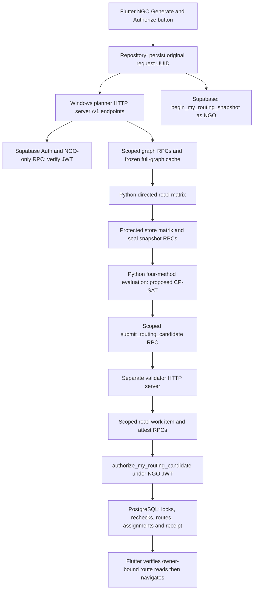
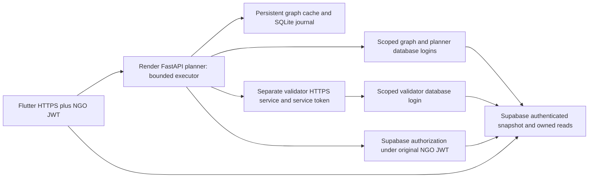

# Routing architecture audit and Render hosting review

**Historical reference — cloud hosting postponed/not selected (owner decision, 7 November 2026).** The selected default is [Windows laptop routing](../LOCAL_ROUTING_WINDOWS.md). Preserve this investigation as evidence; it is not an instruction to deploy or a local runtime prerequisite.

Date: 6 November 2026. Decision: **CONDITIONAL GO for a separately approved portability implementation and isolated pilot; NO-GO for an unchanged/free-tier deployment.** This is a design review, not deployment approval.

Only this report was created. No Flutter, planner, SQL, grants, records, Storage, worker activation or GitHub changes were made. The reference ZIP was read in memory; its README commands were treated as evidence, not instructions to execute. No credentials or model assets were copied. Public Render documentation was checked during this audit.

## 1. Evidence and inspection limits

The execution trace below follows current source imports and call sites, rather than relying on historical descriptions. In particular, comments calling RoutingModel the primary method are superseded by the actual `METHODS` export.

Local read-only observations:

| Observation | Result |
| --- | --- |
| Planner GET `http://127.0.0.1:8787/health`, 2026-11-06T12:37:04.5008380Z | `ACTIVE`, project `rcgyuwiidqvrgbxswhqj` |
| Validator GET `http://127.0.0.1:8788/health`, 2026-11-06T12:37:04.5449411Z | `ACTIVE`, same project |
| `netstat -ano -p tcp`, about 12:36 UTC | Loopback listeners: 8787/PID 6000; 8788/PID 12880. PIDs are transient. |
| Current local `build/app/outputs/flutter-apk/app-debug.apk` | Kernel contains `http://127.0.0.1:8787`; SHA256 `ff7638a06dee555a94b5d6a043bef522c0973d7ef0051bbc01a4cc437a80dfd6` |
| Teammate ZIP | 43,578,307 bytes; SHA256 `e3a101eeed99a7c49158521cf21108daa3696ab011fa4979891cb4459cbcdd93` |

Health proves the listeners answer with the expected project identity. It does not prove graph warmth, database connectivity, validator readiness, or equality between running processes and files edited after startup. Process command-line inspection was not available. The APK is the local build artifact, not a verified pull from the phone. No DEV database queries, authenticated planner POSTs, route generation, benchmarks, builds or service starts were performed. SQL deployment status and current policy values therefore remain outside this audit's fresh observations.

Primary source index (absolute workspace links):

| Ref | Source |
| --- | --- |
| S1 | [Route UI and generation button](C:/Users/User/Downloads/FYP-GeoLock_Hub/frontend/geolock_hub_app/lib/routing/ngo_routes_page.dart) |
| S2 | [Flutter repository, persistence and recovery](C:/Users/User/Downloads/FYP-GeoLock_Hub/frontend/geolock_hub_app/lib/routing/ngo_routing_repository.dart) |
| S3 | [Flutter HTTP client](C:/Users/User/Downloads/FYP-GeoLock_Hub/frontend/geolock_hub_app/lib/routing/routing_worker_client.dart) |
| S4 | [Windows launcher](C:/Users/User/Downloads/FYP-GeoLock_Hub/backend/routing/worker_service/windows/Start-Worker.ps1), [native runtime](C:/Users/User/Downloads/FYP-GeoLock_Hub/backend/routing/worker_service/native_worker.py), [native libpq selection](C:/Users/User/Downloads/FYP-GeoLock_Hub/backend/routing/worker_service/connection_diagnostic_native17.py) |
| S5 | [HTTP application, endpoints and environment](C:/Users/User/Downloads/FYP-GeoLock_Hub/backend/routing/worker_service/server.py) |
| S6 | [Planner orchestration](C:/Users/User/Downloads/FYP-GeoLock_Hub/backend/routing/worker_service/orchestrator.py), [role/JWT transport](C:/Users/User/Downloads/FYP-GeoLock_Hub/backend/routing/worker_service/transport.py) |
| S7 | [Graph cache](C:/Users/User/Downloads/FYP-GeoLock_Hub/backend/routing/worker_service/graph_cache.py), [graph assembly](C:/Users/User/Downloads/FYP-GeoLock_Hub/backend/routing/integration/graph_worker.py), [directed matrix builder](C:/Users/User/Downloads/FYP-GeoLock_Hub/backend/routing/phase_c2/matrices.py) |
| S8 | [Bundle preparation](C:/Users/User/Downloads/FYP-GeoLock_Hub/backend/routing/integration/worker.py), [four-method evaluation](C:/Users/User/Downloads/FYP-GeoLock_Hub/backend/routing/phase_c2/orchestration.py), [method exports](C:/Users/User/Downloads/FYP-GeoLock_Hub/backend/routing/phase_b/__init__.py), [CP-SAT optimizer](C:/Users/User/Downloads/FYP-GeoLock_Hub/backend/routing/phase_b/optimizers.py) |
| S9 | [Independent validator](C:/Users/User/Downloads/FYP-GeoLock_Hub/backend/routing/worker_service/validator.py), [plan validation](C:/Users/User/Downloads/FYP-GeoLock_Hub/backend/routing/phase_b/validation.py), [journal](C:/Users/User/Downloads/FYP-GeoLock_Hub/backend/routing/worker_service/journal.py) |
| S10 | [Authority SQL](C:/Users/User/Downloads/FYP-GeoLock_Hub/docs/stage8/stage-a/forward-migrations/20261101_routing_authority.sql), [publication SQL](C:/Users/User/Downloads/FYP-GeoLock_Hub/docs/stage8/stage-a/forward-migrations/20261102_routing_publication.sql), [automatic-departure SQL](C:/Users/User/Downloads/FYP-GeoLock_Hub/docs/stage8/stage-a/forward-migrations/20261104_routing_automatic_departure.sql), [simplified lifecycle migration](C:/Users/User/Downloads/FYP-GeoLock_Hub/supabase/migrations/20261104130000_unstarted_released_route_cancellation.sql) |
| S11 | [Measured graph probe receipt](C:/Users/User/Downloads/FYP-GeoLock_Hub/results/worker-readiness/20261027T083653Z-5f56bb/result.json), [historical DEV graph/policy receipt](C:/Users/User/Downloads/FYP-GeoLock_Hub/results/automatic-routing-dev-preflight/20261028-readonly/state.json) |
| S12 | [E4 investigation](C:/Users/User/Downloads/FYP-GeoLock_Hub/docs/investigations/E2_DEADLOCK_E4_ADMISSION_REVIEW.md), [benchmark adapter](C:/Users/User/Downloads/FYP-GeoLock_Hub/backend/routing/benchmark_v32/adapter.py), [benchmark runner](C:/Users/User/Downloads/FYP-GeoLock_Hub/backend/routing/benchmark_v32/runner.py), [E4 results review](C:/Users/User/Downloads/FYP-GeoLock_Hub/docs/investigations/E2_E4_REPRODUCIBLE_BENCHMARK_RESULTS.md) |
| S13 | [Authority Contract v3.2 extracted source](C:/Users/User/Downloads/FYP-GeoLock_Hub/results/fyp-requirements-review-20261030/GeoLock_Hub_Coordination_Authority_Contract_v3_2_DEV_Aligned_Draft.txt) |

## 2. Current architecture and exact request flow



1. S1 `_generate` guards duplicate entry and displays its existing in-button spinner. Selected vehicles come from the protected fleet result and UI eligibility checks; the NGO does not supply arbitrary task contents.
2. S2 `generateAndAuthorize` serializes a matching in-flight request; `_startRouteOperation` refuses a competing saved operation and persists request UUID, policy ID, sorted vehicle IDs, explicit authorization intent and phase under the NGO-specific SharedPreferences key before sending it.
3. `_continueRouteOperation` POSTs `/v1/authorization-capabilities`, verifies the `geolock.routing-auto-now.v1` contract and combined-workflow flag, then performs the auth-free `/health` check. S3's health timeout is five seconds.
4. Flutter calls `begin_my_routing_snapshot(p_request,p_policy,p_vehicle_ids)` directly through Supabase as the NGO. PostgreSQL observes authoritative claims, leases, listings, tasks, fleet and policy. The returned snapshot ID is saved before the combined planner request.
5. S3 sends `POST /v1/plan-and-authorize` with only `{request_id,snapshot_id,authorize_on_success:true}` and the current Supabase access token. The default Flutter POST deadline is 150 seconds. No solver runs in Flutter.
6. S5 verifies the JWT using Supabase Auth, then exercises the NGO-only `list_my_vehicles` RPC. It validates exact request fields, ownership/binding and activation flags. A nonblocking one-slot semaphore bounds generation; overload returns a retryable same-request error, not a new route.
7. S6 checks an existing committed authorization receipt first. If absent, it records explicit automatic-authorization intent, reads the pending snapshot through the planner role and checks its owner, request and freshness. Default freshness is 300 seconds.
8. S7 loads the existing frozen road graph through the graph role. It builds a directed matrix for the depot and captured pickup nodes, stores it with `store_routing_matrix`, seals the snapshot, and reads the sealed bundle. Freshness is checked again after matrix construction.
9. S8 prepares exact inputs and executes **all four** methods. Only a feasible, independently checked `proposed` plan becomes a submitted candidate. The comparison methods really execute in this workflow; they are not merely E4 display labels.
10. `submit_routing_candidate` uses a deterministic step UUID. The planner calls the separate validator at `/v1/validate`. The validator rereads the authoritative work item under its separate role, checks digests/ownership/age, rebuilds inputs and runs `validate_plan`; it does not invoke the optimizer. `attest_routing_candidate` stores the digest-bound result. `ATTESTED` still does not authorize dispatch.
11. The planner invokes `authorize_my_routing_candidate` using the **NGO JWT**, deterministic authorization request UUID, candidate ID and `p_depart_at:null`. PostgreSQL chooses AUTO_NOW, locks/rechecks sources and vehicles, validates attestation and timing, retimes the same route order, and commits the protected route/assignment changes and receipt (S10).
12. The service returns `DATABASE_AUTHORIZATION_RECEIPT`. S2 validates the receipt fields, reads every route using `get_my_authorized_route`, checks candidate/snapshot ownership bindings, and safely archives the local operation when verified. S1 navigates to Route Details. The spinner remains active throughout the awaited operation; failures restore normal button content while preserving recovery state.

Persistence includes `routing_private` snapshots, matrices, candidates, validations, bindings, items and request receipts; public `pickup_routes`, `pickup_route_stops` and `active_task_route_assignments`; and task transition to PLANNED. The database assigns vehicles/tasks and records AUTHORIZE_ROUTING audit evidence. Optimizer output does not change claim ownership. Starting/completing pickups and later custody, cancellation, depot checkpoints and route closure use their separate protected APIs; a hosting move must preserve them.

`NgoRoutingRepository.live` can retain a legacy Supabase Edge Function transport for advisory planning through `GEOLOCK_ROUTING_FUNCTION`. The current Generate & Authorize button requires the direct combined HTTP/capabilities/receipt transport, so configuring that legacy function alone does not replace the planner server.

## 3. Actual algorithms, feasibility and E4 distinction

The current chain is `RoutingWorker.plan -> integration.solve_bundle -> phase_c2.evaluate -> phase_b.METHODS`. `METHODS['proposed']` resolves to `phase_b.optimizers.proposed`, which constructs an **OR-Tools CP-SAT circuit model**. It does not resolve to `routing_model.proposed`, even though that other module's opening comment describes itself as primary. Dependencies currently pin OR-Tools `9.15.6755` and psycopg `3.3.6` in [worker requirements](C:/Users/User/Downloads/FYP-GeoLock_Hub/backend/routing/worker_service/requirements.txt) and the included [solver lock](C:/Users/User/Downloads/FYP-GeoLock_Hub/backend/routing/phase_b/requirements-lock.txt).

| Concern | Implemented behavior |
| --- | --- |
| Methods | FCFS and nearest-neighbour baselines plus distance-only and proposed optimization. Both current CP-SAT optimizer wrappers use coverage then directed distance; they are not distinct cost objectives. |
| Objective | Lexicographically maximize served pickup tasks, then minimize directed road distance. No fixed vehicle-cost term affects this current CP-SAT objective. |
| Vehicle selection | NGO-selected IDs, filtered/reobserved by authoritative snapshot/fleet/hold rules; individual capacities, registered depot, availability/version and maximum route duration are enforced. |
| Task selection | One NGO's protected snapshot, valid claim/lease, confirmed task, admissible listing/location/donations and no active conflicting assignment/reconciliation. Flutter display cards are not authority to admit a task. |
| Capacity | Each task visited at most once across vehicles; mandatory tasks exactly once. Assigned pickup mass per vehicle cannot exceed capacity; independent validation checks accumulated load. |
| Time | Snapshot-based nominal departure; donor availability where recorded, listing expiry, policy horizon, service durations, lease expiry with dispatch margin and vehicle route-duration limits. PostgreSQL replays timing at actual departure. |
| Roads | Approved frozen OSM directed graph. Dijkstra prioritizes shortest road distance, with travel time and edge-ID path as deterministic tie-breaks; travel time is accumulated on the same chosen path. It is not an independent fastest-path or live-traffic estimate. |
| Missing roads | No zero-cost/fabricated/straight-line arcs. Current `GraphCache.matrix` requires every requested pair AVAILABLE and rejects otherwise. Scope is 1–100 unique requested nodes. |
| Solver budget | One CP-SAT search worker, seeded from policy. Two passes each get half the declared wall budget and the execution policy's deterministic budget. The captured October policy used 15 seconds total per optimizer, seed 42, deterministic 0.25/pass, horizon 240 min, margin 15 min, direct/hub services 10/15 min. These are historical captured values, not a fresh DEV policy query. Running distance-only and proposed can consume both optimizer budgets, plus other work. |
| Timeout | No first-pass incumbent yields OPTIMISATION_TIMEOUT rather than proof of infeasibility. A valid first-pass incumbent can survive a second-pass timeout; metadata says FEASIBLE_UNPROVEN when optimality is unproved. Independent validation and live authorization remain mandatory. |
| No feasible candidate | No candidate/authorization is minted. The worker currently wraps a missing proposed payload as advisory `outcome:INFEASIBLE`, while detailed method status retains timeout/no-feasible distinctions. Do not infer mathematical infeasibility from that outer outcome alone. |
| Fallback | No automatic nearest-neighbour/straight-line dispatch when proposed planning fails. The comparison baselines are not authorization fallbacks. Keeping a validated CP-SAT incumbent is not switching algorithms. |

E4 uses frozen benchmark adapters/scenarios and the same exported proposed callable; it does not invoke this phone HTTP/JWT/graph-export/independent-attestation/publication chain. Its configured 30-second solver budget (15/pass) is not proof of the current DEV 15-second historical policy or hosted latency. S12 documents the 500-versus-483 admission distinction. Preserve frozen data and reports; do not change admission or solver settings to make Render results look equivalent.

S13 INV-07 and sections 11.4, 11.5, 11.7–11.8 support immutable inputs, independent validation and protected PostgreSQL authority. Its older section 11.6 describes a fixed-plus-distance-cost objective, while current code/S12 explicitly report coverage then raw road km. This pre-existing documentation/objective discrepancy needs thesis/contract alignment, not a hosting-driven algorithm change or an assertion of new supervisor approval.

## 4. Current laptop and Android dependency

The checked-in development setup requires the laptop awake, foreground planner and validator servers, and a reachable Supabase connection. `Start-Worker.ps1` invokes `native_worker`, which delegates to `server.main`; it binds the HTTP socket and remains in `serve_forever`. There is no separately missing gateway in this loopback setup. ACTIVE is not evidence of end-to-end route feasibility.

Existing operator commands, reproduced for identification only and **not executed**:

```powershell
# Separate terminals; only under the already applicable operational approvals.
.\backend\routing\worker_service\windows\Start-Worker.ps1 -Mode validator -Activate -ApprovalRef 'DEV-VALIDATOR-RESTORE-20261029'
.\backend\routing\worker_service\windows\Start-Worker.ps1 -Mode planner -GraphId 'eab1f7ee-a8e0-4bed-a0e1-2c4bff024936' -Activate -ApprovalRef 'DEV-GROUP1-EXACT-20261030' -EnableCombinedWorkflow -EnableExactWorkflow
```

[Run-RoutingDev.ps1](C:/Users/User/Downloads/FYP-GeoLock_Hub/scripts/Run-RoutingDev.ps1) sets `GEOLOCK_SUPABASE_ENV=dev` and compile-time `GEOLOCK_ROUTING_API_URL=http://127.0.0.1:8787`, installs ADB reverse mappings for 8787 and 8788, and runs Flutter debug. The essential phone-to-planner mapping is `adb -s <device> reverse tcp:8787 tcp:8787`; the validator hop is laptop-local and does not need a phone mapping. Do not run this script as a read-only check: it launches/builds the app and changes reverse mappings.

On physical Android, 127.0.0.1 means the phone. Without reverse forwarding, the app cannot reach the laptop planner. Losing the laptop, USB/reverse connection, worker process or network causes preflight/transport failure. Supabase remains hosted, so unrelated claim/history reads may still work. The debug manifest's loopback cleartext exception does not make a LAN HTTP endpoint generally acceptable. S3 accepts a root HTTPS endpoint for hosted builds; arbitrary cleartext non-loopback endpoints remain rejected. A hosted URL is a compile-time setting requiring a rebuild, not an automatic effect of deploying a service.

## 5. Teammate ZIP comparison

Archive root: `FYP-GeoLock_Hub-ss/` in [the supplied ZIP](<C:/Users/User/Downloads/FYP-GeoLock_Hub-ss (1).zip>). All paths below refer to archive members, not newly extracted workspace files.

| Aspect | Observed reference | Routing implication |
| --- | --- | --- |
| API | `ai hub ranking/api/main.py:257–333`: GET `/health`, POST `/v1/hub-ranking`; donation ID and optional dropoff day. | Reuse endpoint contracts/validation style, not ranking semantics. |
| Authority | Lines 143–163, 274–285 forward donor JWT + publishable key to `get_hub_options` and `get_my_donation_detail`. Ranking only processes feasible options. | Route service additionally requires graph/planner/validator role RPCs and explicit NGO-authorized publication. JWT-only read access is insufficient for the whole routing pipeline. |
| Model | `model/model_metadata.json` identifies XGBRegressor, `hubrank-xg-2026-11-01-894d3223`; main checks model hash/feature order. | This is hub ranking, not the CP-SAT route optimizer. No model or ranking code was copied. |
| Failure | Model-load/prediction errors select an explicit reference-score fallback; Supabase timeout defaults to 30 seconds. Local JSONL logs are best-effort. | Safe advisory fallback does not imply routes can fall back to unauthorized plans; routing needs durable recovery. |
| Docker | Python 3.12 slim, pinned FastAPI 0.115.6/uvicorn 0.32.1/httpx 0.28.1/pydantic 2.10.4 plus model libraries; binds `0.0.0.0:$PORT`. Dockerfile includes a publishable-key default (value deliberately omitted here). | Reuse container/PORT pattern. Supply routing configuration separately; bake no privileged credentials, profile files or unrelated model assets into images. |
| Blueprint | Root `render.yaml`: Docker web service, free plan, Singapore, repo-root build context, `/health`. | Reuse explicit build context and health-check declaration. Free plan and health semantics are unsuitable to copy unchanged. |
| Auth/errors/CORS | Bearer is forwarded to Supabase for enforcement; broad CORS, some raw upstream/model errors and best-effort log failures remain visible. | Preserve stricter existing routing auth, sanitized errors, exact body fields, explicit browser origins and token-free logs. |
| Flutter completeness | README names `frontend/.../hub_admin/hub_service.dart` and a nearest-first client fallback. That file is absent from this ZIP. All 29 Dart files were searched; no hub-ranking endpoint/config/mode markers were found. | The ZIP verifies the FastAPI/Docker design, not its claimed Flutter integration or an actual live Render deployment. README uptime-monitor/push/start commands were not followed. |

The archive does not include the current `backend/routing` implementation or a route/planner Python module. It is useful as a hosting reference, not a drop-in routing service replacement. No claim is made about your teammate's separate working tree or deployed service outside this archive.

## 6. Recommended Render architecture and trust boundary

Start with a **paid, always-on, single-instance planner FastAPI web service**, a persistent planner state disk, and a **separate validator service and credentials**. Reuse `Application.dispatch`, `RoutingWorker`, `GraphCache`, `Journal` and the current solver/validator modules; replace only the hosting/bootstrap boundary after separate approval. Keep one planner process and one generation slot initially.



Preserve these boundaries:

- Verify the user's real JWT with Supabase, including NGO authorization; never trust a body `ngo_id` or decode-only JWT. Keep user-level snapshot/authorization/receipt RPCs under that user JWT. Do not replace these with `service_role`.
- Keep dedicated `geolock_graph_login`, `geolock_planner_login`, `geolock_validator_login` and their respective restricted roles. S6 whitelists graph read/matrix store, planner read/seal/submit, and validator read/attest separately; no worker role invokes final authorization. Preserve effective grants and ownership; hosting does not require granting additional client access.
- Only the planner receives graph/planner secrets; only the separate validator receives validator DB credentials. The validator service token is server-side. Flutter receives neither DB passwords nor privileged keys. Supabase HTTPS identity verification, verified database TLS and redacted logs remain required.
- Reuse `/v1/authorization-capabilities`, `/v1/plan-and-authorize`, `/v1/authorization-result` and recovery contracts. Do not silently return a 202/job token to Flutter's existing receipt parser.
- Run blocking graph/solver/RPC work outside FastAPI's event loop in a bounded executor; keep health checks responsive. `uvicorn --workers 1` is deliberate: multiple processes multiply multi-GiB graph caches and make the in-process semaphore insufficient as a global limit.
- For the first compatible pilot, a paid validator web service with managed HTTPS and the existing service-token check is simpler than changing validator transport semantics. A private validator is preferable for reduced exposure, but requires verified internal HTTPS/mTLS or a separately reviewed transport change: existing `RemoteValidator` rejects HTTP for non-loopback private DNS. Private networking alone does not satisfy that guard. Render distinguishes a receiving private service from a queue-consuming background worker. [Private services](https://render.com/docs/private-services), [private networking](https://render.com/docs/private-network).

A thin FastAPI wrapper is feasible, but running the existing Windows start command in a Linux container is not. `native_worker` requires Windows console password entry, a pinned local service profile/CA path and native PostgreSQL 17.11 DLL selection. `server.main` also rejects external binding without app TLS certificates; Render terminates public TLS before forwarding HTTP. Add a reviewed hosted factory/ASGI adapter rather than deleting these local safeguards. Any proxy-aware policy must be confined to the approved hosted deployment and must not blindly trust public forwarding headers. Render requires `0.0.0.0` and its `PORT`; public TLS termination is managed by Render. [Web service networking](https://render.com/docs/web-services).

## 7. Resource and hosting feasibility

### Measured workload versus estimates

S11's **historical read-only Windows probe** loaded 926,414 nodes and 2,145,828 directed edges. It recorded graph warm-up 294.485 s, two three-node matrices 61.672/58.437 s and sampled peak private memory 3,764,772,864 bytes (about 3.51 GiB). This probe used a persistent read-only connection; the normal RoleRpc runtime opens/closes its own per-call connections. It did not run the full solver/validator/authorization HTTP workflow. Its numbers must not be reported as Render throughput or a production p95.

Much of matrix time is whole-graph conversion, canonicalization and contract reconstruction, not just the three shortest-path searches. A three-node matrix is small in output size but still traverses/prepares the full frozen graph representation. Output arrays scale as N² and CP-SAT circuits roughly as vehicles × tasks²; time-window interactions make solve duration workload-dependent. A separate validator rereads the sealed matrix/source bundle, not the entire graph cache.

| Item | Assessment and required measurement |
| --- | --- |
| Free/512 MB | NO-GO for this current full-graph planner. The observed graph process alone greatly exceeds it. Current free web compute is 0.1 CPU/512 MB. [Compute plans](https://render.com/docs/compute-plans). |
| Paid sizing | Begin an isolated sizing trial around 8 GB planner memory and at least 2 CPU, one solve at a time; this is a proposed test allocation, not a proven minimum or capacity guarantee. A 4 GB instance leaves little margin for observed graph memory plus server/solver/transient allocations. Size the separate validator from its own measured peak. Current catalog includes 2 CPU/8 GB and larger plans. [Compute plans](https://render.com/docs/compute-plans). |
| Cold starts | Free services sleep after 15 idle minutes, take about a minute to restart and cannot attach persistent disks. Their outbound-traffic limitations also matter to graph export. Paid instances avoid idle spin-down, but deploy/restart cold initialization still exists. [Free-service limitations](https://render.com/docs/free). |
| Request duration | Render documents HTTP responses up to 100 minutes, but Flutter's 150 s, health's 5 s, validator transport's 120 s, DB statement 120 s/lock 5 s and user-RPC transport default 15 s remain tighter relevant limits. Render's larger ceiling does not fix these. [Render HTTP timeout](https://render.com/docs/render-vs-heroku-comparison). |
| Freshness | A cold 294 s warm-up plus 62 s matrix can exceed the default 300 s snapshot freshness even before solver/auth. Prewarm before admitting snapshot generation; never extend leases/freshness or fabricate success to hide cold start. |
| Health/readiness | Current `/health` returns HTTP 200 even DISABLED and ACTIVE does not mean graph-ready. Add shallow liveness plus a compatible readiness response: non-2xx until activated configuration, cache verification/warmth and required dependency checks pass. Preserve Flutter's ACTIVE/project payload on ready responses. Readiness must not create snapshots or freeze a new graph. Render HTTP health checks need a 2xx/3xx within five seconds. [Health checks](https://render.com/docs/health-checks). |
| Concurrent requests | Preserve one generation slot and same-request 429/409 semantics. Keep receipt/health reads responsive. Initially do not scale instances/processes; local locks and SQLite cannot coordinate separate instance disks. |
| State disk | Put both graph artifacts and `Journal.jobs.sqlite3`/WAL/locks under a persistent mount such as `/var/data/routing`. Retain ownership-bound computed payloads and receipts. Losing the journal can cause a time-bounded solver to recompute a different candidate for the same deterministic submission key; database checks may safely reject it, but recovery availability is degraded. A disk is not the business authority. |
| Disk availability | Paid persistent disks preserve only their mounted path, attach to one instance, prevent horizontal scaling and alter deploy availability. Use application-consistent SQLite backup procedures, not an assumption that filesystem snapshots alone validate journal recovery. [Persistent disks](https://render.com/docs/disks). |
| Image/dependencies | Use a clean Python 3.12 Linux image and test the exact pinned OR-Tools/numpy/pandas/protobuf/psycopg wheel set. Windows environment lock provenance does not establish Linux compatibility. No image was built, so size/startup/install compatibility is unmeasured. Include only runtime code, not the dirty repository, benchmark datasets, backups, `.env`, Windows encrypted profiles or teammate model. Render supports Docker builds; prebuilt images require linux/amd64 and compressed size no more than 10 GB. [Docker](https://render.com/docs/docker), [prebuilt image requirements](https://render.com/docs/deploying-an-image). |
| DB/network | Keep the same Supabase project and restricted roles, verify-full TLS/CA, bounded connections and timeouts. Choose Render region near the actual Supabase region after confirming it; teammate Singapore is not proof of the DB region. Benchmark auth, graph paging and each user/role RPC from the hosted region. No connection-pool or grant change is assumed. |
| Logs/recovery | Emit existing allowlisted stage/request/snapshot/error labels, never JWTs/DSNs/full graphs or private pickup payloads. Keep persistent private journal retention and reviewed off-instance backup; Supabase retains authoritative audit/receipts. Record software/graph/policy/validator versions and recovery drills. |

Exact monthly cost is not quoted: planner, validator, disk and outbound usage need a chosen allocation and current checkout quote. The pricing page's dynamic table was not fully exposed in the retrieved text; compute specs above were verified in the official compute catalog. Budget is a remaining decision, not evidence that free hosting is suitable.

### Web service or background queue?

A paid, prewarmed web service is the smallest compatible first pilot **only if** measured warm end-to-end p95/p99 fits comfortably within the unchanged 150-second client deadline and snapshot/lease limits. Accept overload explicitly rather than queuing snapshots until stale.

If realistic tasks, load or restarts cannot meet that envelope, recommend a thin authenticated web API plus a durable queue and isolated planner background worker. Render background workers consume work and do not receive incoming HTTP. [Background workers](https://render.com/docs/background-workers).

That second design is a separate contract change: it needs durable owner/request/policy/vehicle binding, admission limits, status polling, cancellation/expiry semantics and explicit authorization recovery. A 202 accepted job is not an authorized route. Prefer queuing intent before creating a short-lived snapshot, then create/revalidate it at actual execution under the existing user-authorized mechanism. Long-running jobs cannot assume the original JWT remains valid; never persist plaintext refresh tokens in a queue or authorize as service_role. Reauthentication or a separately approved constrained delegation design would be required. FastAPI in-process background tasks are not a durable queue. No queue schema or permissions are proposed for immediate deployment.

## 8. Retry and failure recovery requirements

Keep the existing original request UUID and snapshot ID across network loss, app reopen, expired HTTP calls and 429/503 responses. S2 persists phases before each side effect; reopening may reconcile a receipt but does not automatically generate/authorize. S6 derives matrix/candidate/authorization step UUIDs from the snapshot and checks committed authorization before recomputation.

After an uncertain response, use `/v1/authorization-result` and owner-bound route reads. Absence of a receipt is not proof of rollback. Do not create a new request, route or snapshot as a transparent fallback to another URL. A browser/network proxy returning HTML, cold-start page, TLS error or timeout is not INFEASIBLE. Keep sanitized error codes and uncertain-outcome states.

On Render failure, existing authorized routes remain database records and history remains readable through protected RPCs, subject to the normal authorization/privacy gates. New generation remains unavailable. A restored Render service must reconcile committed receipts before retrying the exact operation. If a manually selected local development service is used, transfer/verify required journal evidence and reconcile first; never automatically send the same uncertain operation to a second planner with an empty journal. Workers returning `dispatch_authority_issued:false` on an HTTP error do not establish that a prior database authorization rolled back.

## 9. Proposed file-by-file implementation plan — not implemented

Paths in this table are repository-relative **proposals**, not files created by this review. Preserve solver modules, authority SQL, grants and frozen E4 evidence unchanged.

| Proposed file/change | Purpose and constraints |
| --- | --- |
| `backend/routing/hosted_api/main.py` (new) | FastAPI lifespan/bootstrap; strict existing request fields and response schemas; wrap existing dispatch; bounded blocking executor; existing `/v1` routes and shallow `/live` plus compatible `/health` readiness. No startup business mutations. |
| `backend/routing/hosted_api/config.py` (new) | Validate DEV project, flags, approved endpoint/CA paths and server-only secret mounts; fail closed. No Windows prompt/profile dependency. |
| `backend/routing/hosted_api/runtime.py` (new) | Build current RoleRpc/GraphCache/Journal/RemoteValidator/Application with hosted credential supply, persistent state and graph prewarm before readiness. Keep scoped credentials separated by service. |
| `backend/routing/hosted_api/requirements-linux.lock` (new) | Reproducible Linux runtime including existing solver versions plus separately selected/pinned FastAPI/uvicorn. Do not copy teammate ML packages or casually regenerate the historical Windows lock. |
| `backend/routing/hosted_api/Dockerfile` and scoped `.dockerignore` (new) | Minimal non-root Linux image, explicit runtime COPY allowlist, PORT binding, one process, no embedded secrets or graph exports; reviewed shutdown behavior. |
| `deploy/render-routing.review.yaml` (new, initially review-only) | Paid planner web service and separate validator, chosen region, readiness path, manual deployment, persistent planner mount and unsynced secrets. Do not overwrite teammate/root blueprint. Confirm current schema before implementation. |
| `backend/routing/worker_service/transport.py` (only if necessary) | Narrow secret-file/verified connection-factory injection or pool integration after tests. Preserve RPC whitelist, role checks, project checks, outcome translation and transaction semantics. Prefer existing injection hooks. |
| `backend/routing/worker_service/validator.py` (only for later private TLS design) | Reviewed TLS-context/internal-URL support with certificate verification; preserve service token and independent DB identity. Not required for the initial HTTPS web-validator option. |
| `frontend/geolock_hub_app/lib/routing/routing_worker_client.dart` (conditional) | Existing root HTTPS already works. Change only if readiness/polling contract actually requires it; preserve JWT, same-request handling and uncertain outcomes. No automatic localhost fallback. |
| `scripts/Build-VerifiedRoutingHostedDev.ps1` (new; keep existing local helper) | Compile `GEOLOCK_SUPABASE_ENV=dev` and `GEOLOCK_ROUTING_API_URL=https://<approved-planner-host>`; retain current reconciliation flags, verify APK endpoint/hash and retain app data. Keep USB debug helper unchanged. |
| `frontend/.../ngo_routing_repository.dart`, `ngo_routes_page.dart` | Expected unchanged for synchronous pilot: retain in-button spinner, disabled state, duplicate-flight guard, UUID persistence, success navigation and error/recovery. Queue-based design would require separate approved changes here. |
| New `backend/routing/hosted_api/tests/test_auth.py`, `test_contract_parity.py`, `test_readiness.py`, `test_recovery.py`, `test_concurrency.py`, `test_hosted_config.py` | ASGI parity, JWT/NGO rejection, startup disabled, secrets absent, readiness/prewarm, overload, private-validator separation, persistent journal/restart, proxy/URL/TLS and graceful shutdown tests. |
| Existing worker/solver/Flutter tests | Reuse real solver invocation, combined workflow, graph integrity, request events and automatic-route-operation suites; add hosted endpoint/readiness fixtures without DEV writes. |
| `docs/routing/RENDER_DEV_RUNBOOK.md` (new) | Operator-only future setup, sizing measurements, credential provisioning/rotation, backups/recovery, Linux parity, Android HTTPS testing and rollback procedure. |

Configuration inventory for the future review:

- Existing nonsecret/config flags: `GEOLOCK_PROJECT_REF`, `GEOLOCK_GRAPH_ID`, `GEOLOCK_WORKER_STATE`, `GEOLOCK_MAX_SNAPSHOT_AGE_SECONDS`, `GEOLOCK_ROUTING_ALLOW_DEV_WRITES`, `GEOLOCK_ROUTING_ACTIVATION_REF`, `GEOLOCK_COMBINED_ROUTE_ENABLED`; enable exact workflow only if independently in scope. `PORT` is supplied by hosting. Keep DEV-only restriction intact.
- Planner: existing `GEOLOCK_SUPABASE_PUBLISHABLE_KEY`, `GEOLOCK_GRAPH_DSN`, `GEOLOCK_PLANNER_DSN`, `GEOLOCK_VALIDATOR_URL` and `GEOLOCK_VALIDATOR_TOKEN`; validator: existing `GEOLOCK_VALIDATOR_DSN` and `GEOLOCK_VALIDATOR_TOKEN`. Propose new hosted-factory-only `GEOLOCK_GRAPH_PASSWORD_FILE`, `GEOLOCK_PLANNER_PASSWORD_FILE` and `GEOLOCK_VALIDATOR_PASSWORD_FILE`, each mounted only in its corresponding service. These three file variables are a design proposal, not currently supported runtime configuration. DSNs retain verify-full and an explicitly mounted CA path.
- Existing `GEOLOCK_GRAPH_DSN`, `GEOLOCK_PLANNER_DSN`, `GEOLOCK_VALIDATOR_DSN` are sensitive connection configuration; do not print them or put them in Flutter. Keep secrets out of Docker layers, Git, build args and crash logs. Reprovision deliberately for hosting; do not copy Windows CLIXML/native-console password bytes.
- Explicit CORS origins are needed for approved Flutter web origins, not permissive `*`. Native Android requests do not rely on browser CORS. Use a root HTTPS API URL accepted by S3. New hosted and local configurations must be explicit, not auto-switched on a timeout.

## 10. Validation and separately approved deployment sequence

No new implementation tests or benchmarks were run in this documentation-only task. Existing test files and historical receipts are evidence of behavior to preserve, not proof of a future Linux image.

| Layer | Required validation before proceeding |
| --- | --- |
| Local/offline | Import and dependency parity in Linux container; trace `METHODS['proposed']` to CP-SAT; same frozen inputs, seed, budgets and objective; compare plan validity/served counts/distances and disclose timeout-dependent differences rather than promising bitwise optimal solutions. No benchmark overwrites. |
| API unit tests | Missing/invalid JWT, non-NGO, foreign snapshot, invalid/extra fields, disabled combined flow, ready/not-ready states, sanitized upstream failures, 409/429 replay guidance, no health-triggered writes and no secret leakage. |
| Isolated integration | Disposable PostgreSQL with scoped roles and actual RPCs: source drift, expired leases, competing assignments, vehicle holds/depot changes, invalid matrix/digest/attestation, independent validator failure and protected authorization rejection. Exactly one committed assignment/receipt per intended idempotent request. |
| Recovery/chaos | Disconnect after snapshot, candidate, attestation, authorization commit and response; kill/restart planner; restore journal backup consistently; lose cache without changing frozen graph; verify receipt-first recovery and no new UUID/duplicate route. Failed health/cold start must occur before snapshot creation where possible. |
| Performance | Full approved-size graph at cold/warm startup; actual 3-node and representative larger task matrices up to allowed scope; solver and validator separately; p50/p95/p99 total HTTP, memory peaks and connection counts. Include every comparison method, disk parsing, DB WAN latency and one overloaded concurrent NGO. |
| Flutter | Existing button spinner/duplicate guard, success navigation and unconfirmed-response UUID tests; hosted HTTPS/cold-start/non-JSON responses; no transparent new-request fallback. Claim, reconciliation, privacy and route-lifecycle regression suites remain unchanged. |
| Actual hosted testing | Only after separate service/credential/DEV-test approval: readiness without business writes first, then approved disposable operational fixtures, protected concurrent-generation trials, network loss and device Wi-Fi/mobile data without USB/laptop. Never infer hosted success from local tests. |

Proposed operator sequence: approve the portability patch and budget; pass offline/Linux/disposable tests; verify current DEV RPC fingerprints/roles/constraints and backup recovery under separate read-only preflight; approve hosting secret provisioning and service creation; prewarm/verify the fixed graph and readiness; approve narrowly scoped live fixtures; test hosted parity and failures; rebuild/install the HTTPS-configured APK without clearing saved operations; review evidence before wider use. No migration is inherently required by the synchronous hosting move. Any new queue/delegation/storage contract needs a separate reviewed migration and authorization.

Recovery plan must cover database receipts plus persistent journal artifacts, image digest/dependency lock, frozen graph identity, validator build and credential rotation. Code rollback must not roll back authoritative business state or relaunch pending authorization blindly. Preserve receipts and reconcile saved operations before changing endpoints or instances. Do not deploy the old Windows launcher to Linux as a rollback path.

## 11. Blockers and unresolved questions

1. No Linux container, Render service, hosted benchmark or Docker image-size measurement exists for this candidate. Current Windows-specific bootstrap is incompatible as-is.
2. Choose and fund adequate paid planner memory plus separate validator; measure validator requirements and realistic peak tasks/vehicles. 8 GB planner sizing is a trial recommendation only.
3. Confirm actual Supabase region, outbound connectivity, verified CA and scoped-role credentials from Render. No DEV permission change should be necessary; recheck rather than assume.
4. Prove warm total response time within 150 seconds with margin and avoid cold snapshots. Otherwise separately design queue/auth delegation; do not just increase client waits or weaken freshness.
5. Implement genuine readiness and persistent state/recovery before enabling combined authorization. Current ACTIVE health is insufficient.
6. Select HTTPS validator exposure or verified private TLS. Render internal HTTP cannot be substituted into existing RemoteValidator unchanged.
7. Journal loss, multiple planner instances and time-bounded solver recomputation need explicit recovery tests. Existing database idempotency is necessary but does not make the current process stateless.
8. Resolve the pre-existing thesis/contract objective descriptions and retain E4 admission caveats. Hosting must not silently change either.
9. The reference ZIP's described Flutter ranking client is missing; its end-to-end Render operation was not demonstrated by this archive.
10. Current installed-phone build, live DEV catalog/policy and running-process source revision were not attested here. The local APK and loopback health checks are the narrower observations recorded above.

## 12. Recommendation

**CONDITIONAL GO:** the existing Python optimizer can be hosted on Render behind a thin FastAPI adapter while Supabase keeps all business authority. Prefer reuse over an algorithm rewrite. A paid prewarmed singleton planner, durable local journal/cache, separate authenticated validator and verified Linux/DB transport are the smallest compatible architecture to evaluate first.

**NO-GO:** copying the teammate's free blueprint, copying credentials/model assets, deploying the Windows launcher unchanged, using ephemeral journal storage, exposing a service-role key to Flutter, weakening validator transport/roles, or treating an advisory plan/202/error response as committed route authority.

This recommendation authorizes nothing operational. Stop here for review; implementation, credentials, service creation, live tests and deployment require separate user approval.
