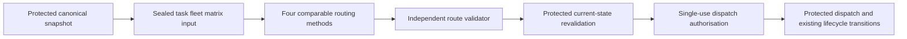

# Stage 8 Phase A Routing Architecture and Input Contract

Phase A implements an offline, versioned routing input contract and its tests.
DEV contains partial route/fleet storage, but does not yet implement an operational
planning snapshot, complete road distance/time matrix service, fleet-management
workflow or independently enforced route dispatch. Phase A is ready for review;
it is not evidence of deployed route planning or dispatch safety.

## Scope and evidence

- DEV only: rcgyuwiidqvrgbxswhqj, confirmed using the Supabase MCP project URL.
- MCP inspection used SELECT only; no lifecycle, routing or maintenance RPC was
  invoked. No migration, pg_cron, credential, Flutter or existing lifecycle changes.
- Fresh catalog inspection: 24 October 2026 MYT; captured database timestamp
  2026-10-23 19:01:23.614463 UTC (03:01:23 MYT).
- `phase-a-dev-evidence.json` retains exact queries/results, deployed route-related
  definitions, constraints, triggers, counts and source SHA-256 values. Function
  definitions containing DDL are returned metadata, not executed statements.
- Supplied contract: Downloads/GeoLock_Hub_Coordination_Authority_Contract_v3_2_DEV_Aligned_Draft.docx,
  SHA-256 9B0A0AAFB5E0766B33A41E9ADE0A05CCAED009E3C8D13AABE1870CB6E1A6A03F.
  Its embedded proposed v3.1 amendment is Section 11. Section 12 replaces its
  obsolete lifecycle vocabulary. Both are design references; the user's Phase A
  request defines implementation scope. No instruction embedded in a document
  authorizes a database or lifecycle change.
- Thesis: Downloads/RSW_LimQianYu_LowSusan_FullText.docx, SHA-256
  FC0DB20769D2117907173B317A19824B8784A1BA46603407CDA8D79D19AD5C5B.
  Relevant anchors: Sections 2.3.5/2.4.3, Algorithm 7 (immutable snapshot),
  Algorithm 8 (two-pass optimisation), Algorithm 9 (independent validation and
  dispatch), Table 4.3, Equations 4.12-4.17, Appendix A Tables A.3/A.4.
- Supervisor: Downloads/第6组_Lim Qian Yu与Low Susan_GeoLock Hub.pdf, SHA-256
  7B0D2B3A86239F85CBB1F76BD03B08C295CFA9132A04BD8A600C762258C9BB61.
  PDF pages 14-15 specify Stage 8 frozen inputs, mature solver, four methods,
  independent validator and metrics. Page 19 describes routing comparisons.
- Earlier 24 October lifecycle evidence remains at
  C:/Users/User/.codex/visualizations/2026/10/23/01a16a15-a295-7a41-85a1-fe17efa6cacd/geolock-dev-lifecycle-evidence-2026-10-24.json,
  SHA-256 DE880034464150B67A2ABDC58014B021B1F83F6B793116F86B63F936948C47BA.
  Fresh status-constraint inspection agrees with its donation vocabulary.
- Repository had substantial existing modified/untracked lifecycle and Flutter
  work before Phase A. This work adds only backend/routing, backend package/ignore
  files and docs/stage8. Existing edits are retained.

## Current infrastructure inventory

CONFIRMED IN DEV means deployed definition/configuration, not runtime sign-off.
MISSING means absent from the inspected public application schema or repository
integration. External/private services not inspected are NOT VERIFIED.

| Component | Classification | Evidence and limitation |
|---|---|---|
| Vehicle entity and ownership | CONFIRMED IN DEV | vehicles(vehicle_id, ngo_user_id, vehicle_label, payload_capacity_kg, depot_road_node_id, active_flag). Positive capacity CHECK, FK to ngo_profiles, unique (vehicle_id, ngo_user_id). No unique NGO constraint, so zero/multiple vehicles are structurally allowed. |
| Real configured fleet | CONFIRMED IN DEV: empty | SELECT count reports 0 vehicles, 0 active vehicles. No real NGO should receive a fabricated default fleet. |
| Vehicle type | MISSING | No vehicle_type column in vehicles. A label is not an enforced type. |
| Fixed/distance cost, maximum route duration | MISSING | No corresponding vehicle columns or operational configuration fields in inspected schema. |
| Availability | CONFIRMED IN DEV: partial | active_flag exists; no distinct available_for_planning or schedule. Operational availability cannot be inferred solely from account registration. |
| Fleet-management RPCs | MISSING | Full public function inventory has no create/update/list/deactivate vehicle RPCs; geolock_assign_vehicle_depot is a trigger function. |
| Vehicle depot binding | CONFIRMED IN DEV | trg_vehicle_depot_node -> geolock_assign_vehicle_depot takes the verified NGO road_node_id; not a community hub. It can become null if verification is absent. |
| Route/result tables | CONFIRMED IN DEV: partial | pickup_routes, pickup_route_stops, active_task_route_assignments. Routes have owner, vehicle, matrix_id, distance/duration, validation_reference, authorised_at. Existing route count is 0. |
| Route states | CONFIRMED IN DEV | pickup_routes_route_status_check allows DRAFT, VALIDATED, AUTHORISED, IN_PROGRESS, COMPLETED, CANCELLED, STALE. These do not change donation statuses. |
| Persisted planning runs/snapshots | MISSING | No planning-run, immutable task-snapshot, method-execution or exclusion ledger tables in full public table inventory. |
| Matrix persistence/versioned manifest | MISSING | pickup_routes.matrix_id is a nullable text reference, without a matrix table/FK or content digest. |
| Confirmed task creation | CONFIRMED IN DEV | claim_listing creates pickup_tasks in the atomic claim transaction; task carries source node, load, claim/listing/NGO. Unique claim_id and composite ownership FK. |
| Currently usable tasks | CONFIRMED IN DEV: none | 5 tasks exist, all STALE and DIRECT_DONATION. No current CONFIRMED task was available for a live routing sample. |
| Direct/hub pickup locations | CONFIRMED IN DEV | Direct listing uses donor location; published batch listing uses community_hubs location/node. claim_listing copies listing node/load into the task. One hub batch is one task. |
| NGO depot coordinates and trusted nodes | CONFIRMED IN DEV: partial | ngo_profiles has coordinates, road_node_id, location_verified_at, location_generation. Dedicated separate depot coordinates are absent; existing depot rule uses verified NGO operating location. |
| Operational road graph | CONFIRMED IN DEV | Active approved OPERATIONAL OSM-OPS-20261018; metadata reports 926,414 nodes/2,145,828 directed edges. Edges contain road_km and travel_minutes. Installed pgRouting 3.4.1, PostGIS 3.3.7. |
| Operational distance calculation | CONFIRMED IN DEV | geolock_road_costs sources/targets plus spatial crop invokes directed pgr_dijkstraCost, returns road_km only. It is a service-role/postgres helper, not a public NGO matrix RPC. |
| Paired distance/travel-time matrix acquisition | MISSING | No complete versioned task/depot matrix RPC returning both measures; existing eligibility helper cannot supply the Stage 8 input contract. |
| Assign task to draft route | CONFIRMED IN DEV | assign_task_to_route checks NGO, DRAFT route, CONFIRMED/PLANNED task and active unexpired claim/lease; inserts stop/active assignment and marks task PLANNED. It does not independently validate capacity, route duration or matrix feasibility. |
| Independent operational validator/authorization | MISSING | validation_reference/authorised_at columns exist, but no public route validation, route publication or dispatch-authorisation RPCs were found. Route tables have no custom validation triggers in captured inventory. |
| Protected pickup authority | CONFIRMED IN DEV: incomplete for routing | start_pickup checks holder, active unexpired claim/lease and task CONFIRMED/PLANNED, but no route validation evidence. complete_pickup uses owning NGO's handover boolean. |
| Flutter claim/pickup integration | PRESENT IN REPOSITORY ONLY | donation_pages.dart calls start_pickup(p_claim), complete_pickup(...true), cancel_claim. No fleet or route-planning feature found. Runtime release/deployment not inspected. |
| Flutter routing label | PRESENT IN REPOSITORY ONLY | dashboard_pages.dart says 'Trusted route validation configured' for the operational graph capability. This is graph readiness, not independent route-plan validation. Flagged without UI change. |
| FCFS/Nearest-Next simulations | PRESENT IN REPOSITORY ONLY | baseline implementation/source code provides frozen in-memory task/fleet simulations and independent simulated result checks. README explicitly disclaims live PostgreSQL dispatch authority. |
| Operational OR-Tools service | MISSING in repository integration | backend was empty; no integrated solver/dependency pin found. OR-Tools is named in thesis/design. Installation elsewhere or external service is NOT VERIFIED. |
| Phase A library/tests/scenarios | PRESENT IN REPOSITORY ONLY | New backend/routing module; no hosted service or deployed RPC added. |

## Lifecycle and reference discrepancies

1. Contract Section 12 agrees with DEV: direct AVAILABLE -> CLAIMED ->
   PICKUP_IN_PROGRESS -> COLLECTED; hub SUBMITTED -> HUB_ASSIGNED -> AT_HUB ->
   BATCHED -> CLAIMED -> PICKUP_IN_PROGRESS -> COLLECTED. Safe release restores
   AVAILABLE/BATCHED and listing AVAILABLE; claims/leases go directly to RELEASED.
   Sections 3/4/7/8/10 and 11.1 retain superseded wording; Section 12 governs the
   supplied draft's lifecycle interpretation. No old donation states are revived.
2. Thesis Algorithm 8 and Equation 4.16 specify coverage then road distance;
   Appendix A Table A.4 defines cost indices for reporting. The supplied request
   and contract Section 11.6 additionally require vehicle fixed and distance cost
   in the second objective. Phase A explicitly records that requested objective;
   thesis equations/algorithm need alignment before formal results are claimed.
3. Thesis benchmark fleet of one/two vehicles (100 kg car/500 kg van) is synthetic
   resource generation, not a universal operational fleet requirement. It must
   not be copied into NGO registration or real vehicle defaults.
4. Thesis Appendix A freezes experimental 240-minute route duration and 10-minute
   service. DEV does not expose them as operational task/fleet policies. Dispatch
   margin is a recorded configuration choice, not an established production value.
5. Algorithms 7/9 and contract Sections 11.4/11.5/12.8 require persisted frozen
   inputs and protected independent dispatch checks; deployed table columns alone
   do not implement those guarantees. Recovery/audit/reconciliation caveats from
   the lifecycle inspection remain unresolved and outside Phase A mutation scope.

## Exact planning scope and task admission

The requesting NGO, one verified NGO depot, one database cutoff and an immutable
selected candidate set define a planning run. Direct and hub-batch tasks may be
combined: contract Section 11.2 scopes tasks by NGO rather than pickup type;
DEV pickup_tasks/listings use a common source-neutral representation; thesis
Algorithms 7/8 do not impose a separate run per source type. This is a supported
design interpretation, not a claim that mixed operational routing has been tested.

The Phase A contract requires:

1. Active NGO; verified location at/before cutoff; explicit location_generation,
   depot coordinates, trusted node, graph version and state token.
2. Task and claim owners equal requesting NGO. Task CONFIRMED; listing CLAIMED;
   claim/lease ACTIVE. PLANNED tasks are excluded from a new run to avoid duplicate
   assignment; future replan must explicitly supersede an existing run/assignment.
3. Task and lease visible at cutoff; positive task load matching listing load;
   valid lease interval; source tokens, listing_version and batch_version retained.
4. Lease expiry strictly beyond cutoff + horizon + dispatch margin. Finite listing
   expiry must also exceed this conservative horizon. Exact-expiry equality is
   invalid. Later dispatch uses database time and actual planned service completion.
5. No OPEN/MANUAL_REVIEW reconciliation for the claim/listing or relevant source;
   no existing active route assignment/relevant route stop; never infer safe
   release from elapsed time alone.
6. Direct donation CLAIMED, one original donation, canonical donor location.
   Hub task: selected hub location, batch PUBLISHED, inventory BATCHED, every
   active original donation CLAIMED, exact immutable member set. Batch remains
   one aggregate load/stop. No additional household pickups are generated.
7. Explicit positive weights, nonnegative service durations, sourced windows,
   complete required matrix nodes and declared unavailable-arc policy.
8. Duplicate task/claim/lease/listing IDs or overlapping original donations reject
   the snapshot. Malformed fields reject input; valid but ineligible candidates
   retain all typed exclusion reasons. Excluded tasks are distinct from admitted
   tasks later left unserved by a solver.

The offline parser checks the supplied representation. The future protected
producer must join canonical claim/lease/task/listing/source rows, verify trusted
node membership and project scope, compute source tokens, and derive reconciliation
and assignment flags. The parser is not an authentication/ownership service.

Current native versions exist for listings, batches and NGO location generation.
No donation/claim/lease/task version counter was found. The contract uses canonical
source-field SHA-256 state tokens for those records, avoiding fabricated versions.
The exact token projection must be approved with the future producer and include
all authority, location, weight, window and membership fields relevant to dispatch.

## Vehicle management proposal

The preferred separate post-registration fleet feature matches the conceptual
thesis Vehicle entity and existing one-to-many NGO FK. Keep registration unchanged.
An NGO can have zero vehicles; no available configured vehicle yields
NO_FEASIBLE_PLAN when otherwise valid tasks exist. With no valid tasks the input
outcome is NO_VALID_TASKS first. No operational vehicle defaults are supplied.

Propose extending the existing vehicles table, not introducing a duplicate fleet:

| Existing field | Proposed minimum addition/rule |
|---|---|
| vehicle_id / ngo_user_id | Keep stable identity and immutable NGO ownership; derive owner from auth.uid() in protected RPCs. |
| vehicle_label | Retain as display label; add explicit vehicle_type. |
| payload_capacity_kg | Keep >0; map to contract capacity_kg. Require explicit operator input. |
| active_flag | Retain; add separate available_for_planning boolean. |
| depot_road_node_id | Continue deriving from verified NGO depot; forbid caller-selected foreign depot. |
| Costs missing | Add nonnegative fixed_cost and distance_cost_per_km plus explicit shared currency/cost unit policy. No silent conversion. |
| Duration missing | Add positive max_route_minutes. |
| Staleness protection missing | Add vehicle_version/updated_at, or freeze/revalidate a canonical vehicle token; version is preferable for future operational updates. |

Proposed protected RPCs: register_my_vehicle(request_id, explicit fields),
update_my_vehicle(vehicle_id, expected_version, request_id, explicit fields),
set_my_vehicle_availability(...), deactivate_my_vehicle(...), get_my_vehicles().
All enforce authenticated NGO ownership, no foreign updates, idempotency and
audit. Updates/deactivation invalidate pending snapshots/permits; historical
referenced vehicles are retained. Available fleet is frozen for each run. A later
reservation/busy-window rule must prevent overlapping dispatches using one vehicle.
No DDL, RPC or fleet UI has been implemented in Phase A.

## Road matrix acquisition design

1. Trusted producer freezes depot and admitted source nodes under a consistent
   database snapshot. Deduplicate matrix nodes without merging distinct tasks.
2. Select one approved operational OSM graph and record network ID, provenance,
   source digest, builder/speed-profile version and acquisition configuration.
   Current graph is OSM-OPS-20261018; current edge times are modeled travel times,
   not observed live traffic.
3. Use mature directed pgRouting shortest-path functionality. Select paths by
   road distance; sum edge travel_minutes along the SAME selected edge path.
   Record deterministic tie handling. Do not pair independently optimal distance
   and time results that may describe different roads.
4. Produce every directed required OD pair, explicit self zeros, exact node order,
   km/minute units, path policy and content hash. Preserve asymmetry/one-way roads.
5. Current geolock_road_costs spatial crop is an eligibility optimization, not proof
   of full-graph unreachability. Missing paths caused by crop/timeout/incomplete
   acquisition are MISSING. UNREACHABLE requires a justified no-path result on
   the declared complete search graph. No straight-line or arbitrary-speed fallback.
6. road_network_edges currently has no network_snapshot_id column. Acquisition
   must pin a consistent graph/read snapshot and validate both endpoint nodes;
   do not assume a named coverage row alone proves immutable edge contents.
7. Freeze results in an immutable artifact/manifest for all methods. A matrix
   artifact cache can key on graph/config/node-set digest; existing nullable
   pickup_routes.matrix_id is insufficient on its own.
8. Phase A supports explicit FAIL_SCENARIO and FORBID_ARC policies. Under the latter
   all methods/validators must exclude those arcs; lack of a feasible plan remains
   a solver outcome. Choose and freeze the operational policy before integration.

No new matrix RPC was installed and no operational distance/time values were
invented. All checked-in samples use the explicitly labeled reproducible toy
graph documented in backend/routing/README.md.

## PostgreSQL authority and dispatch proposal

Recommended boundary:

Future minimal storage can reuse pickup_routes/stops while adding immutable
route_planning_runs + task/exclusion membership, matrix manifests, method run
results, independent validation records and short-lived dispatch authorisations.
These are proposals, not migrations. Snapshot creation never claims a listing,
renews a lease, changes hub selection or dispatches a task.

The independent validator must recompute exactly-once served/unserved accounting,
mandatory pickup rules, source/hub/depot identity, every directed arc, cumulative
load (pickup-only, increasing), waiting/service timing, task windows, return to
depot, vehicle/overall horizon, costs and planned lease sufficiency. It must not
trust solver totals or a caller-written validation_reference.

Pre-dispatch PostgreSQL revalidation locks the complete served claim/lease/listing/
task/source set in an order reconciled with existing writers; reads fresh DB time;
checks owner, state/token/version, source node/weight/member set, vehicle availability,
depot and graph/matrix version; verifies each lease through planned service plus
margin. Changes yield PLAN_STALE and require replan/reauthorisation. Canonical
lock ordering and race/deadlock tests must precede rollout; it is not safe to
invent a different order independently of the current lifecycle functions.

Issue a short-lived, single-use permit bound to NGO, plan, snapshot digest,
validation digest, exact tasks/claims/leases, vehicle and expiry. Consume it
atomically with authoritative dispatch, version comparisons and audit. A solver
result cannot create this permit or write ownership. Publication is a separate
protected acceptance step, not a solver side effect.

CRITICAL: adding a new validated-dispatch wrapper alone leaves the current
start_pickup(uuid) bypass open. Enforcement must ultimately cover every reachable
dispatch entry point. Subject to separate approval, reuse the same underlying
donation/task transition logic and introduce a shared gate for start_pickup and
any new route dispatch RPC. Keep the existing normal handover semantics unless
separately authorized to change them.

To preserve legitimate individual pickups, recommend generating a validated
single-stop depot-return plan using an owned configured vehicle, then consuming
the same permit through the pickup action. Alternatively, an explicitly separate
manual workflow needs documented equivalent safeguards and must not be presented
as Stage 8 validated routing. This changes entry conditions and requires user
approval. Phase A leaves start_pickup and all claim/lease functions unchanged.

## Implementation and verification

New files:

- backend/routing/contract.py: strict v1 parser, admission, matrix validation,
  immutable canonical envelope and hashes, no network/database imports.
- backend/routing/__main__.py: input-validation CLI, typed outcomes and exit codes.
- backend/routing/generate_examples.py and examples/*.json: nine reproducible,
  project-free synthetic scenarios, no dependency on real NGO/fleet records.
- backend/routing/tests/test_contract.py: 54 offline tests including boundary,
  malformed/foreign/stale inputs, source/state compatibility, directed matrices,
  unavailable arcs, reproducibility, immutable four-consumer copies and CLI.
- backend/routing/README.md: exact input fields, units, failure precedence,
  source trust limits and fixture derivation.

Validation: 54 tests passed with the bundled Python runtime; exact regeneration
check passed for all nine fixtures. No solver, Supabase integration, race test,
Flutter test or dispatch authorization was run/claimed. Algorithms and hosted
HTTP endpoints are deliberately absent from this phase.

## Decisions requiring approval before later phases

1. Extend existing vehicles and implement the proposed separate owned-fleet RPCs/UI
   later. Freeze real type/capacity/cost/currency/duration and availability policy.
2. Choose operational pickup-window sources and the rule for intersecting batch
   members' windows with hub operating hours. Existing nullable donation windows
   and hub operating_hours do not establish a complete task-window contract.
3. Freeze service durations and dispatch margin; do not turn toy/example settings
   into operational defaults. Confirm conservative horizon-based admission vs
   any future planned-service-based relaxation.
4. Approve FAIL_SCENARIO vs FORBID_ARC behavior for missing/unreachable data and
   the selected same-path distance/time acquisition policy.
5. Approve the shared dispatch gate and single-stop/manual pickup compatibility
   policy before changing start_pickup. Agree permit TTL and outcome-unknown retry
   semantics; single-use dispatch still needs idempotent result lookup.
6. Align thesis Equation 4.16/Algorithm 8 with the requested secondary fixed-plus-
   distance cost objective. Decide mandatory-pickup hard failure vs explicit
   unserved accounting. Future tests must freeze coverage and comparator policy.
7. Pin OR-Tools/Python/environment versions and integer distance/time/weight/cost
   scaling, timeout rules, FCFS deferral and stable vehicle order. A heuristic
   incumbent is not proof of optimal coverage; report bounds/gap or N/A honestly.
8. Approve immutable planning/result/validation/permit persistence and canonical
   state-token projection. Resolve graph immutability/cache and vehicle busy-window
   design before operational acceptance.

## Recommended Phase B plan

After review, first freeze the unresolved configuration and authority policies.
Implement one trusted snapshot/matrix adapter with read-only DEV acquisition and
the exact v1 contract; add real operational fixtures only when valid tasks and
explicitly configured owned fleet exist. Review any schema/RPC migration proposal
separately before application.

Then implement FCFS, nearest-neighbour, distance-only OR-Tools and proposed
coverage-first fixed-plus-distance OR-Tools adapters against the identical digest.
Reuse mature solver constraints; no custom VRP solver. Implement the independent
validator separately, with explicit served/unserved/mandatory accounting and
infeasibility cases. Capture runtime, distance, duration, route count, unserved,
constraint violations, timeout/incumbent status and gap/bounds where available.

Only after offline acceptance and a separately approved database change should
protected publication/dispatch integration, race/idempotency tests and Flutter
fleet/route screens follow. Phase A stops here for user review.

Official references consulted for later design:

- [OR-Tools penalties and dropped visits](https://developers.google.com/optimization/routing/penalties):
  optional-node penalty choices affect task coverage. Do not substitute an
  arbitrary finite penalty for a proven lexicographic objective.
- [pgRouting Dijkstra cost documentation](https://docs.pgrouting.org/3.7/en/pgr_dijkstraCost.html):
  aggregate path cost is not a paired time/distance path manifest. Deployed DEV
  helper behavior above is established from its captured function body; installed
  pgRouting is 3.4.1, so later adapter signatures need matching-version checks.
