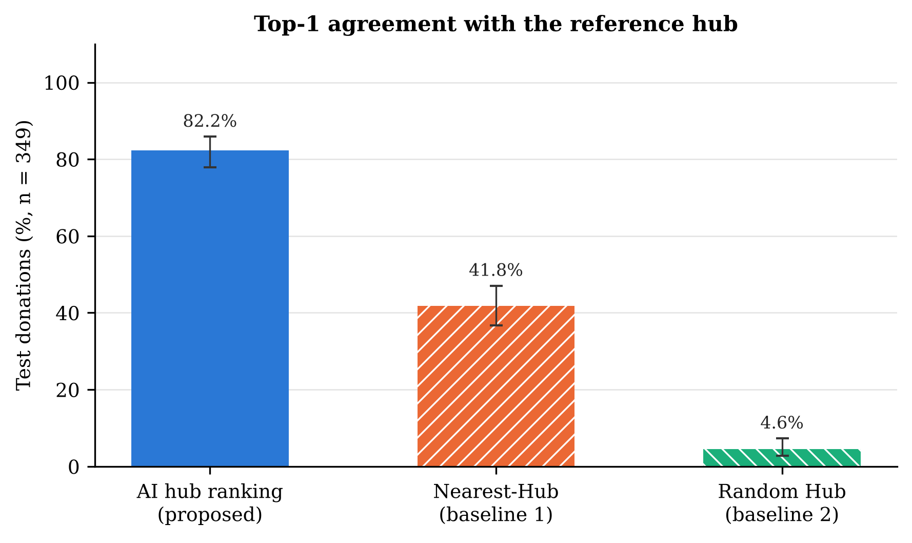
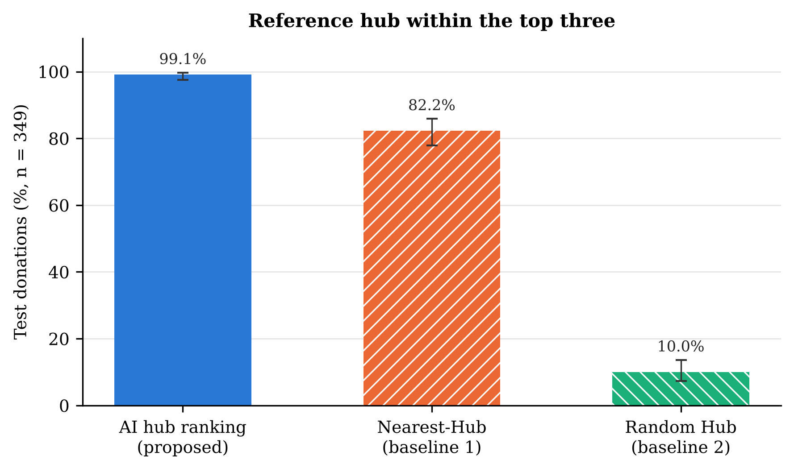
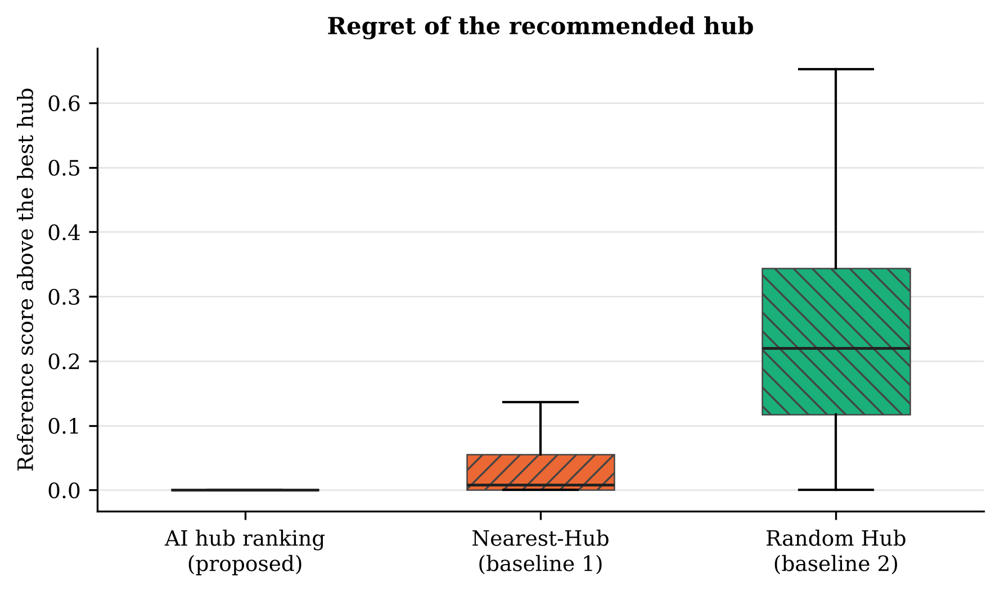

# E1 result: AI hub ranking vs Nearest-Hub

## What we wanted to find out

When a donor gives a small donation (under 10 kg), GeoLock Hub suggests a community hub for the drop off. The "right" hub is defined by a fixed reference policy that balances four things: road distance (45 %), how full the hub already is (20 %), how much free space is left (25 %) and how well the hub can store the item (10 %). The app uses an AI model to rank hubs in place of that formula. We wanted to know whether the AI picks the same hub as the reference policy for donations from areas it never saw while training, and whether it does this better than the obvious simple rule: "pick the nearest hub".

## What we used

- **Data:** the frozen benchmark dataset GEOLOCK-BENCHMARK-DATASET. The 349 test donations are the held out part of the frozen data split: they come from map areas that were not used to train the model.
- **Same input for every method:** each donation comes with its list of hubs that already pass the hard rules (accepts the item category, has enough space, is open during the drop off window, is active, can be reached by road). No method can recommend a hub outside that list.
- **Nearest-Hub (baseline 1):** sorts the hubs by road distance and recommends the closest one.
- **Random Hub (baseline 2, chance level):** recommends a random hub from the list (fixed seed), to show what guessing achieves.
- **AI hub ranking (proposed):** the frozen XGBoost model the app uses, ranked with the same code as the app's ranking API.

## Results

The main numbers are also in `comparison_summary.csv`, one row per measure with every method side by side.

| Method | Same hub as the reference | Reference hub in top 3 | Median road distance to the recommended hub |
| --- | --- | --- | --- |
| **AI hub ranking (proposed)** | 287 of 349 (82.2%) | 346 of 349 (99.1%) | 4.15 km |
| Nearest-Hub (baseline) | 146 of 349 (41.8%) | 287 of 349 (82.2%) | 2.79 km |
| Random Hub (chance level) | 16 of 349 (4.6%) | 35 of 349 (10.0%) | 12.60 km |

*Figure 1. Top-1 agreement with the reference hub on the 349 held out test donations. Error bars show 95 % Wilson confidence intervals.*

*Figure 2. Share of test donations whose reference hub is among the method's top three hubs. Error bars show 95 % Wilson confidence intervals.*

*Figure 3. Regret of the recommended hub: its reference score minus the best score among the feasible hubs (0 means the best hub). Boxes show the quartiles, whiskers 1.5 times the interquartile range.*

## Analysis

**The AI is clearly better than the Nearest-Hub rule.** It chose the reference hub for 82.2% of the test donations, against 41.8% for Nearest-Hub: 40.4 percentage points more, or about 2.0 times as often. The 95 % confidence intervals do not overlap (77.9% to 85.9% vs 36.8% to 47.1%).

**The difference is not luck.** Looking at the same donations side by side, the AI was right and Nearest-Hub wrong in 164 donations, while the opposite happened in only 23 (exact McNemar test, p = 2e-27).

**When the AI misses, it misses by very little.** For 99.1% of donations the reference hub was still in its top three, and its average regret is 0.0016 against 0.0312 for Nearest-Hub (Figure 3). The ranking quality score NDCG@3 tells the same story: 0.996 vs 0.931.

**Why the nearest hub is often not the right hub.** The nearest hub is frequently already full or poorly equipped for the item. The reference policy accepts a slightly longer drive to avoid that: its chosen hub is a median 3.83 km away, compared with 2.79 km for the nearest hub. The AI learned this trade off (median 4.15 km), which is why it agrees with the reference much more often.

**Where the AI and the reference policy differ.** They chose a different first hub for 62 of 349 donations. In those cases the reference hub was still in the AI's top three 59 times, the median regret was 0.0048 and the AI's hub was a median 1.19 km further than the reference hub. The AI picked the same hub as Nearest-Hub for only 128 of 349 donations, so it does not rank by distance alone. No method recommended a hub outside the feasible list: every ranking was checked to contain exactly the hubs that pass the hard rules.

**Random choice performs badly** (4.6%), which confirms the task is not trivial: with a median of 36 feasible hubs per test donation, guessing almost never finds the right one.

## Check before the experiment: the 10 kg rule

The benchmark's 8 fixed weight cases were checked against the app's collection rule (missing or 0 kg is invalid, under 10 kg goes to a community hub, 10 kg or more is a direct household pickup). 8 of 8 gave the expected result, so only small donations reach the hub recommendation step.

| Case | Weight (kg) | Expected | Rule result |
| --- | --- | --- | --- |
| WT-01 | (empty) | INVALID_WEIGHT | INVALID_WEIGHT |
| WT-02 | -1 | INVALID_WEIGHT | INVALID_WEIGHT |
| WT-03 | 0 | INVALID_WEIGHT | INVALID_WEIGHT |
| WT-04 | 0.5 | COMMUNITY_HUB | COMMUNITY_HUB |
| WT-05 | 9.9 | COMMUNITY_HUB | COMMUNITY_HUB |
| WT-06 | 10 | DIRECT_HOUSEHOLD | DIRECT_HOUSEHOLD |
| WT-07 | 10.1 | DIRECT_HOUSEHOLD | DIRECT_HOUSEHOLD |
| WT-08 | 30 | DIRECT_HOUSEHOLD | DIRECT_HOUSEHOLD |

## Conclusion

On donations from unseen areas, the AI hub ranking reproduces the reference hub choice 82.2% of the time, far more often than choosing the nearest hub (41.8%), and when it differs it usually picks a hub that is almost as good. The proposed method performs better than the baseline on every measure in this experiment.

## Limits of this experiment

- The weighted deterministic policy is the reference target here, not a separate baseline (as in the report). The AI is trained to imitate it, so this experiment shows how faithfully it does that; it does not show that the AI is better than the weighted policy itself.
- Hub load, capacity and storage come from the synthetic part of the benchmark, and each hub's state is the same for every donation (it is not used up as donations arrive).
