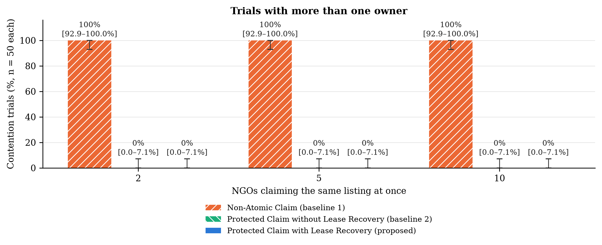
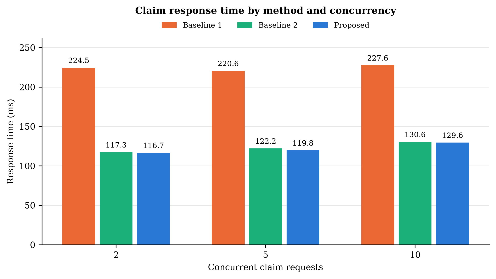
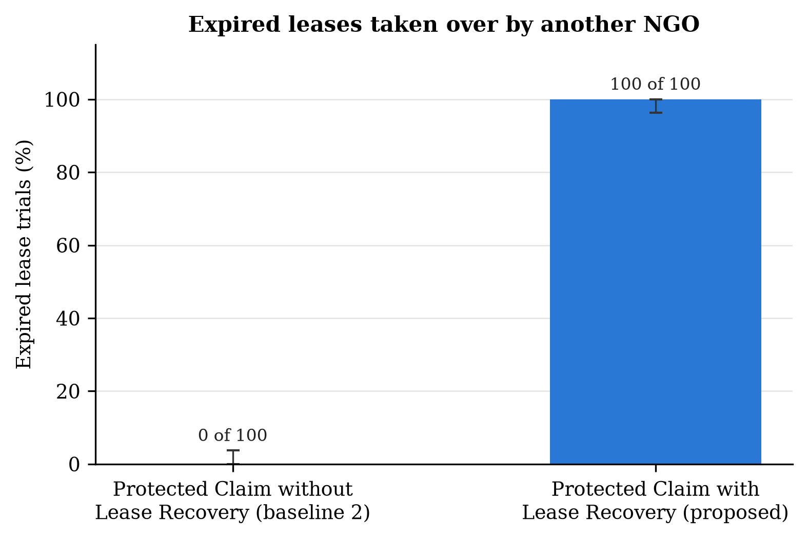
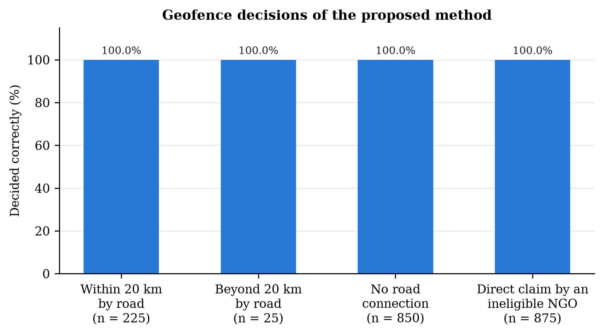

# E2 result: protected claim and lease recovery

## Contention: three primary methods

All three methods used the same 150 frozen contention scenarios: 50 each with 2, 5, and 10 concurrent requests (850 requests per method). Request count is not a count of distinct NGO identities; the frozen scenario NGO pool may be reused when request count exceeds the number of eligible identities.

| Method | Duplicate trials / 150 (95% Wilson CI) | SUCCESS | CONFLICT | ERROR | 40P01 | 40001 | Median of scenario medians (ms) | Pooled P95 (ms) |
| --- | ---: | ---: | ---: | ---: | ---: | ---: | ---: | ---: |
| Non-Atomic Claim | 150/150 (100.0%; 97.5% to 100.0%) | 850 | 0 | 0 | 0 | 0 | 225.1 | 253.2 |
| Protected Claim, no lease recovery | 0/150 (0.0%; 0.0% to 2.5%) | 150 | 700 | 0 | 0 | 0 | 124.8 | 408.7 |
| Protected Claim with lease recovery (proposed) | 0/150 (0.0%; 0.0% to 2.5%) | 150 | 700 | 0 | 0 | 0 | 122.8 | 360.6 |

### Contention by concurrent request level

| Requests at once | Method | Trials | Duplicate trials (95% Wilson CI) | SUCCESS | CONFLICT | ERROR | Median of scenario medians (ms) |
| ---: | --- | ---: | ---: | ---: | ---: | ---: | ---: |
| 2 | Non-Atomic Claim | 50 | 50 (100.0%; 92.9% to 100.0%) | 100 | 0 | 0 | 224.5 |
| 2 | Protected Claim, no lease recovery | 50 | 0 (0.0%; 0.0% to 7.1%) | 50 | 50 | 0 | 117.3 |
| 2 | Protected Claim with lease recovery (proposed) | 50 | 0 (0.0%; 0.0% to 7.1%) | 50 | 50 | 0 | 116.7 |
| 5 | Non-Atomic Claim | 50 | 50 (100.0%; 92.9% to 100.0%) | 250 | 0 | 0 | 220.6 |
| 5 | Protected Claim, no lease recovery | 50 | 0 (0.0%; 0.0% to 7.1%) | 50 | 200 | 0 | 122.2 |
| 5 | Protected Claim with lease recovery (proposed) | 50 | 0 (0.0%; 0.0% to 7.1%) | 50 | 200 | 0 | 119.8 |
| 10 | Non-Atomic Claim | 50 | 50 (100.0%; 92.9% to 100.0%) | 500 | 0 | 0 | 227.6 |
| 10 | Protected Claim, no lease recovery | 50 | 0 (0.0%; 0.0% to 7.1%) | 50 | 450 | 0 | 130.6 |
| 10 | Protected Claim with lease recovery (proposed) | 50 | 0 (0.0%; 0.0% to 7.1%) | 50 | 450 | 0 | 129.6 |

### Paired duplicate-ownership tests

| Pair | Only first method has duplicate ownership | Only second method has duplicate ownership | Exact McNemar p |
| --- | ---: | ---: | ---: |
| b1 vs b2 | 150 | 0 | 1.4013e-45 |
| b1 vs p | 150 | 0 | 1.4013e-45 |
| b2 vs p | 0 | 0 | 1 |

The test uses each shared contention scenario as its paired unit.

*Figure 1. Duplicate-ownership trial rates by method and concurrency; whiskers show 95% Wilson intervals.*

*Figure 2. Claim response time by method and concurrency. Each bar represents the median of 50 contention-trial medians, measured in milliseconds.*

## Lease recovery comparison

Lease checks are separate from contention: both protected methods use 100 expired-lease cases and 25 active-lease controls. The non-atomic method has no lease mechanism and is not included in this comparison.

| Measure | Protected, no recovery | Proposed, with recovery |
| --- | ---: | ---: |
| Expired leases recovered (/100) | 0/100 | 100/100 |
| Active leases incorrectly released (/25) | 0/25 | 0/25 |
| Exact paired McNemar p | 1.57772e-30 |

*Figure 3. Expired-lease recovery with 95% Wilson intervals.*

## Additional proposed-method checks

- Request replay returned the same answer in 150/150 contention trials.
- Repeated recovery released nothing additional in 125/125 lease cases.
- Stale holder was refused in 100/100 expired cases.
- Concurrent recovery passed: True.
- Geofence decisions correct: 1100/1100; direct ineligible claims refused: 875/875.

## Reproducibility notes

- Frozen benchmark: GEOLOCK-BENCHMARK-DATASET; input hashes are recorded in each method manifest.
- Database metadata: verified isolated Supabase E2 target (see manifests; credentials are not recorded here).
- Baseline 1 deliberately synchronizes its read step before its write step to expose the non-atomic race.
- Retry behavior remains one retry using the same request ID after SQLSTATE 40P01 or 40001; every observed SQLSTATE is retained in request records.
- Lease expiry is simulated from frozen claim-state timestamps; recovery is invoked directly for this controlled test.
- Request counts at concurrency levels 5 and 10 may reuse NGO identities from the scenario’s eligible NGO pool.

**Assessment: SUPPORTED.**
