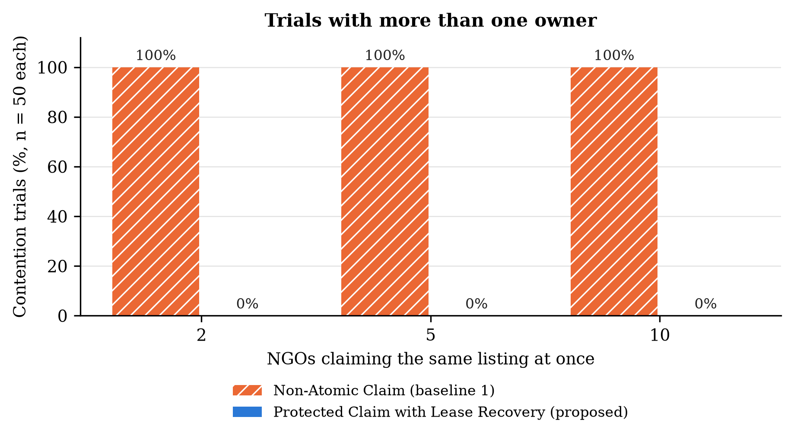
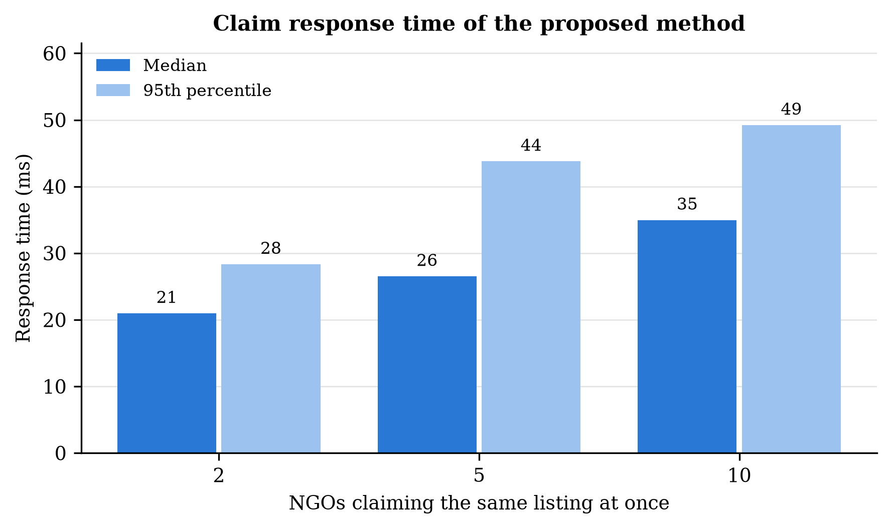
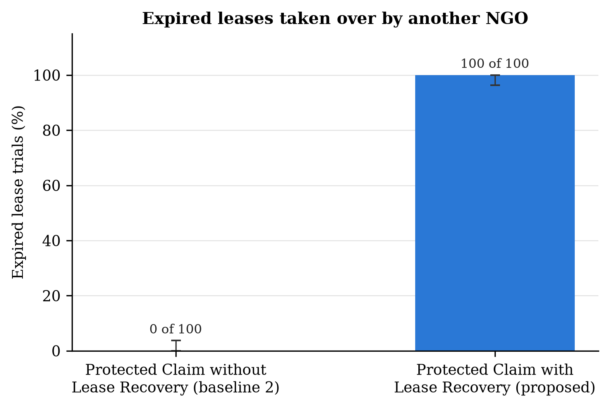
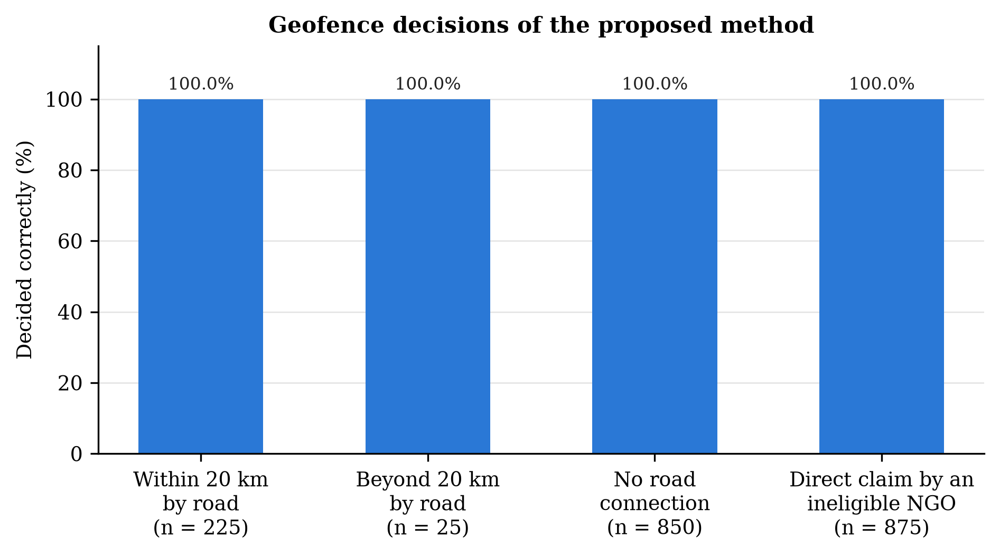

# E2 result: safe claiming and lease recovery

## What we tested

E2 answers two questions about the GeoLock claim functions that the Flutter app calls.

1. **Contention.** Several NGOs press "Claim" on the same donation at the same time. Does exactly one of them get it?
2. **Lease recovery.** An NGO claims a donation and never comes. Is the donation released after its 6 hour lease, so another NGO can take it, without ever taking away a claim that is still valid?

Each question has its own baseline (report Table 3.6). Each baseline removes one protection of the proposed method, so the comparison shows what that protection does.

| Condition | How a claim is made | Expired leases | Compared in |
| --- | --- | --- | --- |
| Non-Atomic Claim (baseline 1) | two separate steps: check "is it still available?", then save. No lock, no second check, no one claim rule | not used | part 1 |
| Protected Claim without Lease Recovery (baseline 2) | the app's `claim_listing()` | never released | part 2 |
| **Protected Claim with Lease Recovery (proposed)** | the app's `claim_listing()`: locks the donation, checks again, allows one active claim only | released by the app's `recover_expired_claims()` | parts 1 and 2 |

## Setup

* **Data:** the frozen benchmark dataset GEOLOCK-BENCHMARK-DATASET: 150 contention scenarios, 125 lease scenarios and 1,100 NGO and donation pairs for the geofence check.
* **Database:** separate experiment only Supabase project. Never the app's own Supabase project. The claim and recovery functions are copied unchanged from the live app. Each condition starts from a freshly rebuilt database.
* **Contention setting:** 50 trials each with 2, 5 and 10 NGOs. Each NGO has its own connection and a barrier releases all requests of a trial together. READ COMMITTED isolation, one retry after a deadlock, time limits of 15 s to connect, 30 s per statement and 60 s at the barrier.

## Results

The main numbers are also in `comparison_summary.csv`, one row per measure.

### 1. Contention: baseline 1 against the proposed method

Each trial is one new donation that 2, 5 or 10 NGOs claim at the same time. The trial fails if more than one claim is saved in the database.

| NGOs at once | Trials | Baseline 1: trials with more than one owner | Proposed: trials with more than one owner |
| --- | --- | --- | --- |
| 2 | 50 | 50 (100.0%) | 0 (0.0%) |
| 5 | 50 | 50 (100.0%) | 0 (0.0%) |
| 10 | 50 | 50 (100.0%) | 0 (0.0%) |
| **All** | 150 | 150 (100.0%) | 0 (0.0%) |

| All 850 requests | Baseline 1 | Proposed |
| --- | --- | --- |
| Told "you got it" | 850 | 150 |
| Told "already claimed" | 0 | 700 |
| Failed with an error | 0 | 0 |
| Extra claims saved beyond one owner | 700 | 0 |
| Attempts recorded in the audit log | 0 | 850 |
| Response time, median | 38 ms | 30 ms |

*Figure 1. Share of contention trials that ended with more than one saved owner, by number of NGOs claiming at once (50 trials per bar).*

*Figure 2. Response time of `claim_listing()` in the proposed method: median and 95th percentile over all requests at each contention level.*

### 2. Lease: baseline 2 against the proposed method

Each trial is a donation that one NGO claimed earlier. In 100 trials that NGO's 6 hour lease has run out, in 25 it is still running. A second NGO then tries to claim the donation.

| Earlier claim | Trials | Second NGO got it: baseline 2 | Second NGO got it: proposed | Right outcome |
| --- | --- | --- | --- | --- |
| lease expired (NGO never came) | 100 | 0 | **100** | the second NGO gets it |
| lease still valid | 25 | 0 | **0** | the first NGO keeps it |

*Figure 3. Share of the 100 expired lease trials in which another eligible NGO took the donation over. Error bars show 95 % Wilson confidence intervals.*

### 3. Extra checks of the proposed method

These checks have no baseline. They test that the proposed method also handles the harder cases named by the supervisor and the authority contract.

| Check | Result |
| --- | --- |
| Same request ID sent again | first answer returned, nothing new saved in 150 of 150 trials |
| One claim held open for 1 s while a second NGO claims | exactly one claim saved in 50 of 50 trials |
| Recovery run again right after | released nothing more in 125 of 125 trials |
| Old holder claims again after its lease expired | refused in 100 of 100 trials |
| Two recovery jobs at the same moment on 100 expired claims | each claim released exactly once: yes |
| Geofence: NGO within 20 km by road may claim | 1,100 of 1,100 pairs decided correctly |
| Ineligible NGO calls `claim_listing()` directly | refused 875 of 875, 0 claims saved |

*Figure 4. Geofence decisions of the proposed method by type of NGO and listing pair, and direct `claim_listing()` calls by ineligible NGOs that were refused.*

## Analysis

**Without an atomic claim, every race ends with several owners.** In baseline 1 every NGO saw "available" before anyone saved a claim, so all 850 requests were told "you got it". All 150 trials ended with more than one owner and 700 extra claims were saved. Two NGOs are already enough for this.

**The proposed claim keeps exactly one owner.** None of its 150 trials ended with more than one owner (95 % confidence interval 0.0% to 2.5%; exact McNemar test against baseline 1, p = 1e-45). Each trial had one "you got it" and the other NGOs were told "already claimed" (150 and 700 answers, 0 errors), and the answers always matched what was saved. Every attempt was written to the audit log (850 of 850); baseline 1 left no record.

**The protection is quick.** The median answer took 30 ms and 95 % came within 47 ms, even with 10 NGOs at once. These times include the internet delay to Supabase.

**Without lease recovery, abandoned donations stay blocked.** In baseline 2 none of the 100 expired claims was released, so 100 donations could never be collected. With recovery all 100 were released and taken over by another NGO (exact McNemar test, p = 2e-30), and none of the 25 valid claims was touched.

## Conclusion

The proposed method never let two NGOs own the same donation (0 of 150 trials, against 150 of 150 for baseline 1), and it released every abandoned claim (100 of 100, against 0 for baseline 2) without touching a valid one. It is better than both baselines on the outcome each baseline was built to test, and it passed every extra check.

## Limits of this experiment

* In baseline 1 every NGO finishes its check before any NGO saves, the worst case for a check then save design. With real timing some NGOs would see "already claimed". The test shows that duplicates are possible, not how often they happen in daily use.
* Lease expiry is simulated by giving the earlier claim an older start time, and recovery runs right before the second NGO claims instead of on the scheduler's timer.
* The geofence uses the benchmark road distance, not the app's live road network cache.
* Each contention scenario has 2 to 4 nearby NGOs, so with 5 or 10 requests some NGOs send more than one request.
