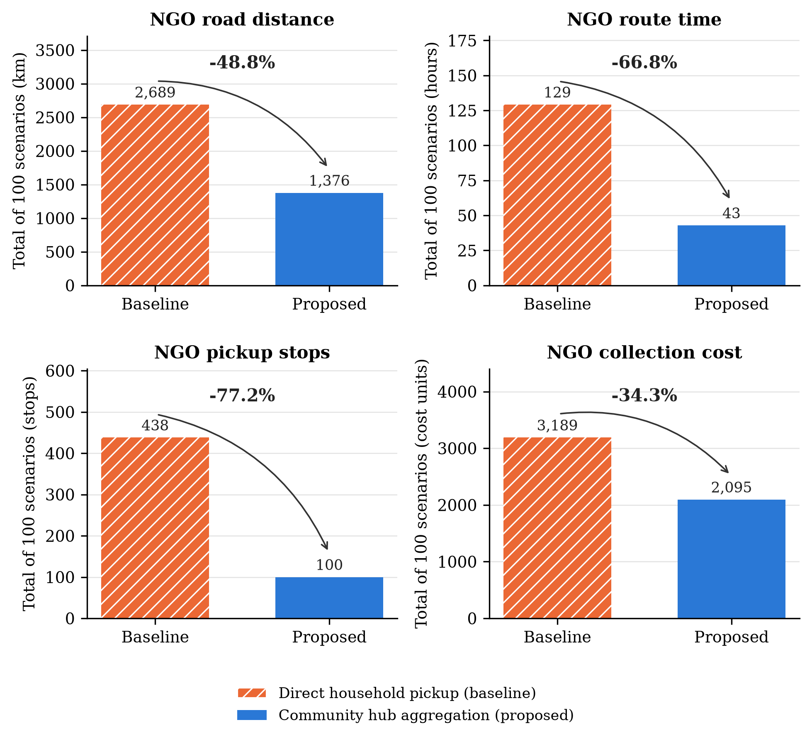
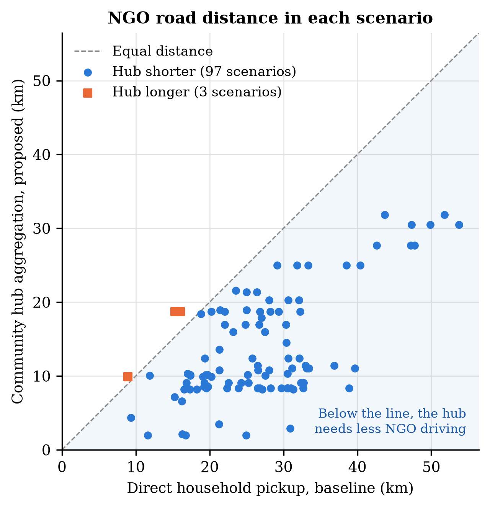
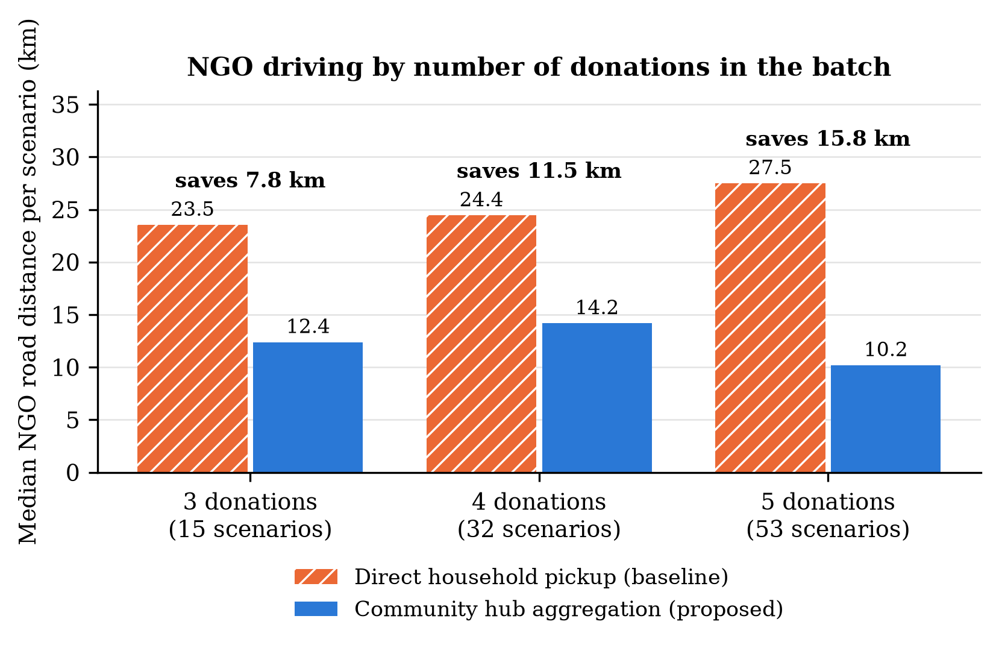

# E3 result: community hub aggregation vs direct household pickup

Plan: [`../EXPERIMENT_PLAN.md`](../EXPERIMENT_PLAN.md). 100 matched scenarios, 438 small donations, 11 NGOs. Both methods use the same route planner, vehicles, depot and roads.

## Main result: the proposed method is better on every NGO measure

| NGO measure (total of 100 scenarios) | Baseline | Proposed | Change (95 % CI) | Proposed better in | p |
| --- | --- | --- | --- | --- | --- |
| NGO road distance (primary) | 2,689.4 km | **1,376.2 km** | -48.8 % (-52.8 to -44.7) | 97 of 100 | 6.7e-18 |
| NGO route time, including 10 min per stop | 7,749 min | **2,571 min** | -66.8 % (-68.6 to -64.9) | 100 of 100 | 7.8e-18 |
| NGO pickup stops | 438 stops | **100 stops** | -77.2 % (-77.9 to -76.4) | 100 of 100 | 1.9e-18 |
| NGO collection cost | 3,189.4 cost units | **2,095.2 cost units** | -34.3 % (-37.7 to -30.7) | 94 of 100 | 2.4e-17 |
| Donations collected | 438 of 438 | 438 of 438 | same | | |
| Hub batches passing every rule | | 100 of 100 | | | |

p is the Wilcoxon signed rank test on the 100 paired differences (Holm corrected for the secondary measures).

*Figure 1. Totals of both methods over the 100 scenarios. The proposed method is lower on all four NGO measures.*

## Analysis

**The decision rule is met.** Total NGO road distance fell from 2,689.4 to 1,376.2 km (-48.8 %, p = 6.7e-18) and every donation was still collected. The typical saving was 13.10 km per scenario (95 % CI 11.54 to 14.66 km).

**The saving appears in almost every scenario, not only on average.** The hub needed less NGO driving in 97 of 100 scenarios (Figure 2), and route time was lower in all 100.

*Figure 2. Each point is one scenario. Points in the shaded area are scenarios where the hub needed less NGO driving.*

**Why it works.** One stop at the hub replaces three to five stops at homes, so NGO stops fell from 438 to 100 and route time from 129.2 to 42.8 hours. A vehicle collected 10.2 donations per hour of route time instead of 3.4. A fuller batch removes more home stops, so the saving grows with the batch size (Figure 3): 7.8 km for 3 donations, 11.5 km for 4 donations, 15.8 km for 5 donations (Spearman ρ = 0.37, p = 1.7e-04; Kruskal-Wallis p = 7.7e-04).

*Figure 3. Median NGO road distance per scenario for batches of 3, 4 and 5 donations, with the median saving.*

## Robustness

**Cost coefficients.** The hub stayed cheaper in total under all 9 settings. The hub handling charge would have to rise from 0.50 to 3.00 units per donation before the hub stopped being cheaper.

| Setting | Baseline cost | Proposed cost | Change | Scenarios cheaper with hub |
| --- | --- | --- | --- | --- |
| Base coefficients | 3,189.4 | 2,095.2 | -34.3 % | 94 |
| Distance halved | 1,844.7 | 1,407.1 | -23.7 % | 89 |
| Distance doubled | 5,878.8 | 3,471.4 | -41.0 % | 96 |
| Dispatch halved | 2,939.4 | 1,845.2 | -37.2 % | 94 |
| Dispatch doubled | 3,689.4 | 2,595.2 | -29.7 % | 94 |
| Hub handling halved | 3,189.4 | 1,985.7 | -37.7 % | 96 |
| Hub handling doubled | 3,189.4 | 2,314.2 | -27.4 % | 89 |
| All halved | 1,594.7 | 1,047.6 | -34.3 % | 94 |
| All doubled | 6,378.8 | 4,190.4 | -34.3 % | 94 |

**Hub distance from the NGO depot.** The share of driving saved falls as the hub lies further away (Spearman ρ = -0.76, p = 4.4e-20), but the hub stays shorter in almost every scenario at every distance.

| Depot to hub and back | Scenarios | Median saving | Hub shorter in |
| --- | --- | --- | --- |
| under 10 km | 38 | 15.0 km (66.8 %) | 37 of 38 |
| 10 to 20 km | 43 | 9.7 km (41.9 %) | 41 of 43 |
| 20 km or more | 19 | 11.8 km (35.0 %) | 19 of 19 |

**Every NGO.** All 11 NGOs drove less in total with the hub, by 30.9 to 90.6 %.

**Where the hub did not help.** In 3 scenarios the hub needed more NGO driving: SCN-HUB_AGGREGATION-0048 (HUB0049, +2.7 km), SCN-HUB_AGGREGATION-0051 (HUB0049, +3.5 km), SCN-HUB_AGGREGATION-0075 (HUB0154, +1.0 km). In each, the homes lay along the NGO route while the hub lay away from it. Route time was still shorter in all 3.

## Conclusion

Community hub aggregation is better than direct household pickup for the NGO on every planned measure: 48.8 % less road distance, 66.8 % less route time, 77.2 % fewer stops and 34.3 % lower collection cost, with every donation collected and every batch valid. The result holds under every cost setting and for every NGO.

## Limits

- The hub steps are checked against the app rules in the experiment program, not run in the database.
- Each vehicle makes one trip and road travel times assume no traffic. The cost index is a benchmark quantity, not money.
- Donor travel to the hub is outside this comparison (kept as `donor_travel_km` in the proposed results).
