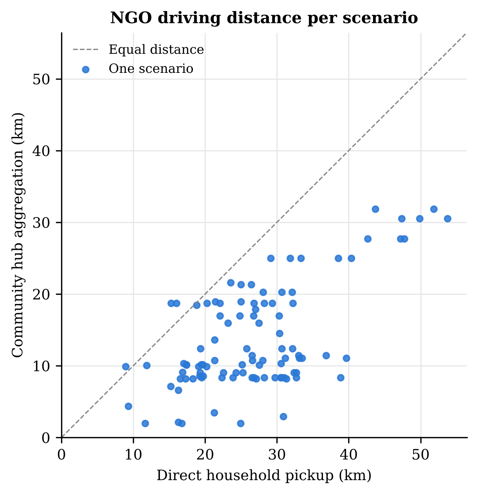
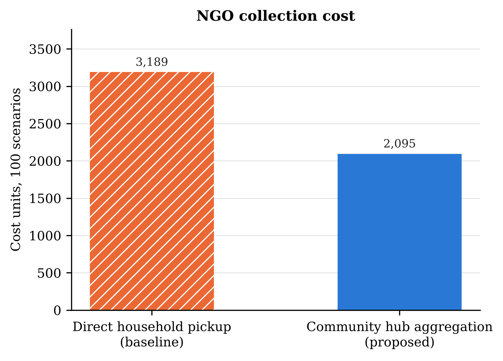
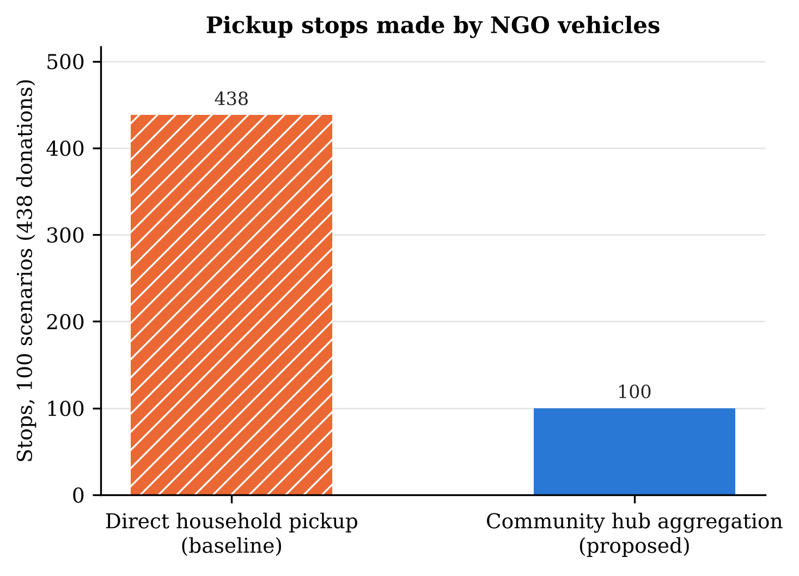
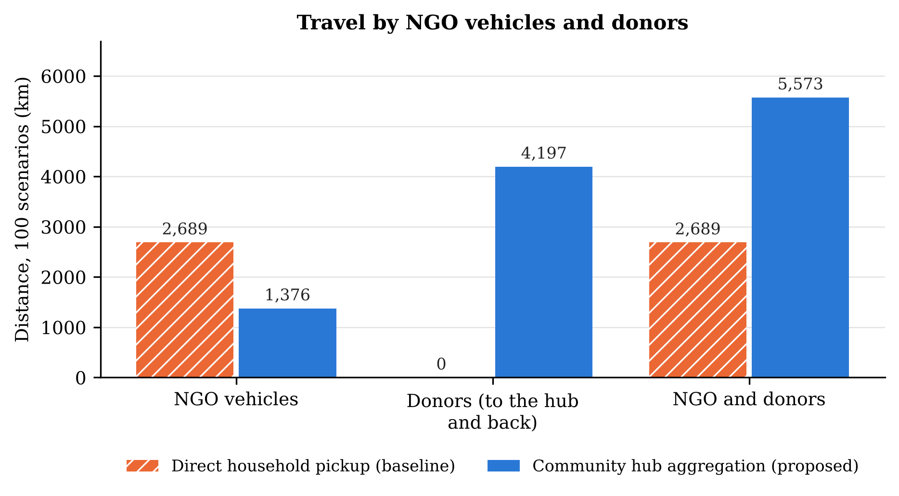

# E3 result: community hub aggregation vs direct household pickup

## What we wanted to find out

Small donations (under 10 kg) are scattered over many homes. Without hubs, an NGO has to drive to every home. With GeoLock Hub, donors drop small items at a nearby community hub, the hub groups them into one batch, and the NGO collects the whole batch in one stop. We wanted to know how much NGO driving this saves, and whether the saving is real or just moves the travelling onto the donors.

## What we used

- **Data:** the frozen benchmark dataset GEOLOCK-BENCHMARK-DATASET: 100 scenarios, each with 3 to 5 small donations from nearby homes (438 donations in total), one community hub, and one NGO with a car (100 kg) and a van (500 kg).
- **Direct household pickup (baseline):** the NGO collects every donation from the donor's home.
- **Community hub aggregation (proposed, as in the app):** each donor reserves space at the hub and drops the item off during opening hours, the hub confirms receipt, the items become one batch (3 to 5 items, at most 30 kg, one category), the batch is published as one listing, and the NGO collects it at the hub.
- **Fair comparison:** both use the same donations, NGO, vehicles, depot, road distances and the same route planner (Nearest-Next, the same code), with a 240 minute limit per vehicle and 10 minutes per stop. Only the collection method differs.

## Results

The main numbers are also in `comparison_summary.csv`, one row per measure with every method side by side.

| Measure (all 100 scenarios) | Direct household pickup (baseline) | Hub aggregation (proposed) | Change |
| --- | --- | --- | --- |
| Donations collected | 438 of 438 | 438 of 438 | same |
| **NGO driving** | 2,689 km | **1,376 km** | −1,313 km (−48.8 %) |
| NGO pickup stops | 438 | **100** | −338 (−77 %) |
| NGO collection cost (1 per km + 5 per trip + 0.5 per item handled at a hub) | 3,189 | **2,095** | −34.3 % |
| Vehicle trips | 100 | 100 | same |
| Donor travel to the hub and back | 0 km | 4,197 km | +4,197 km |

*Figure 1. NGO driving distance in each of the 100 scenarios. Points below the dashed line are scenarios where hub aggregation needed less NGO driving.*

*Figure 2. Total NGO collection cost over the 100 scenarios (1 per km, 5 per trip, 0.5 per item handled at a hub).*

*Figure 3. Total pickup stops made by NGO vehicles over the 100 scenarios.*

*Figure 4. Total distance travelled by NGO vehicles and by donors. Donor travel counts each drop off as a separate car trip from home to the hub and back.*

## Analysis

**The hub roughly halves NGO driving.** Over the 100 scenarios NGO vehicles drove 1,376 km instead of 2,689 km. Scenario by scenario, the hub was shorter in 97 of 100 cases, and the typical saving is 13.1 km per scenario (95 % confidence interval 11.5 to 14.7 km; Wilcoxon signed rank test p = 7e-18).

**Why:** instead of visiting 438 homes, the NGO makes one stop per batch: 100 stops instead of 438. Fewer stops means less zigzag driving between homes and less time per route. Every donation was still collected, and every route stayed within the vehicle capacity and the 240 minute limit.

**The NGO's collection cost falls by 34 %** (3,189 → 2,095 cost units), even after adding the 0.5 handling charge for each item stored at the hub.

**Every batch followed the hub rules.** All 100 batches passed every check: the hub accepted each item and had room for it, every drop off fell inside the donor's availability window and the hub's opening hours, every batch had 3 to 5 items of one category and at most 30 kg, and the NGO was within 20 km of the hub by road.

**The trade off: donors travel instead.** If every donor drives to the hub and back as a separate car trip, donors travel 4,197 km in total (about 9.6 km per donor). Counted that way, NGO plus donor travel is 5,573 km with hubs against 2,689 km without. This is the worst case: donors who walk to a hub in their own neighbourhood, or drop the item off on a trip they were making anyway, add little or no extra travel. The benefit of the hub is therefore for the NGO (its vehicles, drivers and fuel), which is what this experiment set out to measure.

## Conclusion

Collecting small donations through a community hub cut NGO driving by 49 % (1,313 km over 100 scenarios), reduced NGO pickup stops by 77 % and NGO collection cost by 34 %, while still collecting every donation and respecting every hub and route rule. The proposed method is better than the baseline for the NGO on every measure. The saving comes from donors bringing their items to the hub, so it is largest when that drop off trip is short or would happen anyway.

## Limits of this experiment

- Donor travel is counted as a separate car trip home → hub → home, which is the largest it can be.
- The hub steps (reservation, receipt, batching, publishing) are checked against the app's rules in the experiment program, not run in the database.
- Each vehicle makes one trip, and road travel times assume no traffic.
