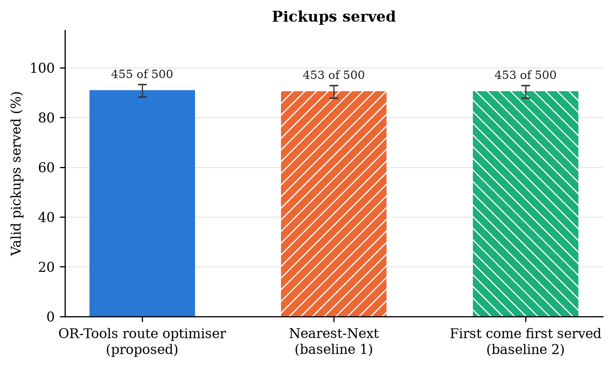
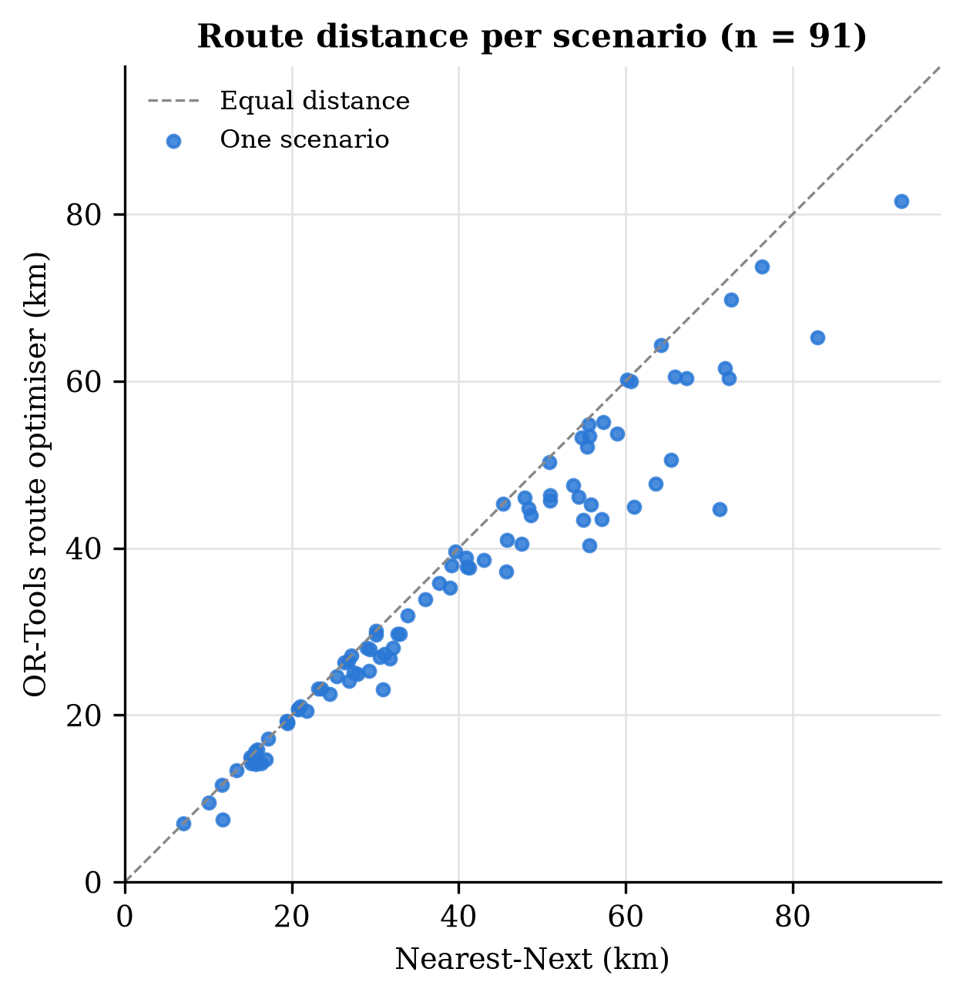
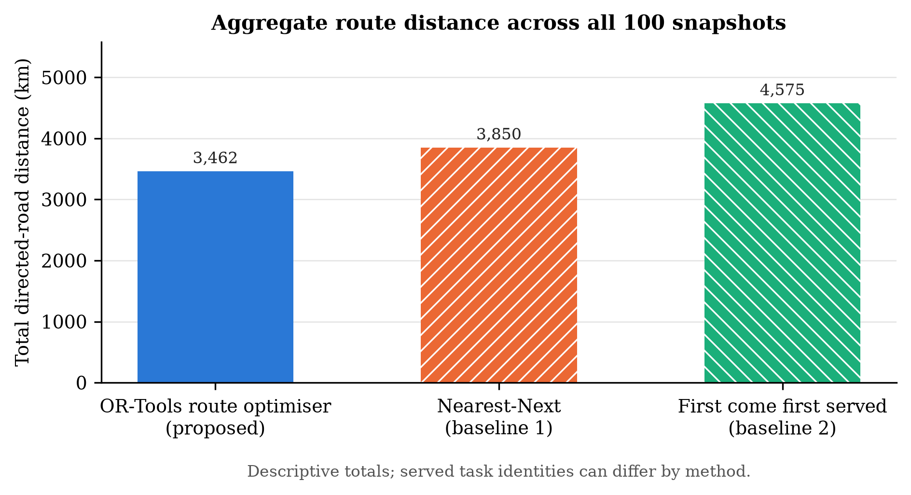
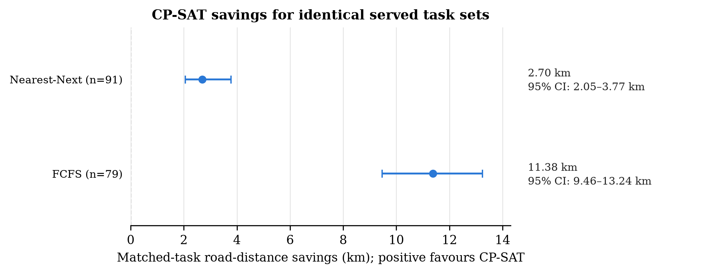

# E4 routing experiment

**Run ID:** `4b03c152c6224c9fa5f3321fc8d31d78`

The frozen benchmark contains 100 snapshots and 500 candidate tasks. The E4-only adapter ignores the synthetic listing-expiry field during post-claim admission; all three methods receive the same 500 admitted task IDs. Claim leases, ownership, task status, pickup windows, capacity, route duration, depot return and directed-road connectivity remain enforced.

## Coverage and aggregate results

Coverage and aggregate route totals below use all 100 snapshots. Aggregate distance totals describe each method’s routes and may cover different served-task sets.

| Method | Served / admitted tasks | Coverage | Total directed-road distance (km) | Driving time (min) | Validated plans / 100 | Hard violations |
| --- | ---: | ---: | ---: | ---: | ---: | ---: |
| Nearest-Next | 453 / 500 | 90.6% | 3,849.9 | 4578.59 | 100 / 100 | 0 |
| FCFS | 453 / 500 | 90.6% | 4,575.2 | 5307.55 | 100 / 100 | 0 |
| OR-Tools CP-SAT (proposed) | 455 / 500 | 91.0% | 3,462.2 | 4163.56 | 100 / 100 | 0 |

## Identical-served-task paired comparisons

These paired distance and time comparisons include only snapshots where both independently validated plans served exactly the same task IDs. They are distinct from the aggregate totals above.

| Baseline | Matched snapshots | CP-SAT distance (km) | Baseline distance (km) | CP-SAT distance saving (HL, 95% bootstrap CI) | Wilcoxon–Pratt p | CP-SAT driving-time saving (HL, 95% CI) | Wilcoxon–Pratt p |
| --- | ---: | ---: | ---: | ---: | ---: | ---: | ---: |
| Nearest-Next | 91 | 3,222.4 | 3,575.3 | 2.70 (2.05, 3.77) | 3.956e-16 | 2.80 (1.86, 4.24) | 2.425e-11 |
| FCFS | 79 | 3,003.3 | 3,931.2 | 11.38 (9.46, 13.24) | 1.286e-14 | 11.40 (9.26, 13.81) | 1.883e-14 |

Secondary distance and driving-time p-values are Holm-adjusted across the four baseline-by-measure comparisons; see `metrics.json`.

*Figure 1. Tasks served by each method across all 100 snapshots; whiskers are 95% Wilson intervals.*

*Figure 2. Per-snapshot route distances for CP-SAT and Nearest-Next, restricted to snapshots with identical served task IDs and valid plans.*

*Figure 3. Aggregate route-distance totals across all 100 snapshots. Methods may serve different task identities.*

*Figure 4. Hodges–Lehmann paired road-distance savings for CP-SAT; positive values favour CP-SAT, with 95% bootstrap confidence intervals.*

## Reproducibility and limitations

- Shared run ID: `4b03c152c6224c9fa5f3321fc8d31d78`; admitted tasks: 500 across 100 snapshots.
- The figure and summaries are generated from scenario CSVs, route-detail CSVs, and manifests; no paper values are hard-coded.
- Matched-snapshot inference conditions on identical served task sets; aggregate distance totals are descriptive and should not be interpreted as a paired causal comparison.
- Each snapshot has five candidate tasks and two vehicles; vehicle routes are single trips and travel times do not model live traffic.
